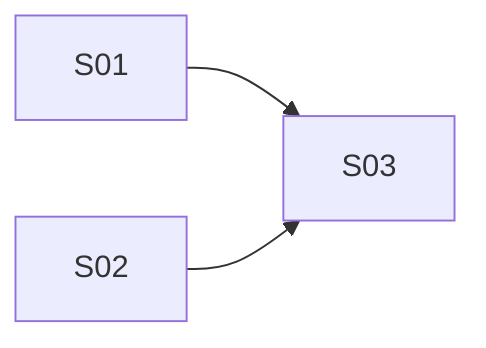

# Implementation Steps: hash-exec

- **Source RFF:** `.rff/hash-exec/request-for-feature.md`
- **Date:** 2026-11-10
- **Steps:** 3 (2 slices, 1 enabler) in 2 stages

## 1. Overview
The feature splits along its two natural seams: the generic `#exec-` router (parsing, registry, error handling) and the `highlight` command. The router comes first as a walking skeleton: after it, any exec hash is parsed and dispatched, and every bad link produces a `[hash-tools]` warning. The highlight look (one CSS class) is an independent, small enabler built in parallel. The final slice registers `highlight`, which uses both, and delivers the recruiter-facing behavior. Each step updates the part of `CLAUDE.md` that describes its own work.

## 2. Software layers
| Layer | Location / main files | Notes |
|-------|----------------------|-------|
| Markup | `index.html` | Only the `<head>` changes: one `` in `<head>` right after the Bootstrap bundle `<script>` (line ~29) |
  | Docs | `CLAUDE.md` | modify: Overview sentence ("just `index.html`, `index.css`, and `images/`") also lists `hash-tools.js`; Scripts bullet no longer says "there is no JS file" and names `hash-tools.js` as the one JS file, loaded with `defer`, alongside the inline scripts; new **Hash tools** bullet after the Scripts bullet |
- **How to test:**
  - Automated: none (no test suite).
  - Manual (open DevTools console, load `index.html` with each hash, reloading between them):
    - Given `#exec-unknown-%5B%5D`, when the page loads, then one `[hash-tools]` warning about the unknown command `unknown` appears and the page is unchanged.
    - Given `#exec-highlight-%5B%22Qt%22%5D`, then a warning reports the unknown command `highlight` (registry is empty).
    - Given `#exec-high_light-%5B%5D` and `#exec-` (empty name), then a warning reports an invalid name.
    - Given `#exec-x-notjson`, `#exec-x-%E0%A4%A` (bad percent-encoding) and `#exec-x-%7B%7D` (`{}`), then the warnings report the parse/decode failure or the non-array value (whichever check the router performs first for that case, as long as one warning is logged and nothing changes).
    - Given `#about`, `#projects` or no hash, then no warning is logged and the page scrolls exactly as before; the navbar collapse, "Show more projects" toggle and footer year still work.
    - Given the page is open, when the hash is edited to `#exec-unknown`, then a new warning appears without reloading (hashchange).
    - Dispatch check (temporary, not committed): add `commands.echo = function (p) { console.log(p); };` in the `// Commands` region; `#exec-ECHO-%5B1%2Ctrue%2Cnull%2C%22a-b%22%5D` logs `["1","true","null","a-b"]`; `#exec-echo` logs `[]`; changing the command to `throw new Error('x')` gives a `[hash-tools]` warning and no uncaught error. Remove the command afterwards.
- **Notes / risks:** RFF assumptions used: script loaded with `defer` in `<head>` after the Bootstrap bundle; IIFE with no globals; `[hash-tools]` prefix. The name ends at the first `-` after `exec-`, so params such as `"Real-time simulation"` keep their dashes. `location.hash` may already be decoded by the browser; decoding once is accepted by the RFF.

### S02 - Highlighted-chip look

- **Type:** Enabler
- **Purpose:** Define the visual state of a highlighted tech chip and its scroll offset, so a command can mark chips by adding one class.
- **Behavior:** Any `.skill-chip` that also carries `.skill-chip-highlight` shows a solid `--my-primary-text` (`#4f6e24`) background with white text (about 5.9:1), keeps its badge size and shape, and, when scrolled into view with `scrollIntoView({ block: 'start' })`, lands below the sticky navbar like the section headings.
- **Requirements covered:** FR-10, FR-11 (scroll offset part), FR-15 (CSS organization bullet); unblocks FR-08, FR-09, FR-11
- **Depends on:** none
- **Prerequisites:** `--my-primary-text`, `--main-nav-height` (CSS variables, already exist on `html` in `index.css`); `.skill-chip` (class, already exists)
- **Provides:**
  - `.skill-chip-highlight` (CSS class): selector `.skill-chip.skill-chip-highlight`, specific enough to override `.skill-chip`'s `color` and `background-color`; sets `background-color: var(--my-primary-text)`, `color: #fff`, `scroll-margin-top: calc(var(--main-nav-height) + 1rem)`. Changes no size, padding or shape. Others may rely on: adding/removing the class on a `.skill-chip` element is the whole highlight on/off switch.
  - `/* Hash tools */` (CSS block in `index.css`): placed right before `/* Bootstrap overrides */`; holds the styles used by `hash-tools.js` commands.
- **Layers touched:**
  | Layer | Files | Change |
  |-------|-------|--------|
  | Styles | `index.css` | modify: new `/* Hash tools */` block with the `.skill-chip.skill-chip-highlight` rule, inserted before `/* Bootstrap overrides */` |
  | Docs | `CLAUDE.md` | modify: CSS organization bullet lists `/* Hash tools */` after `/* Education */` in the block order |
- **How to test:**
  - Automated: none.
  - Manual: Given the page is open, when DevTools adds `skill-chip-highlight` to a `Qt` chip in `#skills` (e.g. `document.querySelector('.skill-chip').classList.add('skill-chip-highlight')`), then it shows a dark green background and white text, with the same size as its neighbors; other chips are unchanged.
  - Manual: Given that chip highlighted, when `el.scrollIntoView({ block: 'start' })` runs in the console, then the chip ends just below the navbar (not hidden behind it), on both a desktop width and below 768px.
  - Manual: DevTools contrast checker on the highlighted chip reports at least 4.5:1.
- **Notes / risks:** RFF assumptions used: new `/* Hash tools */` block before `/* Bootstrap overrides */`; `scroll-margin-top` on the class. Smooth vs instant scrolling comes from the existing reduced-motion `html` rule, which this step does not touch.

### S03 - `highlight` command marks matching chips and scrolls to the first

- **Type:** Slice
- **Purpose:** Register the `highlight` command so that a link like `#exec-highlight-%5B%22C%2B%2B%22%2C%22Qt%22%5D` opens the portfolio with the relevant skills marked and in view.
- **Behavior:** Each call first removes `skill-chip-highlight` from every chip, then, in one `querySelectorAll('.skill-chip')` pass, highlights each chip matching any parameter: with `term` = trimmed, lowercased parameter and `label` = trimmed, lowercased `textContent`, a term of 3+ characters matches when `label` contains it, a shorter term only when `label` equals it. If at least one chip matches, the first match in document order is scrolled into view (`scrollIntoView({ block: 'start' })`), smooth unless reduced motion. If none match, nothing scrolls. Each parameter that matched no chip gets its own warning naming it; an empty parameter list clears the highlight and warns. The highlight persists through navbar and anchor clicks until the next `highlight` call or a reload.
- **Requirements covered:** FR-08, FR-09, FR-11, FR-12, FR-13, FR-14, FR-15 (highlight sentence)
- **Depends on:** S01, S02
- **Prerequisites:** `commands` (registry), `warn` (helper), `// Commands` region and **Hash tools** bullet in `CLAUDE.md` (from S01); `.skill-chip-highlight` (CSS class) and `/* Hash tools */` (CSS block) (from S02); `.skill-chip` (class, already exists)
- **Provides:** `highlight` (registered command, `commands.highlight`): takes `string[]` terms, as described in Behavior. Other code may rely on: it is the only code that adds or removes `skill-chip-highlight`.
- **Layers touched:**
  | Layer | Files | Change |
  |-------|-------|--------|
  | Scripts | `hash-tools.js` | modify: add `commands.highlight = function (params) { … };` in the `// Commands` region |
  | Docs | `CLAUDE.md` | modify: append one sentence to the **Hash tools** bullet describing `highlight` (matching rule, `.skill-chip-highlight` in the `/* Hash tools */` block, scroll to first match, warnings) |
- **How to test:**
  - Automated: none.
  - Manual (DevTools console open; each Given is a fresh load unless it says the page is already open):
    - Given `#exec-highlight-%5B%22C%2B%2B%22%2C%22Qt%22%5D`, then all `C++`, `C/C++`, `C / C++` and `Qt` chips are dark green with white text, and the first one (in `#skills`) is visible just below the navbar.
    - Given C++ chips highlighted, when the hash becomes `#exec-highlight-%5B%22python%22%5D`, then the C++/Qt highlights are gone and the `Python` chips are highlighted and scrolled to.
    - Given a highlight is active, when a navbar link is clicked, then the highlight stays.
    - Given `#exec-HIGHLIGHT-%5B%22qt%22%5D`, then the `Qt` chips are highlighted.
    - Given `#exec-highlight-%5B%22sql%22%5D`, then `MySQL`, `NoSQL`, `PostgreSQL` and `SQL Server` chips are highlighted.
    - Given `#exec-highlight-%5B%22C%22%5D`, then no chip is highlighted, no scroll happens, and a warning names `C`.
    - Given `#exec-highlight-%5B%22C%23%22%5D`, then only `C#` chips are highlighted.
    - Given `#exec-highlight-%5B%22%20qt%20%22%5D`, then only `Qt` chips are highlighted.
    - Given a highlight is active, when the hash becomes `#exec-highlight-%5B%22Cobol%22%5D`, then no chip is highlighted, the page does not scroll, and a warning names `Cobol`.
    - Given `#exec-highlight-%5B%22Qt%22%2C%22Cobol%22%5D`, then `Qt` chips are highlighted and a warning names `Cobol`.
    - Given `#exec-highlight` or `#exec-highlight-%5B%5D`, then no chip is highlighted and a warning is logged.
    - Given DevTools "Emulate prefers-reduced-motion: reduce", when a highlight runs, then the page jumps to the match instead of scrolling smoothly.
- **Notes / risks:** The RFF example lists `MySQL`, `NoSQL`, `SQL Server` for `sql`; `PostgreSQL` also matches by the substring rule, which the RFF accepts. Partial terms can over-match (`java` → `JavaScript / TypeScript`), accepted by the RFF. On page load the browser's failed native anchor jump happens before the deferred script, so the script's scroll wins. Chips inside the closed `#more-projects` collapse: there are none today, so no collapse is opened.

## 4. Execution stages
| Stage | Steps (parallel) | Depends on stages | Delivers |
|-------|------------------|-------------------|----------|
| 1 | S01, S02 | - | Working `#exec-` router with silent-failure warnings; the highlighted-chip style |
| 2 | S03 | 1 | The `highlight` command: tailored skill links work end to end |

**Critical path:** S01 → S03

**Parallelization notes:** S01 and S02 touch disjoint code files (`hash-tools.js` + `index.html` vs `index.css`). Both edit `CLAUDE.md` but in different bullets: S01 owns the Overview sentence, the Scripts bullet and the new Hash tools bullet; S02 owns only the CSS organization bullet. Small edits, safe in parallel. S03 only appends inside the `// Commands` region and to the end of the Hash tools bullet.

## 5. Requirements coverage
| Requirement | Steps |
|-------------|-------|
| FR-01 | S01 |
| FR-02 | S01 |
| FR-03 | S01 |
| FR-04 | S01 |
| FR-05 | S01 |
| FR-06 | S01 |
| FR-07 | S01 |
| FR-08 | S03 |
| FR-09 | S03 |
| FR-10 | S02 |
| FR-11 | S02 (offset), S03 (scroll) |
| FR-12 | S03 |
| FR-13 | S03 |
| FR-14 | S03 |
| FR-15 | S01, S02, S03 (each documents its own part) |

## 6. Shared items
| Item | Kind | Created by | Used / extended by | What others may rely on |
|------|------|-----------|--------------------|-------------------------|
| `hash-tools.js` | file | S01 | S03 | IIFE, no globals, `defer`-loaded; regions `// Commands` then `// Router` |
| `commands` | JS registry object | S01 | S03 | lowercase keys; commands added as `commands.<name> = function (params)` in `// Commands`; called with `string[]`, exceptions caught |
| `warn` | JS function | S01 | S03 | `warn(...args)` → `console.warn('[hash-tools]', ...args)` |
| `[hash-tools]` | log prefix | S01 | S03 | every warning starts with it (via `warn`) |
| **Hash tools** bullet | `CLAUDE.md` region | S01 | S03 | commands append one sentence each |
| `.skill-chip-highlight` | CSS class | S02 | S03 | add/remove on a `.skill-chip` toggles the highlight; includes navbar scroll offset |
| `/* Hash tools */` | CSS block | S02 | S03 (referenced in docs) | block for styles used by `hash-tools.js` |
| `.skill-chip` | CSS class | existing | S02, S03 | every tech chip; label is its `textContent` |
| `--my-primary-text`, `--main-nav-height` | CSS variables | existing | S02 | text green; navbar height |

## 7. Assumptions and open points
- RFF assumptions adopted as planned: `defer` script in `<head>` after the Bootstrap bundle, IIFE with no globals, `[hash-tools]` prefix (S01); `/* Hash tools */` block and `scroll-margin-top` on the class (S02); no screen-reader announcement, decoding once is safe (S03).
- `sql` also highlights `PostgreSQL` (4 chips), which the RFF example does not list but its substring rule implies (S03).
- The order of the router's checks (name, lookup, then decode/parse, or parse first) is left to S01; each failure only needs one warning and no page change.
