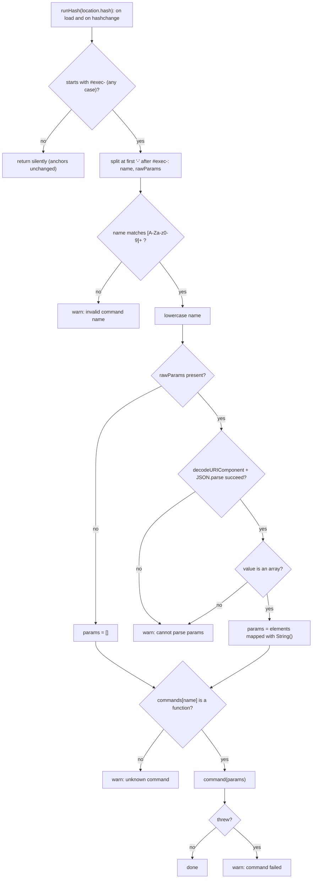

# S01 - Exec hashes are parsed and dispatched to a command registry

- **Plan:** [plan.md](plan.md)
- **Type:** Slice
- **Requirements covered:** FR-01, FR-02, FR-03, FR-04, FR-05, FR-06, FR-07, FR-15 (Overview sentence, Scripts bullet, Hash tools bullet)
- **Prerequisites:** none
- **Creates:** `hash-tools.js` (file), `commands` (JS registry object), `warn` (JS function), `// Commands` and `// Router` (JS regions), `[hash-tools]` (log prefix), **Hash tools** bullet in `CLAUDE.md`

## 1. Goal
The page loads a new standalone script, `hash-tools.js`, that reads `window.location.hash` once at load and again on every `hashchange`. A hash of the form `#exec-<name>[-<params>]` is parsed, validated and dispatched to a command looked up in the `commands` registry. The registry is empty in this step, so every well-formed exec hash ends in an "unknown command" warning. Every bad link changes nothing on the page and logs exactly one `console.warn` starting with `[hash-tools]`. Non-exec hashes and no hash are ignored: anchors, the navbar collapse, the "Show more projects" toggle and the footer year work exactly as before.

## 2. Context
- The site is static: `index.html`, `index.css`, `images/`. There is no JS file today; the three inline scripts (after `</nav>`, after `#projects`, inside `<footer>`) use the style `(() => { ... })();`, `const`, arrow functions, early `return`s and short "why" comments.
- `<head>` loads the Bootstrap bundle with `<script defer src="https://cdn.jsdelivr.net/npm/bootstrap@5.3.1/dist/js/bootstrap.bundle.min.js"></script>` (line 29), followed by a blank line and `<link rel="stylesheet" href="index.css">`.
- Deferred scripts run in document order after the DOM is parsed and before `DOMContentLoaded`, so `hash-tools.js` needs no ready handler.
- No test suite and no build: verification is manual in a browser with the DevTools console, plus a few greps.
- Security (RFF section 9): parameters are never inserted into the DOM or evaluated; only functions present in `commands` can run.

## 3. Structure

### 3.1 Files
| File | Change | Responsibility |
|------|--------|----------------|
| `hash-tools.js` (project root) | new | `#exec-` router, `commands` registry, `warn` helper |
| `index.html` | modify | load `hash-tools.js` with `defer` from `<head>` |
| `CLAUDE.md` | modify | Overview sentence, Scripts bullet, new Hash tools bullet |

### 3.2 Scripts: `hash-tools.js`
One IIFE, no globals, no reference to `window.bootstrap`, no DOM writes. Internal order is fixed: header comment and constants, helpers (`warn`, `commands`), the `// Commands` region (empty), the `// Router` region (functions, then the initial run and the listener at the very end).

```js
// Hash tools: runs commands from links such as #exec-<name>-<encodeURIComponent(JSON.stringify(array))>.
// Every tool lives in this file. Bad links change nothing on the page and only log a [hash-tools] warning.
(() => {
  const LOG_PREFIX = '[hash-tools]';
  const EXEC_PREFIX = '#exec-';                 // compared case-insensitively
  const PARAMS_SEPARATOR = '-';                 // the first one after the name splits name from params
  const COMMAND_NAME_PATTERN = /^[a-z0-9]+$/i;  // ASCII letters and digits only

  function warn(...args) {
    console.warn(LOG_PREFIX, ...args);
  }

  // Lowercase command name -> function (params: string[]): void. No prototype, so names like
  // "constructor" or "tostring" are never found by accident.
  const commands = Object.create(null);

  // Commands
  // Register each command here as: commands.<name> = function (params) { ... };

  // Router

  /** @returns {{ name: string, rawParams: string | null } | null} null when the hash is not an exec hash. */
  function splitExecHash(hash) { /* ... */ }

  /** @returns {string[]} @throws {URIError | SyntaxError | TypeError} */
  function parseParams(rawParams) { /* ... */ }

  function runHash(hash) { /* ... */ }

  runHash(window.location.hash);
  window.addEventListener('hashchange', () => runHash(window.location.hash));
})();
```

Member details:

- **`LOG_PREFIX`** = `'[hash-tools]'`. Used only by `warn`. `warn` is the only place in the file that calls `console.warn`.
- **`warn(...args): void`**: `console.warn(LOG_PREFIX, ...args)`. Usable by commands for their own warnings.
- **`commands`**: `Object.create(null)`, declared before the `// Commands` region. Keys are lowercase names; values are `function (params)` where `params` is a non-null `string[]` (possibly empty, elements not trimmed). The `// Commands` region holds only the comment above in this step.
- **`splitExecHash(hash: string)`** (pure):
  - If `hash.slice(0, EXEC_PREFIX.length).toLowerCase() !== EXEC_PREFIX`, return `null` (covers `''`, `#about`, `#exec`, `#executive`).
  - `rest = hash.slice(EXEC_PREFIX.length)`; `separatorIndex = rest.indexOf(PARAMS_SEPARATOR)`.
  - No separator: `{ name: rest, rawParams: null }`. Otherwise: `{ name: rest.slice(0, separatorIndex), rawParams: rest.slice(separatorIndex + 1) }`. The name is returned as written (not validated, not lowercased); the params keep any further `-`.
- **`parseParams(rawParams: string | null): string[]`** (pure):
  - `null` returns `[]`.
  - Otherwise `value = JSON.parse(decodeURIComponent(rawParams))`; both may throw (`URIError`, `SyntaxError`); errors propagate unchanged.
  - If `!Array.isArray(value)`, throw `new TypeError('params must be a JSON array')`.
  - Return `value.map((element) => String(element))` (`[1, true, null, "a-b"]` gives `["1", "true", "null", "a-b"]`).
- **`runHash(hash: string): void`**: never throws. Steps in order, each failure warns once and returns:
  1. `parts = splitExecHash(hash)`; `null` returns silently.
  2. `!COMMAND_NAME_PATTERN.test(parts.name)`: `warn(\`invalid command name "${parts.name}" in\`, hash)`.
  3. `name = parts.name.toLowerCase()`.
  4. `params = parseParams(parts.rawParams)` inside `try`; on catch: `warn(\`cannot parse params for "${name}":\`, error.message)`.
  5. `command = commands[name]`; `typeof command !== 'function'`: `warn(\`unknown command "${name}"\`)`.
  6. `try { command(params); } catch (error) { warn(\`command "${name}" failed:\`, error); }`.

### 3.3 Markup: `index.html`
Insert one line right after the Bootstrap bundle `<script>` (line 29), before the blank line and the `index.css` link. Nothing else in the file changes; the inline scripts stay as they are.

```html
  <script defer src="https://cdn.jsdelivr.net/npm/bootstrap@5.3.1/dist/js/bootstrap.bundle.min.js"></script>
  <script defer src="./hash-tools.js"></script>
```

### 3.4 Docs: `CLAUDE.md`
Three edits; every other bullet stays untouched.

1. **Overview** (line 7): replace ``just `index.html`, `index.css`, and `images/`.`` with ``just `index.html`, `index.css`, `hash-tools.js`, and `images/`.``
2. **Scripts bullet** (line 18): replace the opening ``**Scripts**: there is no JS file. Each inline `<script>` sits`` with ``**Scripts**: the one JS file is `hash-tools.js` (see Hash tools), loaded with `defer` in `<head>` right after the Bootstrap bundle. All other scripts are inline: each inline `<script>` sits``. The rest of the bullet is kept word for word.
3. **New Hash tools bullet**, inserted directly after the Scripts bullet:

```markdown
- **Hash tools**: `hash-tools.js` (project root) holds every hash tool in one IIFE that adds no globals and does not use `window.bootstrap`. It reads `location.hash` on load and on every `hashchange`; a hash starting with `#exec-` (any case) has the form `#exec-<name>[-<params>]`, where `<name>` is `[A-Za-z0-9]+` (case-insensitive, ending at the first `-`) and `<params>` is `encodeURIComponent(JSON.stringify(array))`, so later `-` stay in the params. The router validates the name, decodes and parses the params, requires an array, converts each element with `String()` (missing params give `[]`) and calls `commands[<lowercase name>](params)`. Other hashes are ignored, so anchors work as before. A bad link (invalid name, undecodable or non-JSON params, a non-array value, an unknown command, a command that throws) changes nothing on the page and logs one `console.warn` prefixed `[hash-tools]` through `warn()`. To add a command, write `commands.<name> = function (params) { … };` in the file's `// Commands` region; commands use `warn()` for their own warnings.
```

## 4. Logic flows



The router validates the name, then the params, then looks up the command, so decode, JSON and non-array failures are reported even while the registry is empty. Every exec-hash path ends in either a successful command call or exactly one `[hash-tools]` warning; the page is never modified by the router itself.

## 5. Edge cases and errors
| Case | Expected behavior |
|------|-------------------|
| No hash (`''`), `#about`, `#projects`, `#exec`, `#executive` | Ignored silently; native anchor behavior unchanged. |
| `#EXEC-Echo-...` | Prefix and name accepted case-insensitively; name used as `echo`. |
| `#exec-` (empty name) | `[hash-tools] invalid command name "" in #exec-` |
| `#exec-high_light-%5B%5D`, `#exec-%C3%A9-%5B%5D` | Invalid name warning (only ASCII letters and digits allowed). |
| `#exec-unknown` (no params) | Params `[]`; unknown command warning naming `unknown`. |
| `#exec-x-` (separator, empty params) | `JSON.parse('')` throws: cannot parse params warning. |
| `#exec-x-notjson` | `SyntaxError`: cannot parse params warning. |
| `#exec-x-%E0%A4%A` (bad percent-encoding) | `URIError`: cannot parse params warning. |
| `#exec-x-%7B%7D` (`{}`), `#exec-x-%22a%22`, `#exec-x-null` | `TypeError` "params must be a JSON array": cannot parse params warning. |
| `#exec-x-%5B%5D` with `x` unregistered | Unknown command warning. |
| `#exec-constructor-%5B%5D`, `#exec-tostring` | Registry has no prototype: unknown command warning, nothing runs. |
| Params containing `-` (`["Real-time simulation"]`) | Only the first `-` after the name splits; the param keeps its dashes. |
| Non-string elements `[1,true,null,{},[2,3]]` | Become `"1"`, `"true"`, `"null"`, `"[object Object]"`, `"2,3"`. |
| Command throws | Caught; command failed warning with the error; no uncaught error in the console. |
| Same exec hash entered again | Browser fires no `hashchange`; nothing re-runs (accepted). |
| JavaScript disabled or file fails to load | Nothing happens; page unchanged. |

## 6. Tests

### 6.1 Automated
None: the project has no test suite or build, and this step does not add one.

### 6.2 Manual
Environment: open `index.html` directly or via `npx serve .`, desktop Chrome or Edge, DevTools console open with "Warnings" visible. For each "Given" hash, load the page with it (paste the URL and reload) unless stated otherwise.

- Given `#exec-unknown-%5B%5D`, when the page loads, then exactly one warning `[hash-tools] unknown command "unknown"` appears and the page does not scroll or change. (FR-02, FR-03, FR-06, FR-07)
- Given `#exec-highlight-%5B%22Qt%22%5D`, then one warning reports the unknown command `highlight`. (FR-06, FR-07)
- Given `#exec-UNKNOWN`, then one warning reports the unknown command `unknown` (lowercased, empty params accepted). (FR-03, FR-04)
- Given `#exec-high_light-%5B%5D`, then one invalid command name warning appears. Given `#exec-`, then one invalid command name warning with `""` appears. (FR-04, FR-07)
- Given `#exec-x-notjson`, `#exec-x-%E0%A4%A` and `#exec-x-%7B%7D` in turn, then each gives exactly one `cannot parse params for "x"` warning (with the JSON error, the URI error, and `params must be a JSON array` respectively), and the page is unchanged. (FR-04, FR-05, FR-07)
- Given `#exec-constructor-%5B%5D`, then one unknown command warning appears and no error is thrown. (FR-06)
- Given `#about`, `#projects` or no hash, then no `[hash-tools]` message is logged, the page lands where it did before the change, and the navbar hamburger (below 768px), the "Show more projects" toggle and the footer year all still work. (FR-03, RFF compatibility)
- Given the page is open with no hash, when the address bar hash is edited to `#exec-unknown` and Enter is pressed, then a new unknown command warning appears without a reload; when it is then edited to `#skills`, then no warning appears and the page scrolls to Expertise. (FR-02, FR-03)
- Given the console, when `typeof commands`, `typeof warn` and `typeof runHash` are evaluated, then each is `"undefined"` (no globals). (FR-01)
- Dispatch check (temporary edit, never committed): add `commands.echo = function (params) { console.log(params); };` in the `// Commands` region and reload with:
  - `#exec-ECHO-%5B1%2Ctrue%2Cnull%2C%22a-b%22%5D` logs `["1", "true", "null", "a-b"]`. (FR-04, FR-05, FR-06)
  - `#exec-echo` logs `[]`. (FR-04)
  - `#exec-echo-%5B%22Real-time%20simulation%22%5D` logs `["Real-time simulation"]`. (FR-04)
  - After changing the body to `throw new Error('x');`, `#exec-echo-%5B%5D` logs one `[hash-tools] command "echo" failed:` warning with the error and no red uncaught error. (FR-07)
  - Remove the temporary command and confirm with the static check below.

### 6.3 Static checks
- `grep -n 'hash-tools.js' index.html` → exactly one line, `<script defer src="./hash-tools.js"></script>`, on the line right after the Bootstrap bundle script. (FR-01)
- `grep -c 'console.warn' hash-tools.js` → `1` (only inside `warn`). (FR-07 logging rule)
- `grep -n 'bootstrap' hash-tools.js` → no output. (RFF section 8)
- `grep -nE '^\s*commands\.' hash-tools.js` → no output (the registry is empty; no leftover test command). (FR-06)
- `grep -nE '^\s*// (Commands|Router)\s*$' hash-tools.js` (the `\s*` tolerates the CRLF line endings the repo uses) → two lines, `// Commands` before `// Router`.
- `node --check hash-tools.js` (if Node is installed) → no output, exit code 0.
- `grep -n 'there is no JS file' CLAUDE.md` → no output; `grep -n '\*\*Hash tools\*\*' CLAUDE.md` → one line, directly after the Scripts bullet; `grep -n 'hash-tools.js' CLAUDE.md` matches the Overview, Scripts and Hash tools lines. (FR-15)

## 7. Implementation order
1. Create `hash-tools.js` with the constants, `warn`, `commands`, the empty `// Commands` region and the `// Router` functions, the initial run and the listener. The page does not load it yet, so nothing changes.
2. Add the `<script defer src="./hash-tools.js"></script>` line to `index.html`; run the manual checks in 6.2, including the temporary dispatch check, then remove the temporary command.
3. Update `CLAUDE.md` (Overview, Scripts bullet, Hash tools bullet) and run the static checks in 6.3.

## 8. Out of scope
- Registers no command; the `// Commands` region stays empty apart from its comment.
- Adds no CSS and does not touch `index.css`.
- Does not change the existing inline scripts, any section markup, or any chip.
- Does not edit the `CLAUDE.md` CSS organization bullet or any bullet other than the Overview sentence, the Scripts bullet and the new Hash tools bullet.
- No visible error UI, no global API for registering commands, no removal of the hash from the URL (RFF non-goals).

## 9. Design notes
- **Check order (name, params, lookup, call):** validating params before the lookup means parse failures are reported and testable while the registry is empty, and a future command always receives well-formed input. Rejected: lookup first, which would hide every params error behind "unknown command".
- **Single responsibility:** `splitExecHash` (syntax split) and `parseParams` (decode, parse, convert) are pure and know nothing about logging; `runHash` alone orchestrates and turns each failure into one warning. `parseParams` signals errors by throwing, so one `try/catch` covers the decode, JSON and non-array cases with one message format.
- **Open/Closed:** new commands are added as `commands.<name> = function (params)` entries; the router never changes for them.
- **Safety:** `Object.create(null)` plus the `typeof command === 'function'` check means only explicitly registered functions run; names like `constructor` or `__proto__` cannot reach inherited members.
- **No magic strings:** prefix, separator, name pattern and log prefix are named constants at the top of the IIFE.
- **Style:** arrow IIFE and `const` match the inline scripts; commands use `function (params)` as the registration form names it. `warn` and the router helpers are function declarations so the file reads top-down.
- **Script path:** `./hash-tools.js` as the plan states, although `index.css` is linked without `./`; both resolve the same.
- **Decoding once:** if a browser exposes an already decoded `location.hash`, a second decode is harmless for chip-style labels; a stray `%` would fail as a params error with a warning, which the RFF accepts.
