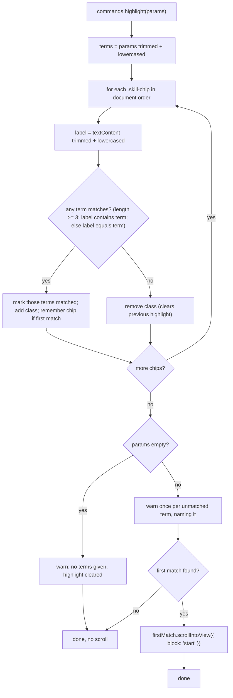
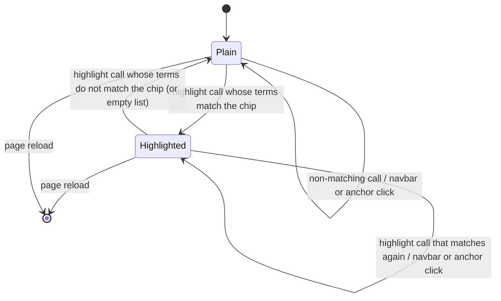

# S03 - `highlight` command marks matching chips and scrolls to the first

- **Plan:** [plan.md](plan.md)
- **Type:** Slice
- **Requirements covered:** FR-08, FR-09, FR-11, FR-12, FR-13, FR-14, FR-15 (highlight sentence)
- **Prerequisites:** `hash-tools.js` (file), `commands` (JS registry object), `warn` (JS function), `// Commands` (JS region in `hash-tools.js`), `[hash-tools]` (log prefix), **Hash tools** bullet in `CLAUDE.md`, `.skill-chip-highlight` (CSS class, selector `.skill-chip.skill-chip-highlight`), `/* Hash tools */` (CSS block in `index.css`), `.skill-chip` (CSS class)
- **Creates:** `highlight` (registered command, `commands.highlight`)

## 1. Goal
Register the `highlight` command so that a link such as `index.html#exec-highlight-%5B%22C%2B%2B%22%2C%22Qt%22%5D` opens the portfolio with the matching tech chips marked and the first one in view. When done:

- Each call clears every highlight left by a previous call, then adds `skill-chip-highlight` to every `.skill-chip` that matches any parameter (3+ character terms: case-insensitive substring of the label; shorter terms: case-insensitive whole-label equality; both trimmed).
- If anything matched, the first match in document order is scrolled into view below the sticky navbar, smoothly unless the user prefers reduced motion. If nothing matched, nothing scrolls.
- Each parameter that matched no chip gets its own `[hash-tools]` warning naming it; an empty parameter list clears the highlight and warns.
- The highlight stays through navbar and anchor clicks, until the next `highlight` call or a reload.

## 2. Context
- `hash-tools.js` exists with the `commands` registry, the `warn` helper and an empty `// Commands` region (comment `// Register each command here as: commands.<name> = function (params) { ... };`), followed by `// Router`. The router lowercases the name, so `#exec-HIGHLIGHT-…` reaches `commands.highlight`; it calls the command with a non-null `string[]` (possibly empty, elements not trimmed) and catches anything it throws. File style: arrow IIFE, `const`, named constants at the top of a region, function declarations for helpers, short "why" comments.
- `index.css` has `.skill-chip.skill-chip-highlight` in `/* Hash tools */`: dark green fill, white text and `scroll-margin-top: calc(var(--main-nav-height) + 1rem)`. The reduced-motion `@media (prefers-reduced-motion: no-preference) { html { scroll-behavior: smooth; } }` rule already exists, so `scrollIntoView` without a `behavior` option is smooth or instant as the user prefers.
- `index.html` has 119 chips, all `<span class="badge skill-chip">Label</span>`, each the only child of its own `<li>`, in `#skills` (line ~157), `#experience` (~395) and `#projects-professional` (~512). None are inside `#more-projects`. Labels relevant to the checks: `C++` (5), `C/C++` (1), `C / C++` (1), `Qt` (5), `C#` (4), `Python` (3), `MySQL` (1), `NoSQL` (1), `PostgreSQL` (4), `SQL Server` (4). The first `C++`/`Qt` match in document order is `C/C++` in `#skills` (line ~211).
- The hero photo has `width`/`height` attributes, so the layout above `#skills` does not shift after the image loads.
- No test suite or build: verification is manual in a browser with the DevTools console, plus greps. The working tree uses CRLF line endings.

## 3. Structure

### 3.1 Files
| File | Change | Responsibility |
|------|--------|----------------|
| `hash-tools.js` | modify | `highlight` command inside the `// Commands` region |
| `CLAUDE.md` | modify | One sentence appended to the **Hash tools** bullet |

### 3.2 Scripts: `hash-tools.js`
Add the block below inside the `// Commands` region, after the region's registration comment and before `// Router`. Nothing else in the file changes: `warn`, `commands`, the router functions, the initial run and the `hashchange` listener stay as they are.

```js
  // highlight: marks the tech chips matching any term and scrolls to the first one.
  // Link: #exec-highlight-<encodeURIComponent(JSON.stringify(["C++", "Qt"]))>
  const CHIP_SELECTOR = '.skill-chip';
  const CHIP_HIGHLIGHT_CLASS = 'skill-chip-highlight';  // look and navbar offset live in index.css /* Hash tools */
  const MIN_PARTIAL_TERM_LENGTH = 3;                     // shorter terms ("Qt", "C#") must equal the whole label

  /** term and label are already trimmed and lowercased. */
  function chipLabelMatches(label, term) {
    return term.length >= MIN_PARTIAL_TERM_LENGTH ? label.includes(term) : label === term;
  }

  commands.highlight = function (params) {
    const terms = params.map((param) => param.trim().toLowerCase());
    const termMatched = terms.map(() => false);
    let firstMatch = null;

    document.querySelectorAll(CHIP_SELECTOR).forEach((chip) => {
      // ... compute isMatch for this chip, record termMatched[i], keep firstMatch ...
      chip.classList.toggle(CHIP_HIGHLIGHT_CLASS, isMatch);  // also clears highlights from a previous call
    });

    // ... warnings, then scroll (see below) ...
  };
```

Member details:

- **`CHIP_SELECTOR`** = `'.skill-chip'`, **`CHIP_HIGHLIGHT_CLASS`** = `'skill-chip-highlight'`, **`MIN_PARTIAL_TERM_LENGTH`** = `3`: private constants of the command (no magic strings or numbers). They are `const`s inside the IIFE, so no globals.
- **`chipLabelMatches(label: string, term: string): boolean`** (pure): `label.includes(term)` when `term.length >= 3`, else `label === term`. Length is `String.prototype.length` of the trimmed term (`"c++"` = 3, `"c#"` = 2, `""` = 0). An empty term therefore only equals an empty label, and no chip has one.
- **`commands.highlight(params: string[]): void`**:
  1. `terms` = each param trimmed and lowercased (same index as `params`); `termMatched` = `false` per term; `firstMatch` = `null`.
  2. One `document.querySelectorAll(CHIP_SELECTOR)` pass, in document order. Per chip: `label = chip.textContent.trim().toLowerCase()`; loop over **all** terms (no early `break`, so every term that matches this chip is recorded): when `chipLabelMatches(label, terms[i])`, set `termMatched[i] = true` and `isMatch = true`. Then `chip.classList.toggle(CHIP_HIGHLIGHT_CLASS, isMatch)`, which removes a previous highlight from non-matching chips and adds it to matching ones (FR-09, FR-12). If `isMatch` and `firstMatch` is `null`, `firstMatch = chip`.
  3. If `params.length === 0`: `warn('highlight: no terms given, highlight cleared')` and return (the pass in step 2 has already cleared every chip; nothing scrolls).
  4. For each index `i` with `!termMatched[i]`: `warn(\`highlight: no chip matches "${params[i]}"\`)`. The original parameter is shown (untrimmed, inside quotes), so `" Cobol "` or `""` is visible as written in the link.
  5. If `firstMatch` is not `null`: `firstMatch.scrollIntoView({ block: 'start' })`. No `behavior` option: the existing `html` rule decides smooth vs instant (reduced motion), and the class's `scroll-margin-top` keeps the chip below the navbar.
- The command never reads or writes the URL, never inserts params into the DOM and only reads `textContent` (RFF security note). It does not touch `#more-projects` or call Bootstrap.

### 3.3 Docs: `CLAUDE.md`
Append one sentence at the end of the **Hash tools** bullet (after its last sentence, on the same line). No other text in `CLAUDE.md` changes.

```markdown
The one command so far, `highlight` (`#exec-highlight-%5B%22C%2B%2B%22%2C%22Qt%22%5D`), clears the previous highlight and adds `.skill-chip-highlight` (styled in the `/* Hash tools */` block of `index.css`) to every `.skill-chip` whose trimmed label, ignoring case, contains a term of 3 or more characters or equals a shorter one (`c++` matches `C / C++`, `Qt` matches only `Qt`), scrolls to the first match below the navbar, and warns once for each term that matched nothing (and for an empty list); the highlight stays until the next `highlight` call or a reload.
```

Wording may be tightened, but it must name `highlight`, the matching rule (3+ characters substring, shorter whole label, trimmed, case-insensitive), `.skill-chip-highlight` and the `/* Hash tools */` block, the scroll to the first match, and the warnings.

## 4. Logic flows



One chip pass both clears and sets the class, so a call always replaces the previous highlight, even when nothing matches. Warnings come after the pass because only then is it known which terms matched; the scroll happens last, and only when there is a match.



Each chip is either plain or highlighted. Only a `highlight` call changes the state; non-exec hash changes are ignored by the router, so the highlight persists (FR-14).

## 5. Edge cases and errors
| Case | Expected behavior |
|------|-------------------|
| `["C++","Qt"]` | 12 chips highlighted (`C++` ×5, `C/C++`, `C / C++`, `Qt` ×5); scroll to `C/C++` in `#skills`; no warning. |
| `["sql"]` | `MySQL`, `NoSQL`, `PostgreSQL`, `SQL Server` chips highlighted (PostgreSQL is accepted by the substring rule). |
| `["C"]` (1 char) | Whole-label rule: no match; no chip highlighted, previous highlight cleared, no scroll; warning `highlight: no chip matches "C"`. |
| `["C#"]` (2 chars) | Only the 4 `C#` chips. |
| `[" qt "]` | Trimmed to `qt` (2 chars): only `Qt` chips. |
| `["qt"]` via `#exec-HIGHLIGHT-…` | Router lowercases the name; `Qt` chips highlighted. |
| `["Qt","Cobol"]` | `Qt` chips highlighted and scrolled to; one warning naming `Cobol`. |
| `["Cobol"]` after an active highlight | All highlights removed, no scroll, one warning naming `Cobol`. |
| `[]` (`#exec-highlight` or `#exec-highlight-%5B%5D`) | All highlights removed, no scroll, one warning `highlight: no terms given, highlight cleared`; no per-term warnings. |
| `[""]` or `["   "]` | Empty term, whole-label rule: no match; highlights cleared, warning naming `""` / `"   "`. |
| `["Qt","qt"]` | Both terms match the same chips; no warning. |
| `["java"]` | `Java` and `JavaScript / TypeScript` chips (over-match accepted by the RFF). |
| `["Real-time simulation"]` | Dashes kept by the router; substring match on that chip. |
| Non-string elements `[1, true, null]` | Arrive as `"1"`, `"true"`, `"null"`; `"1"` is whole-label only, `"null"` and `"true"` are substrings; none match, three warnings. |
| A term matches a chip in `#projects-professional` or `#experience` only | That chip is the first match; the page scrolls there. |
| First match near the bottom of the page | Browser scrolls as far as it can; chip visible. |
| Reduced motion preferred | Instant jump via the existing `html` rule. |
| Navbar / anchor click after a highlight | Router ignores the hash; highlight stays. |
| Same exec hash entered again | No `hashchange`; nothing re-runs (accepted). |
| Page reload | Highlight is re-applied from the hash still in the URL (the hash is never removed). |
| JavaScript disabled | Nothing happens; page unchanged. |

## 6. Tests

### 6.1 Automated
None: the project has no test suite or build, and this step does not add one.

### 6.2 Manual
Environment: open `index.html` directly or via `npx serve .`, desktop Chrome or Edge at about 1280px wide, DevTools console open with "Warnings" visible. Each "Given" hash means a fresh load: open the URL with that hash in a new tab (keep the console open there), unless it says the page is already open (then edit the hash in the address bar and press Enter). Do not paste the URL into the current tab and reload: a paste that only changes the hash fires `hashchange` without loading, and the reload restores the previous scroll position (`history.scrollRestoration = 'auto'`), which hides whether the command scrolled. If a new tab is not practical, scroll to the top before reloading. Helper to list highlighted labels: `[...document.querySelectorAll('.skill-chip-highlight')].map(c => c.textContent.trim())`.

- Given `#exec-highlight-%5B%22C%2B%2B%22%2C%22Qt%22%5D`, when the page loads, then the helper returns 12 labels (only `C++`, `C/C++`, `C / C++`, `Qt`), those chips are dark green with white text, the `C/C++` chip in `#skills` is visible just below the navbar, and no warning is logged. (FR-08, FR-11, RFF AC 1, AC "same look")
- Given `#exec-highlight-%5B%22c%2B%2B%22%5D`, then the `C++`, `C/C++` and `C / C++` chips (7) are highlighted. (FR-08, AC 5)
- Given that page, when the hash becomes `#exec-highlight-%5B%22python%22%5D`, then the helper returns only the 3 `Python` labels and the first `Python` chip is scrolled into view. (FR-09, FR-11, AC 2)
- Given a highlight is active, when a navbar link (e.g. "Experience") is clicked, then the page scrolls to the section and the helper returns the same labels. (FR-14, AC 3)
- Given `#exec-HIGHLIGHT-%5B%22qt%22%5D`, then only the 5 `Qt` chips are highlighted. (FR-08, AC 4)
- Given `#exec-highlight-%5B%22sql%22%5D`, then `MySQL`, `NoSQL`, `PostgreSQL` and `SQL Server` chips (10) are highlighted. (FR-08, AC 6)
- Given `#exec-highlight-%5B%22C%22%5D`, then the helper returns `[]`, the page does not scroll (it stays where it opened, at the top in a new tab), and one warning `[hash-tools] highlight: no chip matches "C"` is logged. (FR-08, FR-12, FR-13, AC 7)
- Given `#exec-highlight-%5B%22C%23%22%5D`, then only the 4 `C#` chips are highlighted. (FR-08, AC 8)
- Given `#exec-highlight-%5B%22%20qt%20%22%5D`, then only the `Qt` chips are highlighted. (FR-08, AC 9)
- Given `#exec-highlight-%5B%22Qt%22%5D` is active and the page is then scrolled to the footer, when the hash becomes `#exec-highlight-%5B%22Cobol%22%5D`, then the helper returns `[]`, the page stays at the footer, and one warning names `Cobol`. (FR-12, FR-13, AC 11)
- Given `#exec-highlight-%5B%22Qt%22%2C%22Cobol%22%5D`, then the `Qt` chips are highlighted and scrolled to, and exactly one warning names `Cobol`. (FR-13, AC 12)
- Given `#exec-highlight-%5B%22Qt%22%5D` is active, when the hash becomes `#exec-highlight`, then the helper returns `[]`, nothing scrolls and one warning `highlight: no terms given, highlight cleared` is logged; the same for `#exec-highlight-%5B%5D`. (FR-09, FR-13)
- Given `#exec-highlight-%5B%22%22%5D`, then nothing is highlighted and one warning names `""`. (FR-08 empty term, FR-13)
- Given `#exec-highlight-%5B%22OpenGL%22%5D`, then all 6 `OpenGL` chips are highlighted, in `#skills`, `#experience` and `#projects-professional`, with the same look on gray and white bands. Given `#exec-highlight-%5B%22DICOM%22%5D`, then both `DICOM` chips and the `DICOM / Medical Imaging` chip are highlighted (partial and whole-label matches look the same). (FR-08, FR-10 same look, AC 10)
- Given DevTools Rendering "Emulate CSS media feature prefers-reduced-motion: reduce", when `#exec-highlight-%5B%22Python%22%5D` is loaded, then the page jumps to the match; without the emulation, it scrolls smoothly. (FR-11, AC 15)
- Given a 375px viewport (device mode), when `#exec-highlight-%5B%22Qt%22%5D` is loaded, then the first `Qt` chip lands below the collapsed navbar. (FR-11)
- Given any highlight run, then no red uncaught error and no `command "highlight" failed` warning appear in the console. (robustness)
- Given `#about`, `#projects` or no hash, then nothing is highlighted and no `[hash-tools]` message appears; the navbar collapse, "Show more projects" toggle and footer year still work. (regression, AC 14)
- Given the console, when `typeof chipLabelMatches` and `typeof CHIP_SELECTOR` are evaluated, then both are `"undefined"` (no globals). (RFF section 8)

### 6.3 Static checks
Run from the project root in Git Bash. They avoid end-of-line anchors because the working tree uses CRLF.

- `grep -c 'commands\.highlight = function (params)' hash-tools.js` → `1`. (FR-06 registration form)
- `awk '/^[[:space:]]*\/\/ Commands/{c=NR} /commands\.highlight = /{h=NR} /^[[:space:]]*\/\/ Router/{r=NR} END{print (c<h && h<r) ? "order ok" : "order wrong"}' hash-tools.js` → `order ok` (command inside the `// Commands` region).
- `grep -c 'skill-chip-highlight' hash-tools.js` → `1` (only the `CHIP_HIGHLIGHT_CLASS` constant; every use goes through it).
- `grep -c 'skill-chip-highlight' index.html` → `0` (no markup change).
- `grep -c 'console.warn' hash-tools.js` → `1` (the command logs only through `warn`).
- `grep -nE 'innerHTML|insertAdjacentHTML|eval\(|bootstrap' hash-tools.js` → no output. (RFF security and "no `window.bootstrap`")
- `node --check hash-tools.js` (if Node is installed) → no output, exit code 0.
- `grep -n '\*\*Hash tools\*\*' CLAUDE.md` → one line, and that line contains `highlight`, `.skill-chip-highlight` and `/* Hash tools */`. (FR-15, AC 16)
- `git diff -- index.css index.html` → empty.

## 7. Implementation order
1. Add the constants, `chipLabelMatches` and `commands.highlight` inside the `// Commands` region of `hash-tools.js`.
2. Run the manual checks in 6.2 in the browser.
3. Append the highlight sentence to the **Hash tools** bullet in `CLAUDE.md` and run the static checks in 6.3.

## 8. Out of scope
- Does not change the router, `warn`, `commands` itself or any code outside the `// Commands` region of `hash-tools.js`.
- Does not touch `index.css` or `index.html` (no new style, no markup change, no chip edits).
- Does not open `#more-projects` or any other collapse.
- Does not edit any `CLAUDE.md` text other than appending the one sentence to the **Hash tools** bullet.
- No other commands, no visible error UI, no fuzzy, word-boundary or alias matching, no distinct look for partial matches, no screen-reader announcement, no removal of the hash from the URL (RFF non-goals and assumptions).

## 9. Design notes
- **One pass, toggle:** `classList.toggle(CHIP_HIGHLIGHT_CLASS, isMatch)` clears and sets in the same single `querySelectorAll('.skill-chip')` pass (RFF performance note). Rejected: a separate `querySelectorAll('.skill-chip-highlight')` clearing pass, which adds a second query for no gain. The observable result is the same as "clear, then highlight".
- **Single responsibility:** `chipLabelMatches` holds the matching rule only (pure, testable from the console during development); `commands.highlight` orchestrates marking, warnings and scrolling.
- **No early break per chip:** every term is checked against every chip so that a term matching only chips already matched by an earlier term is not wrongly reported as unmatched. Cost is about 120 chips × a few terms, negligible.
- **Scroll without `behavior`:** relying on the existing `html { scroll-behavior: smooth; }` reduced-motion rule keeps one source of truth for motion; the class's `scroll-margin-top` keeps the navbar offset in CSS.
- **Warnings name the original param:** showing the untrimmed value in quotes helps the owner see stray spaces or empty strings in a link.
- **Empty list returns before per-term warnings:** with no terms there is nothing to name, so exactly one warning is logged.
- **Load timing:** the deferred script scrolls before `DOMContentLoaded`; the hero photo reserves its size, so later image loads do not push the chip out of place. Late webfont swaps could shift it by a few pixels, which is accepted.
- **Constants scoped to the command:** they sit next to the command in the `// Commands` region rather than at the top of the file, so each future command stays self-contained (Open/Closed: new commands add entries, nothing shared is edited).
