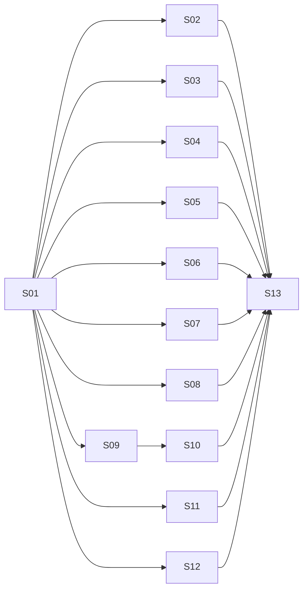

# Implementation Steps: Recruiter-Ready Portfolio Refresh

- **Source RFF:** `request-for-feature.md`
- **Date:** 2026-11-05
- **Steps:** 13 (11 slices, 2 enablers) in 4 stages

## 1. Overview

The site is a single static page, so almost every step edits `index.html` and `index.css`. To make parallel work safe, the plan opens with one small enabler (S01). It builds the new page skeleton: the sticky navbar, an empty, labeled `<section>` for each new area in the final order, labeled CSS regions, a shared end-of-body `<script>` block, and the shared design tokens (`.skill-chip` and a contrast-safe text green). After S01, each section is its own vertical slice. A slice owns one section of the markup and one CSS region, so ten slices can run in parallel in Stage 2. The "More projects" collapse follows its parent slice, and a final enabler runs the accessibility, SEO and responsive audit and updates `CLAUDE.md`.

**Verification URL:** every manual check in this plan (browser checks, devtools device toolbar, Lighthouse, keyboard and JS-disabled tests) can be done against the locally served page at http://127.0.0.1:5500/.

## 2. Software layers

| Layer | Location / main files | Notes |
|-------|----------------------|-------|
| Metadata | `index.html` `<head>` | Title, meta description, Open Graph and Twitter tags, CDN links (Bootstrap 5.3.1, Bootstrap Icons 1.10.5) |
| Markup | `index.html` `<body>` | Everything is hard-coded HTML inside `<main class="container-lg ...">`, using Bootstrap utility classes |
| Styles | `index.css` | Theme variables `--my-primary` / `--my-secondary` on `html`, Bootstrap overrides with `!important`, and a ≤768px media query |
| Scripts | inline in `index.html` | Today only inline `onclick="window.open(...)"`. The plan adds one small inline `<script>` block at the end of `<body>`. Bootstrap's JS bundle (loaded with `defer`) powers the navbar collapse and the "More projects" collapse |
| Assets | `images/`, `images/projects/` | Photo plus project screenshots. Stock skill images and `hashmarks.png` get deleted |
| Docs | `CLAUDE.md` | Describes the page sections and must reflect the new structure |
| Tests | none | There is no test suite or build. Verification is manual in a browser at http://127.0.0.1:5500/ (devtools device toolbar at 375px / 768px / 1280px), plus Lighthouse in Chrome DevTools and an Open Graph preview check |

## 3. Steps

### S01 - Page skeleton with sticky navbar and anchored sections

- **Type:** Enabler
- **Purpose:** Build the shared structure every other slice plugs into, and deliver the navbar (FR-01), which needs all section anchors to exist. Each later slice then owns one clearly bounded region, so most of them can run in parallel.
- **Behavior:** A sticky Bootstrap navbar shows "SC" / the name on the left and the links About, Skills, Experience, Projects, Education. Clicking a link scrolls smoothly to its section, and the section heading is not hidden under the navbar. Below 992px the links collapse into a hamburger menu, and picking a link closes the menu. The page keeps all existing content: the old skills cards sit inside `#skills`, the old Showcase sits inside `#projects`, and Objectives stays until S07 replaces it. The new sections (`#about`, `#value`, `#experience`, `#education`) exist as empty, headed placeholders.
- **Requirements covered:** FR-01. Enables FR-02 to FR-13.
- **Depends on:** none
- **Layers touched:**
  | Layer | Files | Change |
  |-------|-------|--------|
  | Metadata | `index.html` | modify: bump Bootstrap Icons to the latest 1.11.x so that `bi-robot`, `bi-badge-vr` and the other icons are sure to exist |
  | Markup | `index.html` | modify: add a `<nav class="navbar navbar-expand-lg sticky-top">` before `<main>`. Give the sections their final order and ids: `#profile`, `#about`, `#skills` (with two child containers `#expertise-cards` and `#toolbox`), `#value`, `#experience`, `#projects` (with child containers `#projects-pro`, `#projects-personal` and `#projects-more`), `#education`, then the footer. Each new section gets its `h2` using the existing heading pattern. Add `<!-- S0x: ... -->` ownership comments. Fix the hierarchy so there is a single `h1` and every section heading is an `h2` |
  | Styles | `index.css` | modify: add `html { scroll-behavior: smooth; }` and `section[id] { scroll-margin-top: <navbar height>; }`, navbar styling based on the theme variables, an alternating background helper (`.section-alt` with `--bs-gray-100`), a new `--my-primary-text` variable (a darker green that passes 4.5:1 on white, e.g. about `#4f6d24`) used by `a` and `strong`, and a shared `.skill-chip` class (light green tint background, `--my-primary-text` text, small pill). Add commented regions (`/* == About == */`, `/* == Timeline == */` and so on) for the later slices |
  | Scripts | `index.html` | modify: add an empty commented `<script>` block at the end of `<body>` with labeled spots for the footer year (S02) and the project keyboard handler (S09). Close the mobile menu when a link is clicked, either with `data-bs-toggle="collapse" data-bs-target="#navbarNav"` on the links or with a 3-line handler |
- **How to test:**
  - Manual: Given a 1280px viewport, when I click each navbar link, then the page scrolls smoothly to that section and its `h2` sits fully visible below the navbar.
  - Manual: Given a 375px viewport, when I open the hamburger menu and tap "Experience", then the page scrolls there and the menu closes. There is no horizontal scroll.
  - Manual: The existing hero, skills cards, Objectives and Showcase still render and work (project images still open demos).
- **Notes / risks:** Every later step depends on the section ids and child container ids chosen here, so they are the contract. Keep this step free of real content so that it stays small. The `.skill-chip` class and `--my-primary-text` live here because S05, S06, S08 and S11 all use them.

### S02 - Hero with recruiter-ready headline, and footer contact points

- **Type:** Slice
- **Purpose:** Make role, seniority, years of experience and core stack visible above the fold, and give the footer a correct, self-updating copyright with soft contact links.
- **Behavior:** The hero shows the name (`h1`), "Senior Software Engineer", a tagline about full-stack .NET/TypeScript work and 27 years of experience, the photo on the right (md and up) or stacked (mobile), and the LinkedIn, GitHub and email buttons, each with an `aria-label`. The footer reads `© 2026 Sérgio C. Castelani Jr.`. The year is filled in by JS, with the static "2026" as fallback. Small LinkedIn, GitHub and email icons repeat in the footer.
- **Requirements covered:** FR-02, FR-10
- **Depends on:** S01
- **Layers touched:**
  | Layer | Files | Change |
  |-------|-------|--------|
  | Markup | `index.html` | modify `#profile`: new title and tagline copy, `aria-label` on the 3 social links, `alt` and explicit `width`/`height` on `#profile-img` (no `loading="lazy"`, because the photo is above the fold). Modify `<footer>`: new text with `2026` and small social icons |
  | Styles | `index.css` | modify the Hero region (keep the `--bs-gray-100` background and tune spacing). Add a small Footer region for the footer icon size |
  | Scripts | `index.html` | modify the shared script block's "footer year" spot: `document.getElementById('year').textContent = new Date().getFullYear();` |
- **How to test:**
  - Manual: Given a 1366×768 desktop viewport, when the page loads, then the name, "Senior Software Engineer", tagline, photo and the 3 social buttons are visible without scrolling.
  - Manual: Given JS disabled (DevTools → Disable JavaScript), then the footer still reads "© 2026 Sérgio C. Castelani Jr.".
  - Manual: Tab through the social buttons. Each one has a visible focus ring, and a screen reader (or the Accessibility pane) announces its label.
- **Notes / risks:** Footer social icons follow the RFF open-question default. The tagline copy is a draft (open question "Copy approval").

### S03 - Link preview and SEO metadata

- **Type:** Slice
- **Purpose:** Give the page a professional preview when it is shared on LinkedIn or Slack, and better search metadata.
- **Behavior:** `<title>` reads "Sérgio C. Castelani Jr. | Senior Full-Stack Software Engineer". The page has a meta description, `og:title`, `og:description`, `og:url` (`https://portfolio.castelani.dev.br/`), `og:image` (absolute: `https://portfolio.castelani.dev.br/images/photo2.png`), `og:type=website`, and the matching `twitter:card` (`summary_large_image` or `summary`), `twitter:title`, `twitter:description` and `twitter:image` (same absolute URL) tags. A `<link rel="canonical" href="https://portfolio.castelani.dev.br/">` is added too. `lang="en"` stays.
- **Requirements covered:** FR-11
- **Depends on:** S01 (both steps edit `<head>`)
- **Layers touched:**
  | Layer | Files | Change |
  |-------|-------|--------|
  | Metadata | `index.html` | modify `<head>`: title plus the meta, OG and Twitter tags |
- **How to test:**
  - Manual: View the source and check that every tag is present and the description is 150 characters or less.
  - Manual: Locally at http://127.0.0.1:5500/, view the source and check that `og:url`, `og:image`, `twitter:image` and the canonical link all use `https://portfolio.castelani.dev.br/`.
  - Manual: Once the site is deployed, paste https://portfolio.castelani.dev.br/ into the LinkedIn Post Inspector or a Slack message. The preview shows the title, description and photo. (Scrapers cannot reach 127.0.0.1, so this check only works on the public URL.)
- **Notes / risks:** The public URL is https://portfolio.castelani.dev.br/ (confirmed by the user, which resolves the RFF open question on `og:url`). The absolute `og:image` points at the deployed photo, so it resolves only once that file is live at that URL.

### S04 - About section with key-numbers strip

- **Type:** Slice
- **Purpose:** Give recruiters a short professional summary and four numbers they can scan in seconds.
- **Behavior:** `#about` shows the summary paragraph from RFF section 7.3 and 4 stat tiles: "27 years experience", "6 industries", "6 companies", "13+ yrs C++". Each tile has a Bootstrap Icon, a big number in green and a small label. The tiles sit 4 in a row on lg and 2×2 on mobile.
- **Requirements covered:** FR-03
- **Depends on:** S01
- **Layers touched:**
  | Layer | Files | Change |
  |-------|-------|--------|
  | Markup | `index.html` | modify the `#about` placeholder: summary plus `row row-cols-2 row-cols-lg-4` stat tiles |
  | Styles | `index.css` | modify the About region: `.stat-tile` and `.stat-number` (large, `--my-primary-text` or `--my-primary` at a large size that still meets 3:1 for large text) |
- **How to test:**
  - Manual: Given the About section at 1280px, then 4 tiles appear in one row with the exact labels above. At 375px they form a 2×2 grid.
- **Notes / risks:** Summary copy is a draft (open question "Copy approval").

### S05 - Expertise cards with icons, years and chips (stock images removed)

- **Type:** Slice
- **Purpose:** Replace the three generic stock-photo cards with five expertise cards that show depth, context and years.
- **Behavior:** `#expertise-cards` shows exactly 5 cards, in a 3+2 layout on lg (second row centered), 2 per row on md and 1 per row on mobile. Each card has an icon (`bi-window-stack`, `bi-robot`, `bi-cpu`, `bi-badge-3d`, `bi-heart-pulse`), a title, a 1–2 line blurb, a "N+ years" label and `.skill-chip` badges matching RFF section 7.2. The old skills cards and the files `images/desktop.jpg`, `images/web-dev.jpeg` and `images/so.jpg` are gone.
- **Requirements covered:** FR-04, FR-12 (stock images)
- **Depends on:** S01
- **Layers touched:**
  | Layer | Files | Change |
  |-------|-------|--------|
  | Markup | `index.html` | modify `#expertise-cards`: replace the old 3 cards with 5 new cards (`row justify-content-center` + `col-12 col-md-6 col-lg-4`) |
  | Styles | `index.css` | modify the Expertise region: `.expertise-icon` (large icon in theme green) and the years label style |
  | Assets | `images/desktop.jpg`, `images/web-dev.jpeg`, `images/so.jpg` | delete |
- **How to test:**
  - Manual: Given the Skills section, then there are exactly 5 cards, and the titles, years (5+, ~2, 13+, 12+, 7) and chips match RFF section 7.2.
  - Manual: Resize to 1280px (3+2, second row centered), 800px (2 per row) and 375px (1 per row).
  - Automated (shell): `ls images` no longer lists the 3 stock files, and `grep -n "desktop.jpg\|web-dev.jpeg\|so.jpg" index.html` finds nothing.
- **Notes / risks:** The "Profiling" and "LLM integration" chips are inferred (RFF section 7.2 assumption). Keep them unless the user objects. Owns only `#expertise-cards`. S06 owns `#toolbox` in the same section.

### S06 - "Full toolbox" grouped skill chips

- **Type:** Slice
- **Purpose:** Keep every resume keyword on the page for recruiter keyword searches, without cluttering the expertise cards.
- **Behavior:** Below the expertise cards, a compact "Full toolbox" block lists 5 groups, each a small heading followed by `.skill-chip` badges:
  - **Languages:** C#, JavaScript / TypeScript, PHP, Python, HTML / CSS, C / C++
  - **Frameworks & Libraries:** ASP.NET, Microsoft Agent Framework, React, Redux, Qt, Boost, Bootstrap, Express
  - **Databases:** PostgreSQL, SQL Server, MySQL, NoSQL
  - **Tools & Platforms:** Visual Studio, VS Code, Git, Docker, Azure, GitHub Copilot CLI, Codex, Claude
  - **Specialized:** Full-stack web development, Computer Graphics, OpenGL, CUDA, Multithreading, DICOM / Medical Imaging, VoIP / SIP, Real-Time Systems
- **Requirements covered:** FR-05
- **Depends on:** S01
- **Layers touched:**
  | Layer | Files | Change |
  |-------|-------|--------|
  | Markup | `index.html` | modify `#toolbox`: 5 groups (e.g. a `row` with a label column and a chips column, or a definition-list style) |
  | Styles | `index.css` | modify the Toolbox region: group label style and a smaller chip modifier (`.skill-chip-sm`) if needed |
- **How to test:**
  - Manual: Given the Skills section, then all 5 groups appear under the cards, and every skill listed above is present (compare with the resume's "Technical Skills" section).
  - Manual: At 375px the chips wrap with no horizontal scroll.
- **Notes / risks:** The skill list was taken from `Simple Resume.txt` ("Technical Skills"). Runs in parallel with S05 because each step owns its own child container in `#skills`.

### S07 - "What I bring" replaces Objectives

- **Type:** Slice
- **Purpose:** Replace personal aspirations with four statements of value to an employer.
- **Behavior:** `#value` shows 4 value statements (bold lead-in plus one sentence, copy from RFF section 7.4), each with an icon, in a 2×2 grid on md and up. The old "Objectives" section and its CSS are gone.
- **Requirements covered:** FR-06
- **Depends on:** S01
- **Layers touched:**
  | Layer | Files | Change |
  |-------|-------|--------|
  | Markup | `index.html` | modify `#value`: add the 4 statements. Delete the old Objectives `<section>` |
  | Styles | `index.css` | delete the `#objectives-list` rules. Modify the Value region: `.value-item` (icon plus text) |
- **How to test:**
  - Manual: Given the page, then a "What I bring" section with the 4 statements appears between Skills and Experience. The text "Objectives" appears nowhere on the page.
  - Automated (shell): `grep -n "objectives" index.html index.css` finds nothing.
- **Notes / risks:** Copy is a draft (open question "Copy approval").

### S08 - Experience timeline with all six roles

- **Type:** Slice
- **Purpose:** Show the career history recruiters look for, with company context, impact bullets and tech, newest first.
- **Behavior:** `#experience` shows a vertical timeline with a green line and a dot per role, listing Tech6, Graebert, Audaces, ITM Apps, AGM and Pixeon in that order. Each entry has the company, the role, a muted date badge, a one-line context, 2–4 bullets and `.skill-chip` tech chips (all from RFF section 7.1). Tech6 reads "Oct 2023 – Oct 2026" and Pixeon reads "Feb 2005 – Jan 2012". Drapo and T6-GPT are plain-text bullets with no links. On mobile the line moves to the left edge and the content takes the full width.
- **Requirements covered:** FR-07
- **Depends on:** S01
- **Layers touched:**
  | Layer | Files | Change |
  |-------|-------|--------|
  | Markup | `index.html` | modify `#experience`: an `<ol class="timeline">` with 6 `<li class="timeline-item">` entries |
  | Styles | `index.css` | modify the Timeline region: `.timeline` (`::before` line in `--my-primary`), `.timeline-item::before` (dot), the date badge, and a ≤768px rule that moves the line to the left edge |
- **How to test:**
  - Manual: Given the timeline, then 6 roles are listed newest first, with the dates exactly as in RFF section 7.1, including Tech6 "Oct 2023 – Oct 2026" and Pixeon "Feb 2005 – Jan 2012".
  - Manual: At 375px the line sits on the left, the text is readable, and there is no horizontal scroll.
- **Notes / risks:** This is the biggest content slice. Tech6's context line is inferred (open-question default: use it). The resume file itself still has wrong Pixeon dates and "Out 2026". That fix is outside this repo and not part of this plan.

### S09 - Featured personal projects (HashMarks removed, accessible image cards)

- **Type:** Slice
- **Purpose:** Curate the showcase down to the three strongest personal demos and make their image links usable from the keyboard.
- **Behavior:** `#projects-personal`, under a "Personal projects" subheading, shows GrowTweet, 3D Viewer and Bat-Flappy in the existing `project-card-img` / `project-img-overlay` pattern, with the same images, live links and source links. Clicking an image, or focusing it and pressing Enter, opens the demo in a new tab. Image divs have `role="link"`, `tabindex="0"`, an `aria-label` ("Open <project> live demo") and a visible focus style. The HashMarks card and `images/projects/hashmarks.png` are gone. The other 5 demos (Spider-man, Rick & Morty, Growflix, Nikel, DOM Challenge) stay visible for now as plain cards in `#projects-more`. In that kept copy, "pactice" becomes "practice" and "Boostrap" becomes "Bootstrap". The section heading reads "Featured Work".
- **Requirements covered:** FR-08 (personal projects, HashMarks removal), FR-12 (hashmarks.png), FR-13
- **Depends on:** S01
- **Layers touched:**
  | Layer | Files | Change |
  |-------|-------|--------|
  | Markup | `index.html` | modify `#projects`: rename the heading to "Featured Work", move the 3 featured cards into `#projects-personal`, move the other 5 into `#projects-more` (not collapsed yet), delete the HashMarks block, fix the 2 typos, and add `role`, `tabindex`, `aria-label` and a `data-url` attribute on every `project-card-img` |
  | Styles | `index.css` | modify the Projects region: a `.project-card-img:focus-visible` outline, and show `.project-img-overlay` on `:focus-visible` as well as `:hover`. Keep the ≤768px corner rule |
  | Scripts | `index.html` | modify the shared script block's "project keyboard" spot: one delegated `keydown` listener that opens `data-url` on Enter for `.project-card-img` (keep the inline `onclick` so clicks work without the script block, or switch both to `data-url`) |
  | Assets | `images/projects/hashmarks.png` | delete |
- **How to test:**
  - Manual: Given the Projects section, then GrowTweet, 3D Viewer and Bat-Flappy appear as image cards, and clicking each image opens its live demo in a new tab.
  - Manual: Press Tab until a project image is focused. A focus ring and the "View" overlay show, and pressing Enter opens the demo.
  - Automated (shell): `grep -ni "hashmarks\|pactice\|boostrap" index.html` finds nothing, and `ls images/projects` has no `hashmarks.png`.
- **Notes / risks:** Owns `#projects-personal` and `#projects-more`. S11 owns `#projects-pro`, so the two steps can run in parallel. S10 builds on the cards this step moves into `#projects-more`.

### S10 - Collapsible "More projects"

- **Type:** Slice
- **Purpose:** Keep the smaller course demos available without diluting the featured work.
- **Behavior:** `#projects-more` starts collapsed. A "Show more projects" button expands it to show the 5 remaining demos, and the button label switches to "Show fewer projects". Clicking again collapses it. Without JS the block stays closed (accepted in the RFF).
- **Requirements covered:** FR-08 (More projects)
- **Depends on:** S09
- **Layers touched:**
  | Layer | Files | Change |
  |-------|-------|--------|
  | Markup | `index.html` | modify `#projects`: add `class="collapse"` to `#projects-more`, plus a toggle `<button class="btn btn-outline-..." data-bs-toggle="collapse" data-bs-target="#projects-more" aria-expanded="false" aria-controls="projects-more">` containing two `` labels |
  | Styles | `index.css` | modify the Projects region: swap the labels with CSS based on Bootstrap's `.collapsed` class / `[aria-expanded]` (no custom JS), and give the outline button theme colors |
- **How to test:**
  - Manual: Given the page loads, then the 5 extra demos are hidden and the button reads "Show more projects". When I click it, the 5 demos appear and the label reads "Show fewer projects". When I click again, they collapse.
  - Manual: The expanded cards still open their demos by click and by Enter (the S09 behavior).
- **Notes / risks:** Toggling the label with CSS avoids adding JS to the shared script block.

### S11 - Professional highlight cards (Sysphera, Audaces 4D + VR mirror)

- **Type:** Slice
- **Purpose:** Lead the projects section with professional work, presented without screenshots because it is proprietary.
- **Behavior:** `#projects-pro`, under a "Professional highlights" subheading, shows 2 cards. Sysphera (`bi-bar-chart-line`, Tech6) and Audaces 4D & VR Try-on Mirror (`bi-badge-vr`, Audaces) each have a large icon, a title, the company name, a 2–3 line description and tech chips (RFF section 7.5). The cards have no link, no hover overlay and no pointer cursor.
- **Requirements covered:** FR-08 (professional highlights)
- **Depends on:** S01
- **Layers touched:**
  | Layer | Files | Change |
  |-------|-------|--------|
  | Markup | `index.html` | modify `#projects-pro`: 2 `col-12 col-lg-6` cards |
  | Styles | `index.css` | modify the Projects region (a separate `/* highlight cards */` sub-block): `.highlight-card` and `.highlight-icon`, with `cursor: default` |
- **How to test:**
  - Manual: Given the Projects section, then the 2 highlight cards appear above "Personal projects". Hovering shows the default cursor and no overlay, and Tab skips them.
- **Notes / risks:** Shares the Projects CSS region with S09 and S10. Each step adds its own sub-block, so the edits do not overlap.

### S12 - Education and languages

- **Type:** Slice
- **Purpose:** Complete the resume flow with formal education, the Growdev program and language levels.
- **Behavior:** `#education` shows two columns on md and up (stacked on mobile). Education lists the B.Sc. in Computer Science from UFSC (2003) and Full-Stack Web Development at Growdev (2023–2024), each with an icon (`bi-mortarboard`). Languages lists Portuguese (Native / C2) and English (Upper Intermediate / B2), with `bi-translate`.
- **Requirements covered:** FR-09
- **Depends on:** S01
- **Layers touched:**
  | Layer | Files | Change |
  |-------|-------|--------|
  | Markup | `index.html` | modify `#education`: 2-column content |
  | Styles | `index.css` | modify the Education region: minimal (icon color and spacing) |
- **How to test:**
  - Manual: Given the Education section, then both degrees with their years and both languages with their levels appear exactly as in FR-09, and the navbar "Education" link lands here.

### S13 - Accessibility, SEO and responsive audit; docs update

- **Type:** Enabler
- **Purpose:** Verify the acceptance criteria that span the whole page (Lighthouse scores, contrast, 375px layout, lazy loading), fix what the audit finds, and document the new structure.
- **Behavior:** Lighthouse Accessibility and SEO are both 90 or higher. There is no horizontal scroll at 375px. All text meets 4.5:1 contrast (large text 3:1). There is a single `h1`, and focus is visible on every interactive element. `CLAUDE.md` "Page sections" describes the new sections, the section and container ids, `.skill-chip`, the timeline and the collapse.
- **Requirements covered:** FR-01 to FR-13 (cross-cutting acceptance criteria), plus the RFF section 8 doc update
- **Depends on:** S02, S03, S04, S05, S06, S07, S08, S10, S11, S12
- **Layers touched:**
  | Layer | Files | Change |
  |-------|-------|--------|
  | Markup | `index.html` | modify: small a11y and SEO fixes found by the audit. Add `loading="lazy"` to any below-the-fold `` (project screenshots are CSS backgrounds, so they need no change) |
  | Styles | `index.css` | modify: contrast and overflow fixes found by the audit |
  | Docs | `CLAUDE.md` | modify: rewrite "Page sections" and add the new conventions (sections and containers, `--my-primary-text`, `.skill-chip`, the shared script block) |
- **How to test:**
  - Manual: Run Chrome DevTools → Lighthouse (mobile and desktop). Accessibility and SEO are both 90 or higher.
  - Manual: In the device toolbar at 375px, scroll the whole page. There is no horizontal scrollbar, and the navbar, cards and timeline all read well.
  - Manual: Walk through every acceptance criterion in RFF section 10 and tick it off.
  - Automated (shell): `grep -c "<h1" index.html` prints 1.

## 4. Execution stages

| Stage | Steps (parallel) | Depends on stages | Delivers |
|-------|------------------|-------------------|----------|
| 1 | S01 | - | Navbar, final section order and anchors, shared tokens (`.skill-chip`, text green), shared script block |
| 2 | S02, S03, S04, S05, S06, S07, S08, S09, S11, S12 | 1 | All content sections: hero and footer, metadata, About, expertise, toolbox, What I bring, timeline, personal and professional projects, education |
| 3 | S10 | 2 (S09) | "More projects" collapse |
| 4 | S13 | 2, 3 | Audit fixes, Lighthouse ≥ 90, updated `CLAUDE.md` |

**Critical path:** S01 → S09 → S10 → S13

**Parallelization notes:**
- `index.html`: S01 creates one placeholder container per slice, with `<!-- S0x -->` ownership comments. Each Stage 2 slice edits only its own section or container: S02 `#profile` + `<footer>`, S03 `<head>`, S04 `#about`, S05 `#expertise-cards`, S06 `#toolbox`, S07 `#value` (plus deleting the old Objectives block), S08 `#experience`, S09 `#projects-personal` + `#projects-more` + the `#projects` heading, S11 `#projects-pro`, S12 `#education`. These regions do not overlap, so the edits merge cleanly.
- `index.css`: S01 adds a commented region per section. Each slice appends only inside its own region. S09 and S11 share the Projects region but use separate sub-blocks.
- Shared `<script>` block: S02 (footer year) and S09 (Enter-key handler) each fill their own labeled spot. S10 uses CSS instead of JS for its label, so it does not touch the block.
- If the steps are run as separate branches, merge them one at a time. Conflicts can only show up at the region boundaries.

## 5. Requirements coverage

| Requirement | Steps |
|-------------|-------|
| FR-01 Sticky navbar | S01 |
| FR-02 Hero | S02 |
| FR-03 About + stats | S04 |
| FR-04 Expertise cards | S05 |
| FR-05 Full toolbox | S06 |
| FR-06 What I bring | S07 |
| FR-07 Experience timeline | S08 |
| FR-08 Featured Work | S09 (personal, HashMarks removed), S10 (More projects), S11 (professional) |
| FR-09 Education & languages | S12 |
| FR-10 Footer | S02 |
| FR-11 Meta / OG / Twitter | S03 |
| FR-12 Image deletions | S05 (stock images), S09 (`hashmarks.png`) |
| FR-13 Typo fixes | S09 |
| NFR: accessibility, SEO, responsive, lazy loading, `CLAUDE.md` | S01 (contrast token, headings, scroll margin), S13 (audit) |

## 6. Assumptions and open points

- **Contrast (S01):** `#86af49` on white is about 2.5:1 and `--my-secondary` is about 3.3:1, so both fail 4.5:1 for body text. S01 adds a darker `--my-primary-text` for links, `strong` and chip text, and keeps `#86af49` for fills, lines and large numbers. The exact shade gets confirmed in S13.
- **Bootstrap Icons version (S01):** bumped from 1.10.5 to the latest 1.11.x instead of checking each icon against 1.10.5 (the RFF allows either).
- **Copy drafts (S02, S04, S05, S07, S11):** tagline, summary, blurbs and "What I bring" are used as written in the RFF. The user reviews them on the rendered page.
- **Tech6 context line (S08):** used as inferred.
- **`og:url` / `og:image` (S03):** resolved. The public URL is https://portfolio.castelani.dev.br/, used for `og:url`, the canonical link and the absolute `og:image` / `twitter:image`.
- **Footer social icons (S02):** included, per the open-question default.
- **Inferred chips (S05):** "Profiling" and "LLM integration" are kept unless the user objects.
- **Full toolbox list (S06):** taken from the "Technical Skills" section of `Simple Resume.txt`.
- **Out of scope:** fixing the Pixeon dates and "Out 2026" in the resume file itself (it lives outside this repo).
