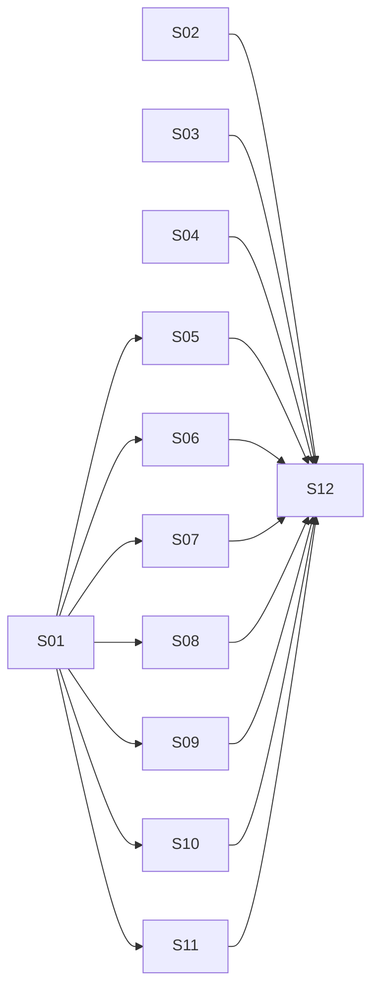

# Implementation Steps: Recruiter-Ready Portfolio Refresh

- **Source RFF:** `request-for-feature.md`
- **Resume (content source of truth):** `my-resume.txt`
- **Public URL:** https://portfolio.castelani.dev.br/
- **Date:** 2026-11-06
- **Steps:** 12 (10 slices, 2 enablers) in 3 stages

## 1. Overview

The page is a static `index.html` + `index.css` site with no build, so every "layer" is markup, styles, inline scripts, assets or metadata. One small enabler (S01) builds the shared page shell first: sticky navbar, empty section shells with their final ids and headings, the alternating-band and chip styles, and the accessible text-green token. Each later slice fills exactly one section (or the hero, footer or `<head>`) and removes the legacy block it replaces, so the page works after every step. Stage 1 delivers the shell, hero, footer and link-preview meta together. Stage 2 fills all content sections in parallel. Stage 3 updates `CLAUDE.md` and runs the final acceptance audit.

## 2. Software layers

| Layer | Location / main files | Notes |
|-------|----------------------|-------|
| Metadata | `index.html` `<head>` | `<title>`, meta description, Open Graph / Twitter tags, CDN links (Bootstrap 5.3.1, Bootstrap Icons) |
| Markup | `index.html` `<body>`: `<nav>`, `<main>` sections, `<footer>` | All content is hard-coded HTML built with Bootstrap utility classes |
| Styles | `index.css` | Theme variables on `html`, Bootstrap overrides, one comment-delimited block per section |
| Scripts | inline `<script>` tags in `index.html` | No JS file. Each script sits right after the markup it serves and relies on the Bootstrap bundle (deferred CDN) |
| Assets | `images/`, `images/projects/` | Profile photo and project screenshots; stock skill images are removed |
| Docs | `CLAUDE.md` | "Page sections" description of the architecture |
| Tests | none | No automated test suite exists. Verification is manual in a browser (desktop and 375px DevTools viewport) plus Lighthouse |

**CSS ownership rule (applies to every step):** each step that adds styles puts them, including its own media queries, in one block headed by a comment naming its section (e.g. `/* Experience timeline */`), inserted before the existing `/* Bootstrap overrides */` comment. A step never edits another step's block.

## 3. Steps

### S01 - Page shell with sticky navigation and section anchors

- **Type:** Enabler
- **Purpose:** Give the page its final structure and navigation so that every content section can be built independently and in parallel. Also fixes the brand-green text contrast once for the whole page.
- **Behavior:** A sticky navbar shows the name on the left and the links About, Skills, Experience, Projects, Education on the right. On small screens it collapses to a hamburger, and clicking a link closes the menu. Clicking a link scrolls smoothly to the matching section, and the section heading is not hidden under the navbar. Below the hero, six new sections appear in the final order, each showing only its heading: About, Expertise, What I bring, Experience, Featured Work, Education & Languages. The legacy sections ("Strongest Hard skills", "Objectives", "Showcase") are still shown, unchanged, below the new sections. Links and `strong` text use a darker green that meets 4.5:1 contrast, and focused elements show a visible green focus ring.
- **Requirements covered:** FR-01; enables FR-03, FR-04, FR-05, FR-06, FR-07, FR-08, FR-09; R-A11Y (contrast, focus states, heading hierarchy)
- **Depends on:** none
- **Prerequisites:** none (uses the existing `#profile` section and the existing `--my-primary` / `--my-secondary` variables)
- **Provides:**
  - `#main-nav` (element id): the sticky Bootstrap navbar, placed before `<main>`. The brand links to `#profile`. Link targets are exactly `#about`, `#skills`, `#experience`, `#projects`, `#education`. Its collapse-on-click inline script sits right after the `<nav>`.
  - Section shells (element ids), placed in this order directly after `#profile` inside `<main>`: `#about` (heading "About"), `#skills` ("Expertise"), `#value` ("What I bring"), `#experience` ("Experience"), `#projects` ("Featured Work"), `#education` ("Education & Languages"). Each shell is `<section id="X" class="page-section …" aria-labelledby="X-heading">` with a single `<h2 id="X-heading" class="border-start border-5 border-primary ps-3 fw-bold mb-5">`. Other steps may only **append content after the `<h2>`** inside their own section. They must not change the `<section>` element, its classes or the `<h2>`.
  - `#projects-professional` and `#projects-personal` (element ids): two empty `
` containers inside `#projects`, after its `<h2>`, in that order. Each container is filled by one step, which may add its own subheading (`<h3>`) and content inside it.
  - `.page-section` (CSS class): vertical padding for content sections.
  - `.section-alt` (CSS class): light-gray (`--bs-gray-100`) band background. S01 applies it to `#skills`, `#experience` and `#education`, so bands alternate with the gray hero.
  - `section[id]` scroll offset rule (CSS): `scroll-margin-top` equal to the navbar height, plus `html { scroll-behavior: smooth; }`.
  - `--my-primary-text` (CSS variable on `html`): a darker brand green with 4.5:1 or higher contrast on white and on `--bs-gray-100`. Use it for green **text**; `--my-primary` stays the fill/accent color. S01 switches the global `a` and `strong` colors to it.
  - `.skill-chip` (CSS class): small rounded badge chip with a light green tint background and `--my-primary-text` text. Meant to be used as `Tech`, usually several in a `d-flex flex-wrap gap-2` wrapper.
  - Global `:focus-visible` outline in the brand green.
  - Bootstrap Icons CDN link bumped to 1.11.3, so every icon named in this plan exists.
- **Layers touched:**
  | Layer | Files | Change |
  |-------|-------|--------|
  | Metadata | `index.html` | modify: Bootstrap Icons `<link>` from 1.10.5 to 1.11.3 (only that line) |
  | Markup | `index.html` | modify: add `<nav id="main-nav">` before `<main>`; insert the six section shells after `#profile`; make `<main>` padding responsive (`p-3 p-md-5`) to avoid horizontal scroll at 375px |
  | Scripts | `index.html` | new: inline script after the navbar that hides the open collapse when a nav link is clicked |
  | Styles | `index.css` | modify: add `--my-primary-text`; switch `a` / `strong` colors; add a `/* Layout and navigation */` block with navbar, `.page-section`, `.section-alt`, `section[id]` scroll offset, smooth scroll, `.skill-chip`, `:focus-visible` |
- **How to test:**
  - Manual: Given the page open on desktop, when you click each navbar link, then the page scrolls smoothly to that section and its heading is fully visible below the sticky navbar.
  - Manual: Given a 375px viewport, when the page loads, then the navbar shows a hamburger; when you open it and click "Experience", then the menu closes and the page scrolls to Experience; and there is no horizontal scroll.
  - Manual: Given the page, then the new section headings appear in order (About, Expertise, What I bring, Experience, Featured Work, Education & Languages) and the legacy sections still render below them.
  - Manual: Given DevTools contrast checker, then link text color on white and on `--bs-gray-100` is 4.5:1 or higher. Tabbing through navbar links shows a visible focus ring.
- **Notes / risks:** Sections are briefly empty (heading only) until their slice lands; this is expected for an enabler. The Icons bump touches only the Icons `<link>` line in `<head>`; the other `<head>` lines belong to the metadata slice. The collapse-on-click script must not break the page if the Bootstrap bundle fails to load (guard for `window.bootstrap`).

### S02 - Hero presents the senior full-stack profile above the fold

- **Type:** Slice
- **Purpose:** Let a recruiter see name, seniority, role and core stack within seconds, with accessible social buttons.
- **Behavior:** The hero shows "Sérgio C. Castelani Jr." as the page's only `h1`, the title "Senior Software Engineer" (styled as a subtitle, not a heading), a one-line tagline about full-stack .NET/TypeScript with 27 years of experience, the photo `images/photo2.png`, and the LinkedIn, GitHub and email buttons. On md and up, text is on the left and the photo on the right; on mobile they stack. The photo has descriptive `alt` text, and each icon-only button has an `aria-label`.
- **Requirements covered:** FR-02; R-A11Y (photo `alt`, `aria-label` on social buttons, single `h1`)
- **Depends on:** none
- **Prerequisites:** existing `#profile` section, `#profile-img`, `.social-btn` and their CSS
- **Provides:** none
- **Layers touched:**
  | Layer | Files | Change |
  |-------|-------|--------|
  | Markup | `index.html` | modify: the `#profile` section only (name, title element, tagline, `alt`, `aria-label`s, `target`/`rel` on external social links) |
  | Styles | `index.css` | modify: existing `#profile` / `#profile-img` rules only if needed for vertical alignment and spacing |
- **How to test:**
  - Manual: Given a 1366×768 desktop viewport, when the page loads, then name, "Senior Software Engineer", tagline, photo and the 3 social buttons are visible without scrolling.
  - Manual: Given a 375px viewport, then text and photo stack and nothing overflows horizontally.
  - Manual: Given a screen reader or the DevTools accessibility tree, then each social button has an accessible name ("LinkedIn", "GitHub", "Email") and the photo has `alt` text; the page has exactly one `h1`.
- **Notes / risks:** Tagline copy is a draft (RFF open question "Copy approval", default: use as written). Suggested tagline: "Full-stack engineer (C#/.NET, TypeScript, React) with 27 years of experience, from C++ graphics engines to AI agents." The current subtitle is an `h3`; replace it with a non-heading element (e.g. `
`) so the heading hierarchy stays valid.

### S03 - Footer with automatic year and social icons

- **Type:** Slice
- **Purpose:** Replace the outdated "(2023)" footer with a correct copyright line and a soft contact point, since the page has no contact section.
- **Behavior:** The footer reads `© 2026 Sérgio C. Castelani Jr.`. A tiny inline script replaces the year with the current year; if JavaScript does not run, the static "2026" stays. Small LinkedIn, GitHub and email icon links (Bootstrap Icons `bi-linkedin`, `bi-github`, `bi-envelope`) appear in the footer, each with an `aria-label`.
- **Requirements covered:** FR-10; RFF open question "Social links in the footer" (default used)
- **Depends on:** none
- **Prerequisites:** existing `<footer>` element
- **Provides:** `#footer-year` (element id): the `` holding the year, written only by the footer's own inline script
- **Layers touched:**
  | Layer | Files | Change |
  |-------|-------|--------|
  | Markup | `index.html` | modify: the `<footer>` element only |
  | Scripts | `index.html` | new: inline script inside or right after the footer that sets `#footer-year` to `new Date().getFullYear()` |
  | Styles | `index.css` | modify: add a `/* Footer */` block if icon sizing or spacing is needed |
- **How to test:**
  - Manual: Given the page, then the footer shows `© <current year> Sérgio C. Castelani Jr.` and three icon links that open LinkedIn, GitHub and a mailto link.
  - Manual: Given JavaScript disabled in DevTools, when you reload, then the footer shows `© 2026 Sérgio C. Castelani Jr.`.
- **Notes / risks:** Bootstrap Icons `bi-linkedin`, `bi-github` and `bi-envelope` exist in both 1.10.5 and 1.11.3, so this step does not depend on the Icons bump.

### S04 - Search and link-preview metadata

- **Type:** Slice
- **Purpose:** Make the page rank and preview well when the link is shared on LinkedIn or Slack.
- **Behavior:** The browser tab shows "Sérgio C. Castelani Jr. | Senior Full-Stack Software Engineer". The page has a meta description, a canonical link (`<link rel="canonical" href="https://portfolio.castelani.dev.br/">`), Open Graph tags (`og:title`, `og:description`, `og:url` = `https://portfolio.castelani.dev.br/`, `og:image` = `https://portfolio.castelani.dev.br/images/photo2.png` as an absolute URL, `og:type=website`) and matching Twitter card tags (`twitter:card=summary`, `twitter:title`, `twitter:description`, `twitter:image` with the same absolute URL).
- **Requirements covered:** FR-11; NFR SEO (§9); R-SEO (Lighthouse SEO ≥ 90, meta part)
- **Depends on:** none
- **Prerequisites:** existing `<head>`
- **Provides:** none
- **Layers touched:**
  | Layer | Files | Change |
  |-------|-------|--------|
  | Metadata | `index.html` | modify: `<title>` and new `<meta>` tags in `<head>` (not the CDN `<link>` lines) |
- **How to test:**
  - Manual: Given the page, then the tab title matches the text above, and DevTools Elements shows all listed meta tags with non-empty content.
  - Manual: Given Lighthouse (SEO category), then there is no "Document does not have a meta description" finding.
  - Manual (once deployed): Given the public URL in a link-preview checker (e.g. LinkedIn Post Inspector), then title, description and photo show.
- **Notes / risks:** RFF open question "Public URL for `og:url`" is resolved: the site is published at https://portfolio.castelani.dev.br/, so `og:url`, the canonical link and the absolute image URLs use it. The preview only shows the photo once that URL serves the new page; locally, check the tags in DevTools. Crawlers cache previews, so use LinkedIn Post Inspector to refresh after deploying.

### S05 - About section with summary and key-numbers strip

- **Type:** Slice
- **Purpose:** Give recruiters a short professional summary and the four headline numbers at a glance.
- **Behavior:** The About section shows the professional summary from RFF §7.3 and a strip of 4 stat tiles: `27` years experience, `6` industries, `6` companies, `13+` yrs C++. Each tile has a big number in brand green (accessible green for text), a small label below and a Bootstrap Icon. Tiles are 4 in a row on lg and 2×2 on mobile.
- **Requirements covered:** FR-03
- **Depends on:** S01
- **Prerequisites:** `#about` (section shell; append after its `<h2>`), `--my-primary-text` (CSS variable)
- **Provides:** `.stat-tile` (CSS class): the key-number tile, used only inside `#about`
- **Layers touched:**
  | Layer | Files | Change |
  |-------|-------|--------|
  | Markup | `index.html` | modify: content inside `#about` after its `<h2>` |
  | Styles | `index.css` | modify: add an `/* About */` block with `.stat-tile` |
- **How to test:**
  - Manual: Given the About section on desktop, then the summary is shown and 4 tiles read "27 years experience", "6 industries", "6 companies", "13+ yrs C++" in one row.
  - Manual: Given a 375px viewport, then the tiles form a 2×2 grid without horizontal scroll.
  - Manual: Given the contrast checker, then the big numbers reach 4.5:1 or higher (or 3:1 if they qualify as large text).
- **Notes / risks:** Summary copy is a draft (RFF open question "Copy approval", default: use as written). Suggested icons: `bi-calendar-check`, `bi-building`, `bi-briefcase`, `bi-cpu`.

### S06 - Expertise cards and full toolbox replace the stock-image skills

- **Type:** Slice
- **Purpose:** Show the five areas of expertise with depth and years, while keeping every resume keyword on the page for recruiter searches.
- **Behavior:** The Expertise section shows exactly 5 cards (Full-Stack Web, AI Agents, C++ & Performance, Computer Graphics & GPU, Medical Imaging), each with a Bootstrap Icon, title, 1–2 line blurb, an "N+ years" label and tech chips, matching RFF §7.2. The grid is 3 per row on lg (3+2, second row centered), 2 per row on md, 1 on mobile. Below the cards, a compact "Full toolbox" block lists every resume skill as small chips, grouped under Languages, Frameworks & Libraries, Databases, Tools & Platforms, Specialized. The legacy "Strongest Hard skills" section and its three stock images are gone from the page and the repo.
- **Requirements covered:** FR-04, FR-05, FR-12 (stock images part)
- **Depends on:** S01
- **Prerequisites:** `#skills` (section shell; append after its `<h2>`), `.skill-chip` (CSS class), `--my-primary-text` (CSS variable), Bootstrap Icons 1.11.3 (for `bi-window-stack`, `bi-robot`, `bi-cpu`, `bi-badge-3d`, `bi-heart-pulse`); existing legacy "Strongest Hard skills" section
- **Provides:** `.expertise-card` (CSS class): card styling used only inside `#skills`
- **Layers touched:**
  | Layer | Files | Change |
  |-------|-------|--------|
  | Markup | `index.html` | modify: content inside `#skills` after its `<h2>`; delete the legacy "Strongest Hard skills" `<section>` |
  | Styles | `index.css` | modify: add an `/* Expertise */` block with `.expertise-card` and toolbox group styling |
  | Assets | `images/desktop.jpg`, `images/web-dev.jpeg`, `images/so.jpg` | delete |
- **How to test:**
  - Manual: Given the Expertise section on desktop, then there are exactly 5 cards in a 3+2 layout, each with icon, title, blurb, years label ("5+ years", "~2 years", "13+ years", "12+ years", "7 years") and the chips from §7.2.
  - Manual: Given md and 375px viewports, then cards show 2 per row and 1 per row.
  - Manual: Given the "Full toolbox" block, then each of the 5 groups is present, every item of the "Technical Skills" section of `my-resume.txt` appears in its group, and every technology listed under "Technologies" in the resume's experience entries appears in exactly one group.
  - Automated (shell): `git grep -n "desktop.jpg\|web-dev.jpeg\|so.jpg"` returns nothing, and the three files no longer exist.
- **Notes / risks:** The toolbox content comes from `my-resume.txt`. Its "Technical Skills" groups map one to one to the toolbox groups: Programming Languages → Languages (C#, JavaScript / TypeScript, PHP, Python, HTML / CSS, C / C++); Frameworks & Libraries (ASP.NET, Microsoft Agent Framework, React, Redux, Qt, Boost, Bootstrap, Express); Databases (PostgreSQL, SQL Server, MySQL, NoSQL); Tools & Platforms (Visual Studio, VS Code, Git, Docker, Azure, GitHub Copilot CLI, Codex, Claude); Specialized Areas → Specialized (Fullstack web development, Computer Graphics, OpenGL, CUDA, Multithreading, DICOM / Medical Imaging, VoIP / SIP, Real-Time Systems). Technologies that appear only in experience entries or expertise cards are added to the closest group: Java, Assembly → Languages; Node.js, Unity, Three.js, WebGL → Frameworks & Libraries; AWS, Jenkins, Jira → Tools & Platforms; TCP/IP, iOS → Specialized. Legacy items not in the resume (Windows, Linux, macOS) are dropped. "Profiling" and "LLM integration" chips are inferred (RFF §7.2 assumption): keep them unless the user removes them. Card blurbs are drafts (default: use as written).

### S07 - "What I bring" replaces Objectives

- **Type:** Slice
- **Purpose:** Replace personal aspirations with four value statements aimed at employers.
- **Behavior:** The "What I bring" section shows the 4 statements from RFF §7.4, each with a bold lead-in (End-to-end ownership, Performance mindset, Hard problems practical solutions, Startup to enterprise) and a short sentence, laid out as a 2×2 grid on md and up and stacked on mobile, each with a Bootstrap Icon. The legacy "Objectives" section and its `#objectives-list` styles no longer exist.
- **Requirements covered:** FR-06
- **Depends on:** S01
- **Prerequisites:** `#value` (section shell; append after its `<h2>`), `--my-primary-text` (CSS variable); existing legacy "Objectives" section and `#objectives-list` CSS rules
- **Provides:** `.value-item` (CSS class): value-statement block used only inside `#value`
- **Layers touched:**
  | Layer | Files | Change |
  |-------|-------|--------|
  | Markup | `index.html` | modify: content inside `#value` after its `<h2>`; delete the legacy "Objectives" `<section>` |
  | Styles | `index.css` | modify: delete the `#objectives-list` rules; add a `/* What I bring */` block with `.value-item` |
- **How to test:**
  - Manual: Given the page, then "What I bring" shows the 4 statements in a 2×2 grid on desktop and stacked at 375px.
  - Automated (shell): `git grep -n "objectives" index.html index.css` returns nothing.
- **Notes / risks:** Copy is a draft (default: use as written). Suggested icons: `bi-diagram-3`, `bi-speedometer2`, `bi-lightbulb`, `bi-rocket-takeoff`.

### S08 - Experience timeline with all six roles

- **Type:** Slice
- **Purpose:** Show the professional history that the current page lacks, in a scannable timeline that matches the corrected resume data.
- **Behavior:** The Experience section shows a vertical brand-green line with a dot per role and 6 entries, newest first: Tech6, Graebert, Audaces, ITM Apps, AGM, Pixeon. Each entry shows company, role, date range in a muted badge, a one-line company context, 2–4 bullets and tech chips, exactly as in RFF §7.1 (Tech6 "Oct 2023 – Oct 2026", Pixeon "Feb 2005 – Jan 2012"). Drapo and T6-GPT are plain text, not links. On mobile, the line moves to the left edge and the content takes the full width.
- **Requirements covered:** FR-07
- **Depends on:** S01
- **Prerequisites:** `#experience` (section shell; append after its `<h2>`), `.skill-chip` (CSS class), `--my-primary` and `--my-primary-text` (CSS variables)
- **Provides:** `.timeline`, `.timeline-item`, `.timeline-date` (CSS classes): timeline structure used only inside `#experience`
- **Layers touched:**
  | Layer | Files | Change |
  |-------|-------|--------|
  | Markup | `index.html` | modify: content inside `#experience` after its `<h2>` (an ordered list of 6 roles, each role title as `h3`) |
  | Styles | `index.css` | modify: add an `/* Experience timeline */` block with the timeline classes and their own mobile media query |
- **How to test:**
  - Manual: Given the Experience section, then 6 roles appear in the order Tech6, Graebert, Audaces, ITM Apps, AGM, Pixeon, with the dates from §7.1, and each role has 2 to 4 bullets.
  - Manual: Given a 375px viewport, then the line sits at the left edge, text is readable and there is no horizontal scroll.
  - Manual: Compare every company, role, date and chip against RFF §7.1: all match.
- **Notes / risks:** The Tech6 context line is inferred (RFF open question, default: use as written). Use semantic `<ol>` so the order is announced by screen readers. Pixeon has 5 source bullets in §7.1, so merge two of them to stay within 4.

### S09 - Professional highlight cards for Sysphera and Audaces

- **Type:** Slice
- **Purpose:** Lead the Featured Work section with professional projects, presented without screenshots because the work is proprietary.
- **Behavior:** At the top of Featured Work, a "Professional highlights" subheading is followed by 2 cards side by side on lg (stacked on mobile): **Sysphera** (Tech6) with a large `bi-bar-chart-line` icon, and **Audaces 4D & VR Try-on Mirror** (Audaces) with a large `bi-badge-vr` icon. Each card shows the title, company name, a 2–3 line description and tech chips from RFF §7.5. The cards are not links: no hover overlay, no pointer cursor, not focusable.
- **Requirements covered:** FR-08 (professional highlights part)
- **Depends on:** S01
- **Prerequisites:** `#projects-professional` (empty container in `#projects`), `.skill-chip` (CSS class), `--my-primary` (CSS variable)
- **Provides:** `.highlight-card` (CSS class): non-clickable icon card used only inside `#projects-professional`
- **Layers touched:**
  | Layer | Files | Change |
  |-------|-------|--------|
  | Markup | `index.html` | modify: content inside `#projects-professional` only (an `h3` subheading and two cards) |
  | Styles | `index.css` | modify: add a `/* Professional highlights */` block with `.highlight-card` |
- **How to test:**
  - Manual: Given Featured Work, then the "Professional highlights" subheading and the 2 cards appear before any personal project, with the chips from §7.5.
  - Manual: When you hover over or tab to either card, then the cursor stays default, no overlay appears and the card does not receive focus.

### S10 - Personal project cards with a "More projects" toggle

- **Type:** Slice
- **Purpose:** Curate the personal demos (3 featured, 5 collapsed), drop HashMarks, fix typos, and make the image cards keyboard accessible.
- **Behavior:** Below the professional highlights, a "Personal projects" subheading shows GrowTweet, 3D Viewer and Bat-Flappy in the existing image-card pattern, with their current images, live links and source links. A "Show more projects" button expands a collapsed list with Spider-man Fanpage, Rick & Morty API, Growflix, Nikel and DOM Challenge in the same pattern. Once expanded, the button reads "Show fewer projects", and clicking it again collapses the list. The list starts closed. Each project image div has `role="link"`, `tabindex="0"`, an `aria-label` and opens the live demo in a new tab on click or Enter. Source links open in a new tab with `rel="noopener"`. HashMarks appears nowhere, and the copy reads "practice" and "Bootstrap". The legacy "Showcase" section no longer exists.
- **Requirements covered:** FR-08 (personal projects and "More projects" parts), FR-12 (HashMarks image part), FR-13; R-A11Y (project image keyboard support); R-PERF (collapsed screenshots not loaded until shown)
- **Depends on:** S01
- **Prerequisites:** `#projects-personal` (empty container in `#projects`); existing legacy "Showcase" section, `.project-card-img`, `.project-img-overlay` and the `@media (max-width: 768px)` rule in `index.css`
- **Provides:**
  - `#more-projects` (element id): the Bootstrap `collapse` container holding the 5 extra cards
  - `#more-projects-toggle` (element id): the toggle button whose label is switched by this step's own inline script on `shown.bs.collapse` / `hidden.bs.collapse`
- **Layers touched:**
  | Layer | Files | Change |
  |-------|-------|--------|
  | Markup | `index.html` | modify: content inside `#projects-personal` only (subheading, 3 featured cards, toggle, `#more-projects`); delete the legacy "Showcase" `<section>` and the HashMarks card |
  | Scripts | `index.html` | new: inline script right after `#projects` that (a) opens the demo on Enter for `.project-card-img[role="link"]` and (b) switches the toggle label |
  | Styles | `index.css` | modify: existing `.project-card-img` / `.project-img-overlay` rules and the existing `@media (max-width: 768px)` block (add `:focus-visible` state that also reveals the overlay) |
  | Assets | `images/projects/hashmarks.png` | delete |
- **How to test:**
  - Manual: Given Featured Work, then GrowTweet, 3D Viewer and Bat-Flappy are visible and the 5 other demos are hidden. When you click a project image, then its live demo opens in a new tab.
  - Manual: When you click "Show more projects", then the 5 demos expand and the button reads "Show fewer projects"; when you click again, then they collapse and the label reverts.
  - Manual: When you Tab to a project image and press Enter, then the demo opens in a new tab and the overlay is visible while focused.
  - Manual: Given a 375px viewport, then cards stack, images have rounded top corners and there is no horizontal scroll.
  - Automated (shell): `git grep -n -i "hashmarks\|pactice\|Boostrap"` returns nothing (outside `request-for-feature.md` and `.rff/`), and `images/projects/hashmarks.png` no longer exists.
- **Notes / risks:** Keep the inline `onclick="window.open(url,'_blank')"` pattern from `CLAUDE.md` for click; the script adds Enter support only. Screenshots are CSS backgrounds, so `loading="lazy"` cannot be applied; browsers do not fetch backgrounds of elements inside a closed collapse (`display: none`), which keeps the initial load light. If JavaScript fails, the collapse stays closed (accepted by the RFF).

### S11 - Education and languages

- **Type:** Slice
- **Purpose:** Show formal education, recent training and language level, which recruiters check for international roles.
- **Behavior:** The Education & Languages section shows two columns on md and up (stacked on mobile). Education lists "B.Sc. in Computer Science, UFSC (2003)" and "Full-Stack Web Development, Growdev (2023–2024)" with a `bi-mortarboard` icon. Languages lists "Portuguese: Native / C2" and "English: Upper Intermediate / B2" with a `bi-translate` icon.
- **Requirements covered:** FR-09
- **Depends on:** S01
- **Prerequisites:** `#education` (section shell; append after its `<h2>`), `--my-primary-text` (CSS variable), Bootstrap Icons 1.11.3
- **Provides:** none
- **Layers touched:**
  | Layer | Files | Change |
  |-------|-------|--------|
  | Markup | `index.html` | modify: content inside `#education` after its `<h2>` (subheadings as `h3`) |
  | Styles | `index.css` | modify: add an `/* Education */` block only if Bootstrap utilities are not enough |
- **How to test:**
  - Manual: Given the Education & Languages section, then both degrees with institution and year, and both languages with their level, are shown as listed above.
  - Manual: Given a 375px viewport, then the two columns stack.

### S12 - Updated architecture docs and final acceptance audit

- **Type:** Enabler
- **Purpose:** Keep `CLAUDE.md` accurate for future work and confirm that the finished page meets the RFF's acceptance criteria as a whole.
- **Behavior:** `CLAUDE.md` "Page sections" describes the new structure: sticky `#main-nav`, the section order and ids, the `.page-section` / `.section-alt` / `.skill-chip` / `--my-primary-text` conventions, the CSS ownership-by-block rule, the professional vs personal project cards and the `#more-projects` collapse. It no longer mentions "Strongest Hard skills", "Objectives" or `#objectives-list`. A new `.rff/acceptance-report.md` records the result of every RFF §10 acceptance criterion and the Lighthouse Accessibility and SEO scores.
- **Requirements covered:** R-DOCS (RFF §8 "Update `CLAUDE.md`"); verification of RFF §10, R-A11Y and R-SEO (Lighthouse ≥ 90)
- **Depends on:** S01, S02, S03, S04, S05, S06, S07, S08, S09, S10, S11
- **Prerequisites:** all shared items in section 6 (read only)
- **Provides:** none
- **Layers touched:**
  | Layer | Files | Change |
  |-------|-------|--------|
  | Docs | `CLAUDE.md` | modify: "Architecture" bullets for theming, page sections and showcase cards |
  | Tests | `.rff/acceptance-report.md` | new: checklist of RFF §10 with pass/fail and notes, plus Lighthouse scores |
- **How to test:**
  - Manual: Given `CLAUDE.md`, then every section id, class and variable it names exists in `index.html` / `index.css` (`git grep` each), and no removed section is mentioned.
  - Manual: Run Lighthouse (Chrome DevTools, mobile and desktop) on the page served with `npx serve .`; Accessibility and SEO are 90 or higher, recorded in the report.
  - Manual: Walk through each §10 criterion at desktop and 375px and record the result.
- **Notes / risks:** This step does not change page markup or styles. Any failing criterion is recorded in the report with the section it belongs to, so it can be fixed in that section's own work.

## 4. Execution stages

| Stage | Steps (parallel) | Depends on stages | Delivers |
|-------|------------------|-------------------|----------|
| 1 | S01, S02, S03, S04 | - | Navbar and section shells, refreshed hero, footer, SEO / link-preview meta |
| 2 | S05, S06, S07, S08, S09, S10, S11 | 1 | All content sections filled; legacy sections and unused images removed |
| 3 | S12 | 2 | Updated `CLAUDE.md` and acceptance report |

**Critical path:** S01 → S10 → S12 (S10 is the largest stage-2 step)

**Parallelization notes:**
- Every step except S12 edits `index.html`, but each owns a separate region: S01 the `<nav>`, the Icons `<link>` line, the `<main>` attributes and the section shells (element + `<h2>`); S02 `#profile`; S03 `<footer>`; S04 `<title>` and `<meta>` tags; S05–S11 the content after the `<h2>` of their own section (S09 and S10 inside their own `#projects-*` container). Legacy-section deletions are owned by one step each: "Strongest Hard skills" by S06, "Objectives" by S07, "Showcase" by S10.
- In stage 1, S01 inserts shells right after `#profile` while S02 edits inside `#profile`; S01 changes only the Icons `<link>` in `<head>` while S04 adds `<title>`/`<meta>`. These are small edits to different lines and merge cleanly.
- In `index.css`, each step adds its own comment-delimited block before `/* Bootstrap overrides */` (see section 2). Only S01 edits the `html` variables, `a` and `strong` rules; only S07 removes `#objectives-list`; only S10 edits the project-card rules and the existing 768px media query. Parallel merges may need trivial ordering of blocks, never content changes.
- Inline scripts never share a `<script>` tag: S01's sits after `<nav>`, S03's in the footer, S10's after `#projects`.

## 5. Requirements coverage

| Requirement | Steps |
|-------------|-------|
| FR-01 Sticky navbar, hamburger, smooth scroll | S01 |
| FR-02 Hero | S02 |
| FR-03 About + key numbers | S05 |
| FR-04 5 expertise cards | S06 |
| FR-05 Full toolbox | S06 |
| FR-06 "What I bring" replaces Objectives | S07 |
| FR-07 Experience timeline | S08 |
| FR-08 Featured Work (professional, personal, more projects, HashMarks removed) | S09, S10 |
| FR-09 Education and languages | S11 |
| FR-10 Footer with auto year | S03 |
| FR-11 Meta description, OG, Twitter | S04 |
| FR-12 Delete unused images | S06 (stock images), S10 (`hashmarks.png`) |
| FR-13 Typo fixes | S10 |
| R-A11Y (§6: contrast, focus, alt, aria-label, heading hierarchy, keyboard project images) | S01, S02, S10; verified in S12 |
| R-SEO (§9 title, description; Lighthouse SEO ≥ 90) | S04; verified in S12 |
| R-PERF (§9 no heavy assets, lazy images below the fold) | S06 (icons replace photos), S10; verified in S12 |
| R-DOCS (§8 update `CLAUDE.md`) | S12 |
| §10 acceptance criteria (page-wide check) | S12 |

## 6. Shared items

| Item | Kind | Created by | Used / extended by | What others may rely on |
|------|------|-----------|--------------------|-------------------------|
| `#main-nav` | element id | S01 | S12 (docs) | Sticky navbar linking to `#profile`, `#about`, `#skills`, `#experience`, `#projects`, `#education` |
| `#about` | element id | S01 | S05 | Section shell with `<h2>` "About"; append content after the `<h2>` |
| `#skills` | element id | S01 | S06 | Section shell (`.section-alt`) with `<h2>` "Expertise"; append after the `<h2>` |
| `#value` | element id | S01 | S07 | Section shell with `<h2>` "What I bring"; append after the `<h2>` |
| `#experience` | element id | S01 | S08 | Section shell (`.section-alt`) with `<h2>` "Experience"; append after the `<h2>` |
| `#projects` | element id | S01 | S09, S10 | Section shell with `<h2>` "Featured Work" containing the two containers below |
| `#projects-professional` | element id | S01 | S09 | Empty container; S09 fills it entirely |
| `#projects-personal` | element id | S01 | S10 | Empty container; S10 fills it entirely |
| `#education` | element id | S01 | S11 | Section shell (`.section-alt`) with `<h2>` "Education & Languages"; append after the `<h2>` |
| `.page-section` | CSS class | S01 | S12 (docs) | Section padding; applied by S01 only |
| `.section-alt` | CSS class | S01 | S12 (docs) | Gray band background; applied by S01 only |
| `section[id]` scroll offset | CSS rule | S01 | all sections | Headings not hidden under the sticky navbar |
| `--my-primary-text` | CSS variable | S01 | S05, S06, S07, S08, S11 | Accessible text green (≥ 4.5:1 on white and `--bs-gray-100`) |
| `.skill-chip` | CSS class | S01 | S06, S08, S09 | `` light-green tint chip |
| Bootstrap Icons 1.11.3 | CDN link | S01 | S06, S11 (and any icon above 1.10.5) | All icons named in this plan exist |
| `#footer-year` | element id | S03 | - | Year span set by the footer script |
| `.stat-tile` | CSS class | S05 | - | Key-number tile inside `#about` |
| `.expertise-card` | CSS class | S06 | - | Expertise card inside `#skills` |
| `.value-item` | CSS class | S07 | - | Value statement inside `#value` |
| `.timeline`, `.timeline-item`, `.timeline-date` | CSS classes | S08 | - | Timeline structure inside `#experience` |
| `.highlight-card` | CSS class | S09 | - | Non-clickable icon card inside `#projects-professional` |
| `#more-projects` | element id | S10 | S12 (docs) | Bootstrap collapse with the 5 extra demos, starts closed |
| `#more-projects-toggle` | element id | S10 | - | Toggle button; label switched by S10's script |
| `#profile`, `#profile-img`, `.social-btn` | existing ids / class | existing code | S02 | Hero markup and styles |
| `.project-card-img`, `.project-img-overlay`, 768px media query | existing CSS | existing code | S10 (only editor) | Clickable screenshot card pattern |
| Legacy sections ("Strongest Hard skills", "Objectives", "Showcase") and `#objectives-list` CSS | existing markup / CSS | existing code | removed by S06, S07, S10 respectively | Stay untouched until their replacing step deletes them |

## 7. Assumptions and open points

- **Copy drafts** (RFF open question "Copy approval"): summary, tagline, card blurbs and "What I bring" are used as written. Affects S02, S05, S06, S07.
- **Tech6 context line** is inferred (RFF open question): used as written in S08.
- **`og:url` / absolute `og:image`** (RFF open question, resolved by the user): S04 uses https://portfolio.castelani.dev.br/ for `og:url`, the canonical link and absolute image URLs.
- **Footer social links** (RFF open question): repeated as small icons in S03.
- **Experience data** (S08): RFF §7.1 is used where it differs from `my-resume.txt` (the resume still says "Out 2026" for Tech6, and links Drapo while the RFF wants plain text).
- **Full toolbox contents** (S06): built from `my-resume.txt` (Technical Skills groups plus experience-only technologies). Resolved by the user.
- **Inferred chips** "Profiling" and "LLM integration" (RFF §7.2 assumption): kept in S06.
- **Bootstrap Icons bumped to 1.11.3** (RFF §8 allows it) in S01, instead of checking each icon against 1.10.5.
- **Accessible text green** `--my-primary-text` (S01): the exact value is chosen during design to pass 4.5:1; `#86af49` stays for fills, borders and buttons. White icons on `.btn-primary` green are icon-only (3:1 non-text contrast); check this in S12.
- **Bullet count:** Pixeon has 5 source bullets in §7.1; S08 merges two to respect "2–4 bullets".
- **Legacy sections stay visible below the new shells** between S01 and the stage-2 steps that remove them.
