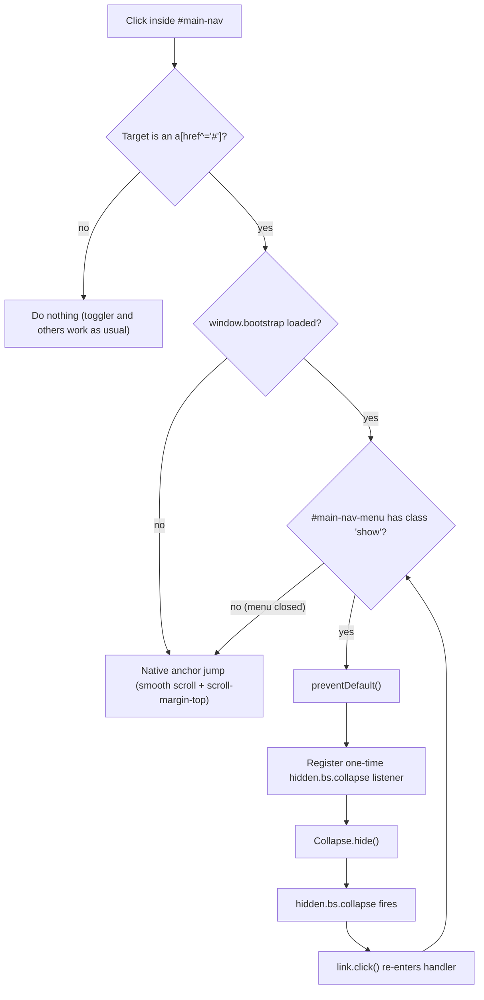
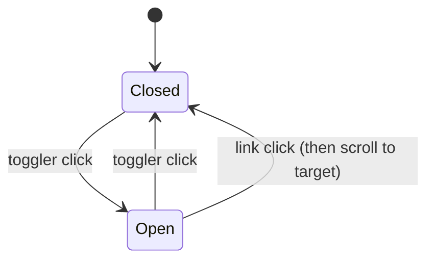

# S01 - Page shell with sticky navigation and section anchors

- **Plan:** [plan.md](plan.md)
- **Type:** Enabler
- **Requirements covered:** FR-01; R-A11Y (text contrast, visible focus states, heading hierarchy of the new sections); acceptance criteria "navbar collapses to a hamburger at 375px", "no horizontal scroll at 375px" (shell part), "heading not hidden under the sticky navbar"; enables FR-03 to FR-09 (section shells and anchors)
- **Prerequisites:** existing `#profile` section, existing `--my-primary` and `--my-secondary` variables on `html`, existing `/* Bootstrap overrides */` comment in `index.css`, Bootstrap 5.3.1 CSS and deferred JS bundle from jsDelivr
- **Creates:** `#main-nav`, `#about`, `#skills`, `#value`, `#experience`, `#projects`, `#projects-professional`, `#projects-personal`, `#education`, `.page-section`, `.section-alt`, `section[id]` scroll offset rule, `--my-primary-text`, `.skill-chip`, global `:focus-visible` outline, Bootstrap Icons 1.11.3 CDN link

## 1. Goal

When this step is done:

- A sticky white navbar sits at the top of the page. The brand on the left links to `#profile`. It shows the full name "Sérgio C. Castelani Jr." from 576px up and the initials "SCCJ" below that, and its accessible name is always "Sérgio C. Castelani Jr. (SCCJ)", which contains the visible text at both widths. The links About, Skills, Experience, Projects and Education on the right link to `#about`, `#skills`, `#experience`, `#projects` and `#education`.
- From 768px up, the links are inline. Below 768px they collapse behind a hamburger button. Clicking a link in the open menu closes the menu first and then scrolls to the section.
- Clicking any link scrolls smoothly (unless the user prefers reduced motion), and the target section's heading ends up fully visible below the navbar.
- Six new sections appear right after the hero, in this order, each showing only its `h2`: About, Expertise, What I bring, Experience, Featured Work, Education & Languages. Expertise, Experience and Education & Languages have a light-gray band background, so the bands alternate with the gray hero. The legacy "Strongest Hard skills", "Objectives" and "Showcase" sections still render below them, unchanged.
- Link text and `strong` text use a darker green, `--my-primary-text` (`#4f6e24`), with at least 4.5:1 contrast. Every keyboard-focused element shows a green outline.
- A `.skill-chip` badge style is available (it is not used on the page yet).
- Bootstrap Icons loads version 1.11.3.

## 2. Context

- `index.html` has no `<nav>`. `<main class="container-lg p-5 pb-0">` holds `#profile` (gray `row`), three legacy sections without ids (`class="p-3 mt-5"`), and the `<footer>`. The `<head>` loads Bootstrap Icons 1.10.5 (line 8), Bootstrap 5.3.1 CSS, the deferred Bootstrap bundle and `index.css`.
- `index.css` defines `--my-primary` / `--my-secondary` on `html`. It colors `a`, `a:hover` and `strong` with them, then has section rules, a `/* Bootstrap overrides */` block and a `/* responsiveness */` media query.
- Conventions (CLAUDE.md and plan section 2): use Bootstrap utilities first and keep custom CSS small and variable-driven. Do not use Bootstrap's default blue for accents. Section headings use `border-start border-5 border-primary ps-3 fw-bold`. New styles go in one comment-headed block inserted before `/* Bootstrap overrides */`. Inline scripts sit right after the markup they serve.
- There is no test suite. Verification is manual in a browser plus `git grep` static checks.
- Measured contrast (WCAG formula): `#86af49` scores 2.55:1 on white. `--my-secondary` (`#759940`) scores 3.29:1. Both fail for text. `#4f6e24` scores 5.85:1 on white, 5.55:1 on `--bs-gray-100` (`#f8f9fa`) and 5.17:1 on the chip tint (`#edf3e4`).

## 3. Structure

### 3.1 Files

| File | Change | Responsibility |
|------|--------|----------------|
| `index.html` | modify | Icons CDN version; `<nav id="main-nav">` plus its inline script; `<main>` padding classes; six section shells after `#profile` |
| `index.css` | modify | `--my-primary-text` and `--main-nav-height` on `html`; `a`, `a:hover`, `strong` colors; new `/* Layout and navigation */` block |

### 3.2 Metadata (`index.html` `<head>`)

Change only the Bootstrap Icons line (current line 8):

```html
<link rel="stylesheet" href="https://cdn.jsdelivr.net/npm/bootstrap-icons@1.11.3/font/bootstrap-icons.css">
```

Do not change any other `<head>` line.

### 3.3 Markup (`index.html` `<body>`)

**a) Navbar.** Insert it directly after `<body>`, before `<main>`:

```html
<nav id="main-nav" class="navbar navbar-expand-md sticky-top bg-white border-bottom" aria-label="Main">
  <div class="container-lg">
    <a class="navbar-brand fw-bold" href="#profile" aria-label="Sérgio C. Castelani Jr. (SCCJ)">
      <span class="d-none d-sm-inline" aria-hidden="true">Sérgio C. Castelani Jr.</span>
      <span class="d-sm-none" aria-hidden="true">SCCJ</span>
    </a>
    <button class="navbar-toggler" type="button"
            data-bs-toggle="collapse" data-bs-target="#main-nav-menu"
            aria-controls="main-nav-menu" aria-expanded="false" aria-label="Toggle navigation">
      <span class="navbar-toggler-icon"></span>
    </button>
    <div id="main-nav-menu" class="collapse navbar-collapse">
      <ul class="navbar-nav ms-auto">
        <li class="nav-item"><a class="nav-link" href="#about">About</a></li>
        <li class="nav-item"><a class="nav-link" href="#skills">Skills</a></li>
        <li class="nav-item"><a class="nav-link" href="#experience">Experience</a></li>
        <li class="nav-item"><a class="nav-link" href="#projects">Projects</a></li>
        <li class="nav-item"><a class="nav-link" href="#education">Education</a></li>
      </ul>
    </div>
  </div>
</nav>
```

- **Responsive brand:** from 576px up (Bootstrap `sm`) the brand shows the full name, and below 576px it shows the initials "SCCJ". Only Bootstrap display utilities are used, so no custom CSS or JS is needed. `sm` is the right breakpoint because it covers every phone width (the 375px target included), while the full name fits comfortably from 576px with the hamburger (about 335px needed) and with the inline links from 768px.
- **Accessible name:** the link's `aria-label` is always "Sérgio C. Castelani Jr. (SCCJ)". It contains the visible text at both widths (the full name from 576px up, "SCCJ" below), which satisfies WCAG 2.5.3 "Label in Name": a voice-control user can say either "click Sérgio" or "click SCCJ". Both spans are `aria-hidden="true"`, so the visible text is not announced twice and the accessible name comes only from the `aria-label`.
- `navbar-expand-md`: links are inline from 768px up. The full-name brand plus five short links fit at 768px.
- `container-lg` inside the nav lines up the navbar content with `<main class="container-lg">`.
- `#main-nav-menu` is a private id of this step. It is used only by the toggler and the script below.
- The navbar has no link to `#value`. FR-01 lists exactly five links.

**b) Navbar script.** Insert it right after `</nav>`, as its own `<script>` tag (see section 4):

```html
<script>
  // Close the open mobile menu before scrolling. The sticky navbar takes up space in the page
  // flow, so scrolling while it collapses would land the target too far down.
  (() => {
    const nav = document.getElementById('main-nav');
    const menu = document.getElementById('main-nav-menu');

    nav.addEventListener('click', (event) => {
      const link = event.target.closest('a[href^="#"]');
      if (!link || !window.bootstrap || !menu.classList.contains('show')) return; // native anchor jump

      event.preventDefault();
      menu.addEventListener('hidden.bs.collapse', () => {
        link.click();                          // menu is closed now, so this re-click is a native anchor navigation
      }, { once: true });
      bootstrap.Collapse.getOrCreateInstance(menu).hide();
    });
  })();
</script>
```

- The script checks `window.bootstrap` when a link is clicked, not when the script is parsed. The bundle is `defer`red and has not loaded yet when this inline script runs.
- `link.click()` replays the click once the menu is hidden. The menu no longer has `show`, so the handler returns early and the browser performs a real native anchor navigation. It honors `scroll-behavior: smooth` (or the reduced-motion jump) and `scroll-margin-top`, adds a history entry for the Back button, fires `hashchange`, updates `:target`, and moves the sequential focus navigation starting point to the section. That last point matters for keyboard users: the focused link disappears when the menu collapses, and the next Tab must continue from the section, not from the top of the page. It also re-scrolls when the link's fragment is already the current hash, which `location.hash = …` would not do (the setter is a no-op for an unchanged fragment). A missing target behaves like a native anchor too: the hash changes and nothing scrolls.

**c) `<main>` padding.** Change `class="container-lg p-5 pb-0"` to `class="container-lg p-3 p-md-5 pb-0 pb-md-0"`. Bottom padding must stay 0 at every width, because the footer sits inside `<main>`. `pb-md-0` is required: Bootstrap emits responsive utilities after base ones with the same specificity and `!important`, so without it `.p-md-5` would override `.pb-0` from 768px up. Do not change any other attribute.

**d) Section shells.** Insert them directly after `</section>` of `#profile` and before the legacy "Strongest Hard skills" section, in this exact order:

```html
<section id="about" class="page-section" aria-labelledby="about-heading">
  <h2 id="about-heading" class="border-start border-5 border-primary ps-3 fw-bold mb-5">About</h2>
</section>

<section id="skills" class="page-section section-alt" aria-labelledby="skills-heading">
  <h2 id="skills-heading" class="border-start border-5 border-primary ps-3 fw-bold mb-5">Expertise</h2>
</section>

<section id="value" class="page-section" aria-labelledby="value-heading">
  <h2 id="value-heading" class="border-start border-5 border-primary ps-3 fw-bold mb-5">What I bring</h2>
</section>

<section id="experience" class="page-section section-alt" aria-labelledby="experience-heading">
  <h2 id="experience-heading" class="border-start border-5 border-primary ps-3 fw-bold mb-5">Experience</h2>
</section>

<section id="projects" class="page-section" aria-labelledby="projects-heading">
  <h2 id="projects-heading" class="border-start border-5 border-primary ps-3 fw-bold mb-5">Featured Work</h2>
  <div id="projects-professional"></div>
  <div id="projects-personal"></div>
</section>

<section id="education" class="page-section section-alt" aria-labelledby="education-heading">
  <h2 id="education-heading" class="border-start border-5 border-primary ps-3 fw-bold mb-5">Education &amp; Languages</h2>
</section>
```

- Content may later be appended only after each `<h2>` (and, in `#projects`, only inside the two containers). The `<section>` elements, their classes and the `<h2>`s are final.
- `#profile`, the legacy sections and the `<footer>` stay untouched.

### 3.4 Styles (`index.css`)

**a) `html` variables** (existing block). Add two variables and keep the existing ones:

```css
html {
  --my-primary: #86af49;
  --my-secondary: rgb(117, 153, 64);
  --my-primary-text: #4f6e24;   /* text green: 5.85:1 on white, 5.55:1 on --bs-gray-100 */
  --main-nav-height: 3.5rem;    /* rendered height of #main-nav (collapsed) */
}
```

- `--my-primary-text` is shared: use it for green text. `--my-primary` stays the fill, border and button color.
- `--main-nav-height` is private to this step. It is the single source for the scroll offset. A Bootstrap navbar with a brand is 3.5rem (56px): 0.5rem padding × 2 + the 40px brand or toggler.

**b) Existing `a`, `a:hover`, `strong` rules.** Change only the colors:

| Rule | Property | Old | New |
|------|----------|-----|-----|
| `a` | `color` | `var(--my-primary)` | `var(--my-primary-text)` |
| `a:hover` | `color` | `var(--my-secondary)` | `var(--my-primary-text)` (the underline stays the hover cue) |
| `strong` | `color` | `var(--my-primary)` | `var(--my-primary-text)` |

`text-decoration` and `font-weight` stay as they are. `--my-secondary` stays defined.

**c) New block `/* Layout and navigation */`.** Insert it immediately before `/* Bootstrap overrides */`:

```css
/* Layout and navigation */
@media (prefers-reduced-motion: no-preference) {
  html { scroll-behavior: smooth; }
}

section[id] {
  scroll-margin-top: calc(var(--main-nav-height) + 1rem);
}

#main-nav {
  --bs-navbar-hover-color: var(--my-primary-text);
  --bs-navbar-brand-hover-color: var(--my-primary-text);
}
#main-nav a:hover {
  text-decoration: none;         /* color change is the navbar hover cue; overrides global a:hover underline */
}
#main-nav .navbar-toggler:focus {
  box-shadow: none;              /* replaced by the global :focus-visible outline */
}

.page-section {
  padding: 3rem 1rem;
}

.section-alt {
  background-color: var(--bs-gray-100);
}

.skill-chip {
  color: var(--my-primary-text);
  background-color: color-mix(in srgb, var(--my-primary) 15%, #fff);   /* #edf3e4 */
  font-weight: 500;
}

:focus-visible {
  outline: 3px solid var(--my-primary-text) !important;
  outline-offset: 2px;
  box-shadow: none !important;   /* drop Bootstrap's blue focus glow */
}
```

What each rule does:

- **Smooth scroll:** only when the user has not asked for reduced motion. Bootstrap's reboot does the same on `:root`, but this rule states it explicitly so the behavior does not depend on Bootstrap internals.
- **`section[id]`:** every anchored section, including `#profile`, stops 1rem below the sticky navbar.
- **`#main-nav` variables:** `--bs-navbar-hover-color` turns the nav links green on hover, and `--bs-navbar-brand-hover-color` does the same for the brand (Bootstrap reads a separate variable for `.navbar-brand:hover`). Both replace Bootstrap's gray.
- **`#main-nav a:hover`:** the global `a:hover` underline (specificity 0,1,1) would beat Bootstrap's `text-decoration: none` on `.nav-link` and `.navbar-brand` (0,1,0), so every navbar link would underline on hover. This rule (1,1,1) removes the underline inside the navbar only; there the green color is the hover cue. Links elsewhere keep the underline.
- **`.page-section`:** the vertical rhythm of the content sections. It uses padding, not margin, so the `.section-alt` bands touch their neighbors with no white gaps.
- **`.section-alt`:** the gray band (`--bs-gray-100`, the same gray as the hero).
- **`.skill-chip`:** used as `<span class="badge skill-chip">`. It overrides `.badge`'s white text and has the same specificity, but it wins because `index.css` loads after Bootstrap. The opaque tint keeps the chip identical on white and gray bands. Text contrast is 5.17:1.
- **`:focus-visible`:** a green ring for keyboard focus on every element. `!important` is needed because Bootstrap's `.btn:focus-visible` and `.nav-link:focus-visible` set `outline: 0` with higher specificity. This matches the file's existing `!important` Bootstrap overrides. The outline contrast is at least 5.5:1, above the 3:1 non-text minimum.

## 4. Logic flows

The navbar click handler decides between the native anchor jump and "close the menu, then scroll". The deferred path exists because `sticky-top` keeps the navbar in the page flow: an open mobile menu pushes the page down, and collapsing it during a smooth scroll would make the scroll land too far down.



The mobile menu has two states. Only the toggler opens it. The toggler or a link click closes it.



## 5. Edge cases and errors

| Case | Expected behavior |
|------|-------------------|
| Bootstrap bundle fails to load (CDN blocked) | Desktop: links work as native anchors. Mobile: the hamburger does nothing and the menu stays closed. All content stays visible and scrollable. No JS error, because of the `window.bootstrap` guard. |
| JavaScript disabled | Same as above. The script does not run, and anchors keep working wherever they are visible. |
| Link clicked while the mobile menu is closed or still opening (no `show` class yet) | Native anchor jump. No `preventDefault`. |
| Link's target id missing | Menu closes, URL hash changes, nothing scrolls. No error (same as a native anchor). |
| Brand link clicked with the mobile menu open | Same deferred path: the menu closes, then the page scrolls to `#profile`. |
| User prefers reduced motion | Jumps are instant (no smooth scroll). The offset still applies. |
| Back button after clicking a nav link | Returns to the previous hash, the same as a native anchor, on both paths, because the deferred path ends in the same native anchor navigation (replayed by `link.click()`). |
| Keyboard user activates a link in the open mobile menu | The menu collapses (hiding the focused link), then the replayed native anchor navigation moves the focus navigation starting point to the target section, so the next Tab lands inside or after that section. |
| Same link tapped again in the open mobile menu after scrolling away (its hash is already current) | Menu closes and the page scrolls back to the section, as a native anchor click on the same fragment does. |
| Menu left open, then viewport widened to 768px or more (for example rotating a tablet) | `#main-nav-menu` keeps its `show` class, so a link click still takes the deferred path: the inline links collapse briefly (about 0.35s), reappear, then the page scrolls to the target. Accepted. |
| 375px viewport | `<main>` padding is 1rem on the top and sides and 0 at the bottom, there is no horizontal scrollbar, and the navbar shows the brand and the hamburger on one line. |
| Viewport 576px to 767px | The full-name brand and hamburger fit on one line (about 240px brand + 1rem margin + about 54px toggler + 1.5rem container padding, roughly 335px), the navbar stays 3.5rem tall, and the target heading is fully visible below it. |
| Viewport below 576px (375px target included) | The initials brand (about 55px) and hamburger fit on one line with plenty of room, even at 320px (roughly 150px needed). The navbar stays 3.5rem tall and the target heading is fully visible below it. |
| Viewport narrower than 320px, or large browser zoom (for example 200% on a phone) | The toggler may still wrap below the brand, making the navbar taller (about 6rem) than the 3.5rem + 1rem offset, so the top of the target section, sometimes including part of the heading, can sit under the navbar. Accepted by the user: it is below the RFF's 375px target, and the user can scroll slightly. |
| Viewport resized across 576px | The brand switches between full name and initials with no reload. Its accessible name stays "Sérgio C. Castelani Jr. (SCCJ)". |
| Empty shells (heading only) | Expected for now. Each shows its padded heading and band. |
| Legacy sections | Rendered below the new shells, unchanged. Their `strong` and link text now use `--my-primary-text`. |

## 6. Tests

No automated suite exists, and this step does not add one.

### 6.1 Manual

Serve the folder (`npx serve .` or `python -m http.server`) and open it in Chrome or Edge.

1. Given a desktop viewport (1366×768), when the page loads, then a white navbar with the full name "Sérgio C. Castelani Jr." on the left and About, Skills, Experience, Projects, Education on the right is visible. When you scroll, the navbar stays pinned at the top. (FR-01)
2. Given a desktop viewport, when you click each navbar link in turn, then the page scrolls smoothly to the matching section and its `h2` is fully visible below the navbar, with a small gap. When you hover a nav link or the brand, then its text turns green (`rgb(79, 110, 36)`) and is not underlined. When you click the brand, the page returns to the hero. (FR-01; acceptance criterion "heading not hidden under the sticky navbar")
3. Given a 375px DevTools viewport, when the page loads, then the navbar shows the initials "SCCJ" and a hamburger on one line, and there is no horizontal scrollbar (`document.documentElement.scrollWidth === document.documentElement.clientWidth` in the console returns `true`). (FR-01; 375px acceptance criterion)
4. Given a 375px viewport, when you open the hamburger and click "Experience", then the menu closes and the page then scrolls to Experience with its heading fully visible, and the URL ends in `#experience`. Repeat with "Education", the last section. (FR-01; RFF flow "navbar links on mobile close the hamburger menu")
5. Given the page, when you scroll below the hero, then the headings read About, Expertise, What I bring, Experience, Featured Work, Education & Languages in that order. Expertise, Experience and Education & Languages have a gray background, and the others are white. Below them, "Strongest Hard skills", "Objectives" and "Showcase" render as before. (Enables FR-03 to FR-09)
6. Given DevTools, when you inspect a link (for example the "Source Code" link in GrowTweet) and a `strong` in Objectives, then the computed color is `rgb(79, 110, 36)` and the contrast picker reports at least 4.5:1. When you inspect any element on a `.section-alt` band, then its computed background is `rgb(248, 249, 250)`. (R-A11Y contrast)
7. Given the page, when you press Tab repeatedly from the top, then the brand, each nav link (desktop) or the hamburger (mobile), the social buttons and the project links each show a 3px green outline, with no blue glow. When you click with the mouse, then no outline appears on buttons. (R-A11Y focus states)
8. Given DevTools with `prefers-reduced-motion: reduce` emulated (Rendering panel), when you click a nav link, then the page jumps instantly and the heading is still visible. (R-A11Y)
9. Given DevTools with the request for `bootstrap.bundle.min.js` blocked, when you reload and click a desktop nav link, then the page still scrolls to the section and the console shows no JavaScript error (only the network message for the blocked `bootstrap.bundle.min.js` request). At 375px the page content remains fully visible. (RFF edge case "if JavaScript fails")
10. Given the console, when you run `const s = document.createElement('span'); s.className = 'badge skill-chip'; s.textContent = 'C#'; document.querySelector('#skills').append(s);`, then a small rounded badge with green text `rgb(79, 110, 36)` on a light green background `rgb(237, 243, 228)` appears, and the DevTools contrast picker reports at least 4.5:1 for the chip text. Then run `const a = document.createElement('a'); a.href = '#'; a.textContent = 'Test link'; document.querySelector('#skills').append(a);`: the link text is `rgb(79, 110, 36)` and the contrast picker reports at least 4.5:1 against the band background `rgb(248, 249, 250)`. Reload to discard both. (`.skill-chip` contract; R-A11Y contrast on `--bs-gray-100`)
11. Given the DevTools Network tab, when the page loads, then `bootstrap-icons@1.11.3/font/bootstrap-icons.css` loads with status 200 and the legacy "View" eye icons still render. (Icons bump)
12. Given the DevTools Accessibility tree, then `nav "Main"` is present, each new section is a region named by its heading, and every new heading is an `h2`. (R-A11Y heading hierarchy)
13. Given a 1366px viewport, when you inspect `<main>` in DevTools, then its computed `padding-bottom` is `0px` and its top and side padding are `48px` (3rem). At 375px, top and side padding are `16px` and `padding-bottom` is `0px`. (Footer spacing unchanged; 375px acceptance criterion)
14. Given a 576px viewport, then the brand shows the full name "Sérgio C. Castelani Jr." next to the hamburger on one line. When you resize to 575px, then the brand switches to "SCCJ" without a reload. At 320px, then "SCCJ" and the hamburger still sit on one line, the navbar is 56px tall, and clicking "Education" in the opened menu leaves its heading fully visible. (User decision: full name on wide screens, initials on narrow ones)
15. Given the DevTools Accessibility tree (or a screen reader) at 1366px and at 375px, when you select the brand link, then its accessible name is "Sérgio C. Castelani Jr. (SCCJ)" at both widths, and neither span with the name or the initials is exposed as separate text. (R-A11Y; WCAG 2.5.3 Label in Name: the name contains the visible text at both widths)
16. Given a 375px viewport and the keyboard only, when you Tab to the hamburger, press Enter to open it, Tab to "Experience" and press Enter, then the menu closes, the page scrolls to Experience with its heading visible, and the URL ends in `#experience`. When you then press Tab, the next focused element is inside or after `#experience` (for example a link in a later section or the footer), not the brand or the hamburger at the top. (R-A11Y focus; RFF flow "navbar links on mobile close the hamburger menu")
17. Given a 700px viewport with the hamburger menu open, when you widen the viewport to 1000px and click "Projects", then the inline links collapse briefly (about 0.35s) and reappear, and the page scrolls to Featured Work with its heading visible. (Accepted edge case: menu left open across the 768px breakpoint)
18. Given a 375px viewport, when you open the menu and tap "Experience", scroll back to the top, reopen the menu and tap "Experience" again, then the menu closes and the page scrolls back to Experience with its heading visible. Repeat with the keyboard only (as in check 16): the second activation also scrolls, and the next Tab lands inside or after `#experience`. (Same link tapped again in the open mobile menu after scrolling away: menu closes and the page scrolls back to the section)

### 6.2 Static checks

Run from the repo root:

- `git grep -n "bootstrap-icons@" index.html` → one line, containing `bootstrap-icons@1.11.3`.
- `git grep -n -o 'id="[a-z-]*"' index.html` → in document order, includes `main-nav`, `main-nav-menu`, `profile`, `about`, `about-heading`, `skills`, `skills-heading`, `value`, `value-heading`, `experience`, `experience-heading`, `projects`, `projects-heading`, `projects-professional`, `projects-personal`, `education`, `education-heading`.
- `git grep -n 'href="#' index.html` → exactly `#profile`, `#about`, `#skills`, `#experience`, `#projects`, `#education`.
- `git grep -n 'aria-label="Sérgio C. Castelani Jr. (SCCJ)"\|d-none d-sm-inline\|class="d-sm-none"' index.html` → three lines inside `#main-nav`: the brand link, the full-name span and the initials span.
- `git grep -n "section-alt" index.html` → exactly 3 lines (`#skills`, `#experience`, `#education`).
- `git grep -n "container-lg p-3 p-md-5 pb-0 pb-md-0" index.html` → one line (`<main>`).
- `git grep -n "my-primary-text" index.css` → the definition on `html` plus its uses in `a`, `a:hover`, `strong`, `#main-nav` (twice: `--bs-navbar-hover-color` and `--bs-navbar-brand-hover-color`), `.skill-chip` and `:focus-visible`.
- `git grep -n "/\* Layout and navigation \*/\|/\* Bootstrap overrides \*/" index.css` → the "Layout and navigation" line comes before the "Bootstrap overrides" line.

## 7. Implementation order

1. `index.html` `<head>`: bump the Icons link to 1.11.3. Reload and confirm the legacy eye icons still show.
2. `index.css`: add `--my-primary-text` and `--main-nav-height`, then switch the `a`, `a:hover` and `strong` colors. The page looks the same apart from darker green text.
3. `index.css`: add the `/* Layout and navigation */` block before `/* Bootstrap overrides */`. The new classes are not used yet, so nothing visible changes except focus rings.
4. `index.html`: change the `<main>` padding classes and insert the six section shells after `#profile`. Shells, bands and anchors now work, reachable by typing `#about` and so on in the URL.
5. `index.html`: add `<nav id="main-nav">` before `<main>`, then its `<script>` right after `</nav>`.
6. Run the manual checks (6.1) and static checks (6.2).

## 8. Out of scope

- Does not change `#profile` (its markup, `#profile`, `#profile-img` and `.social-btn` rules), the `<footer>`, `<title>` or any `<meta>` tag, or any `<head>` line other than the Icons link.
- Does not add content inside the new sections beyond their `<h2>` and the two empty `#projects-*` containers.
- Does not modify or delete the legacy sections, the `#objectives-list` rules, `.project-card-img` / `.project-img-overlay` or the existing 768px media query.
- Does not touch `images/` or `CLAUDE.md`.
- Adds no active-link highlighting on scroll (scrollspy), no dark theme and no contact link (RFF non-goals and not requested).

## 9. Design notes

- **Deferred scroll instead of `data-bs-toggle` on links.** The common Bootstrap trick of adding `data-bs-toggle="collapse"` to each link would close the menu and start the scroll at the same moment. Because `sticky-top` keeps its height in the page flow, the collapse would shift the content up mid-scroll and the page would land too far down. Waiting for `hidden.bs.collapse` avoids this. The scroll itself is `link.click()`, which replays a real native anchor navigation once the menu is closed. It was preferred over `scrollIntoView()` + `history.pushState` (no `hashchange`, no `:target` update, no move of the keyboard focus starting point) and over `location.hash = link.hash` (does nothing when the fragment is already current, so tapping the same link again would not scroll back). `fixed-top` was rejected because it needs a body padding offset and lets the open menu cover the content.
- **Responsive brand with Bootstrap display utilities (user decision).** Two spans toggled by `d-none d-sm-inline` / `d-sm-none` need no custom CSS or JS. Alternatives rejected: a CSS `::after` content swap (puts text in CSS and is harder to keep accessible) and shrinking the font (the full name still crowds the hamburger at 320px). The `aria-label` "Sérgio C. Castelani Jr. (SCCJ)" gives assistive tech one name that contains both visible variants (WCAG 2.5.3). The visible full name is repeated in the markup because it must be rendered text, a deliberate and minimal duplication. The initials "SCCJ" take every part of the name; if the user prefers "SC", only the second span's text changes.
- **One source for the navbar height.** `--main-nav-height` feeds the scroll offset. Changing the navbar's size means changing one variable (DRY, no magic number in the rule).
- **Text green vs fill green (SRP).** `--my-primary` stays the accent fill and `--my-primary-text` is only for text. `#4f6e24` was picked over lighter candidates (for example `#5a7a2b`, which scores 4.36:1 on the chip tint) so the same color passes 4.5:1 on white, on gray bands and on `.skill-chip`.
- **`a:hover` uses the text green too.** `--my-secondary` fails text contrast (3.29:1), so the underline is now the only hover cue. `--my-secondary` stays defined so nothing else breaks.
- **`!important` on `:focus-visible`.** This is the smallest way to beat Bootstrap's `outline: 0` on `.btn` and `.nav-link` across the page. It follows the file's existing override style. Removing Bootstrap's blue focus glow keeps accents on-brand, as CLAUDE.md asks.
- **Opaque chip tint via `color-mix` over white.** It stays tied to `--my-primary`, needs no extra variable, and looks the same on white and gray bands. A transparent tint was rejected because its contrast would vary by background.
- **Trade-off: band width.** The hero is a Bootstrap `.row` with `g-3`, which extends 0.5rem past `<main>`'s padding on each side. The `.section-alt` bands are plain sections, so they are 0.5rem narrower per side than the hero. Matching it would couple `.page-section` to the hero's gutter class, so the small offset is accepted.
