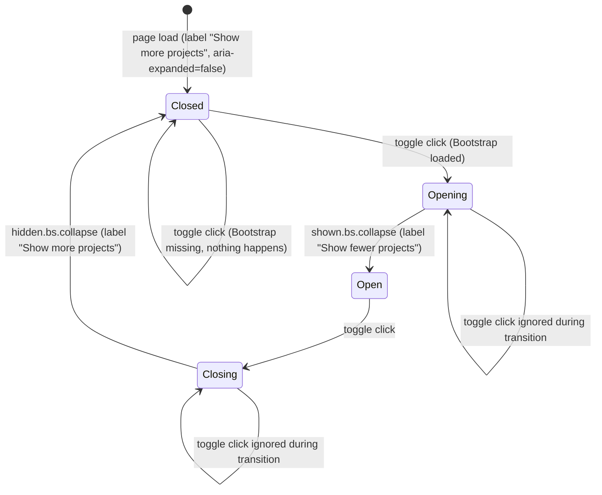
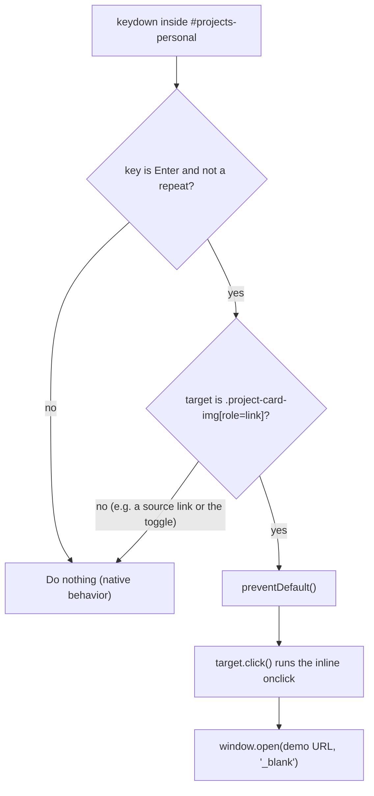

# S10 - Personal project cards with a "More projects" toggle

- **Plan:** [plan.md](plan.md)
- **Type:** Slice
- **Requirements covered:** FR-08 (personal projects, "More projects" collapse, HashMarks removed), FR-12 (`images/projects/hashmarks.png`), FR-13; R-A11Y (keyboard-accessible project images, heading hierarchy, `rel="noopener"`); R-PERF (collapsed screenshots not fetched until shown); acceptance criteria "GrowTweet, 3D Viewer and Bat-Flappy appear as clickable image cards, and HashMarks appears nowhere", "When 'Show more projects' is clicked, the 5 remaining demos expand, and clicking again collapses them", "at 375px cards stack and there is no horizontal scroll"
- **Prerequisites:** `#projects` (section shell with `<h2>` "Featured Work"), `#projects-personal` (empty `<div>` inside `#projects`), `--my-primary-text` (CSS variable), global `:focus-visible` outline, Bootstrap 5.3.1 CSS and deferred JS bundle (collapse plugin), Bootstrap Icons (`bi-eye-fill`); existing legacy "Showcase" `<section>`, `.project-card-img` and `.project-img-overlay` rules and the `@media (max-width: 768px)` block in `index.css`, `images/projects/*.png`
- **Creates:** `#more-projects`, `#more-projects-toggle`

## 1. Goal

When this step is done:

- Inside Featured Work, below whatever precedes `#projects-personal`, an `h3` "Personal projects" is followed by three image cards: GrowTweet, 3D Viewer, Bat-Flappy (2 per row on lg, 1 per row below), with their current screenshots, live demo links and source links.
- Under them, a green outline button "Show more projects" (`#more-projects-toggle`) expands `#more-projects`, a Bootstrap collapse that starts closed and holds Spider-man Fanpage, Rick & Morty API, Growflix, Nikel and DOM Challenge in the same card pattern. Once expanded, the button reads "Show fewer projects"; clicking it again collapses the list and the label reverts.
- Every screenshot (`.project-card-img`) is a keyboard-reachable link: `role="link"`, `tabindex="0"`, `aria-label="<Title> live demo"`. Click (existing inline `onclick`) or Enter opens the demo in a new tab. While it has keyboard focus, the "View" overlay is shown, as on hover.
- Every source link in the cards opens in a new tab with `rel="noopener"`.
- The legacy "Showcase" section, the HashMarks card and `images/projects/hashmarks.png` are gone. The copy reads "practice" and "Bootstrap".

## 2. Context

- The legacy "Showcase" `<section class="p-3 mt-5">` in `index.html` holds 9 cards in `div.container > div.row.g-3 > div.col-12.col-lg-6` blocks, in this order: GrowTweet, HashMarks, Spider-man Fanpage, Rick & Morty API, Growflix, 3D Viewer, Nikel, Bat-Flappy, DOM Challenge. Each card is `div.card.h-100 > div.row.g-0.h-100 > [div.col-md-4.project-card-img (inline background-image + onclick) > div.project-img-overlay > div.btn.btn-dark "View"] + [div.col-md-8 > div.card-body > h5.card-title + p.card-text + p.card-text > small.text-body-secondary]`. Source links use `target="_blank"` without `rel`. Typos: "pactice" (DOM Challenge), "Boostrap" (Growflix tech line).
- `index.css` has `.project-card-img` (left-side radius, cover background, `cursor: pointer`), `.project-img-overlay` (transparent dark layer, fades in on `:hover`), located after `.social-btn` and before `/* Bootstrap overrides */` (other comment-headed blocks may sit between them and that comment), and a `/* responsiveness */` `@media (max-width: 768px)` block that switches the image to top corners with `min-height: 180px`.
- `#projects-personal` is an empty `<div>` placed after `#projects-professional` inside `#projects`. Only its content is this step's; the `<section id="projects">`, its `<h2>` and `#projects-professional` are not touched. Heading levels inside `#projects` are `h2` (section), `h3` (subheadings), `h4` (card titles).
- Conventions: Bootstrap utilities first, small variable-driven CSS, no Bootstrap blue accents, green text uses `--my-primary-text`, new styles in one comment-headed block before `/* Bootstrap overrides */`, inline scripts right after the markup they serve, demos open through the inline `onclick="window.open(url,'_blank')"` pattern (CLAUDE.md).
- No test suite: verification is manual in a browser plus `git grep` and console checks.

## 3. Structure

### 3.1 Files

| File | Change | Responsibility |
|------|--------|----------------|
| `index.html` | modify | Content of `#projects-personal`; inline script right after `</section>` of `#projects`; delete the legacy "Showcase" `<section>` |
| `index.css` | modify | Label the existing project-card rules as the `/* Personal projects */` block, add the focus state for the overlay, style `#more-projects-toggle` |
| `images/projects/hashmarks.png` | delete | No longer used (`git rm`) |

### 3.2 Markup (`index.html`, inside `#projects-personal`)

Replace the empty `<div id="projects-personal"></div>` content (the `<div>` element itself and its id stay as they are) with:

```html
<div id="projects-personal">
  <h3 class="h4 fw-bold mb-4">Personal projects</h3>

  <div class="row g-3">
    <!-- GrowTweet, 3D Viewer, Bat-Flappy: three project cards (template below) -->
  </div>

  <div class="text-center mt-4">
    <button id="more-projects-toggle" class="btn" type="button"
            data-bs-toggle="collapse" data-bs-target="#more-projects"
            aria-expanded="false" aria-controls="more-projects">Show more projects</button>
  </div>

  <div id="more-projects" class="collapse">
    <div class="row g-3 pt-4">
      <!-- Spider-man Fanpage, Rick & Morty API, Growflix, Nikel, DOM Challenge: five project cards -->
    </div>
  </div>
</div>
```

- The toggle sits **before** the collapsed list (disclosure pattern): the button does not move when the list opens, and a keyboard or screen-reader user moving forward lands in the newly shown cards.
- `pt-4` (padding, not margin) separates the extra cards from the button and keeps Bootstrap's height animation smooth (margins inside a collapsing element make it jump).
- The legacy `div.container` wrapper is dropped: the section already provides horizontal padding, and the `g-3` row's 0.5rem negative margins stay inside the section's 1rem side padding (no horizontal scroll).
- No `.collapsed` class is needed on the button: the label is set by the script (3.4), and Bootstrap manages `aria-expanded`.

**Project card template.** Every card uses exactly this structure (the existing pattern). The `<!-- ... -->` notes mark the changes and are not part of the markup:

```html
<div class="col-12 col-lg-6">
  <div class="card h-100">
    <div class="row g-0 h-100">
      <div
        class="col-md-4 project-card-img"
        role="link" tabindex="0" aria-label="{TITLE} live demo"          <!-- added -->
        style="background-image: url(./images/projects/{IMAGE});"
        onclick="window.open('{DEMO_URL}','_blank')"
      >
        <div class="project-img-overlay" aria-hidden="true">              <!-- aria-hidden added -->
          <div class="btn btn-dark">
            <i class="bi bi-eye-fill"></i> View
          </div>
        </div>
      </div>
      <div class="col-md-8">
        <div class="card-body">
          <h4 class="card-title h5">{TITLE}</h4>                           <!-- was h5 -->
          <p class="card-text">{DESCRIPTION}</p>
          <p class="card-text"><small class="text-body-secondary">{TECH}</small></p>
        </div>
      </div>
    </div>
  </div>
</div>
```

- `role="link"` + `tabindex="0"` put the screenshot in the Tab order and announce it as a link; `aria-label` gives it a name, since it has no text of its own. The overlay is `aria-hidden` because the fake "View" button is decorative (the link name already says what it does).
- `h4` with class `h5` keeps the current visual size while fixing the hierarchy (`h2` > `h3` > `h4`).
- Every `<a target="_blank">` in `{DESCRIPTION}` gets `rel="noopener"`.
- In `{TITLE}` and `aria-label`, `&` is written `&amp;`.

**Card data.** Featured row (in this order), then `#more-projects` row (in this order). URLs, images and texts are the current ones; changes are in bold in the "Notes" column.

| # | Row | `{TITLE}` | `{IMAGE}` | `{DEMO_URL}` | `{DESCRIPTION}` (HTML) | `{TECH}` | Notes |
|---|-----|-----------|-----------|--------------|-------------------------|----------|-------|
| 1 | featured | GrowTweet | `growtweet.png` | `https://growtweet.onrender.com/` | `X(Twitter)-like demo.<br/>Front-end <a href="https://github.com/sergiocastelani/growtweet-front" target="_blank" rel="noopener">Source Code</a>.<br/>API <a href="https://github.com/sergiocastelani/growtweet-back" target="_blank" rel="noopener">Source Code</a>.` | `React \| TypeScript \| NodeJS API \| PostgreSQL` | **rel added**, trailing `<br/>` dropped |
| 2 | featured | 3D Viewer | `vweb.png` | `https://vweb-castelani.netlify.app/` | `A component to show 3D GLTF models` | `HTML \| CSS \| Bootstrap \| Javascript \| Threejs` | unchanged |
| 3 | featured | Bat-Flappy | `bat-flappy.png` | `https://bat-flappy.castelani.dev.br/` | `A full flapper game made with Unity.<br/>Source code on <a href="https://github.com/sergiocastelani/flapper-orig" target="_blank" rel="noopener">GitHub</a>.` | `Unity \| C#` | **rel added**, trailing space trimmed |
| 4 | more | Spider-man Fanpage | `spiderman.png` | `https://sergiocastelani.github.io/spiderman-fanpage/` | `A fanpage showcase with 3D elements.` | `HTML \| CSS \| Javascript \| Threejs` | unchanged |
| 5 | more | Rick &amp; Morty API | `rickandmorty.png` | `https://rickmorty.castelani.dev.br/` | `Front-end for the Rick &amp; Morty API.` | `HTML \| CSS \| Javascript \| API` | `&` escaped |
| 6 | more | Growflix | `growflix.png` | `https://sergiocastelani.github.io/growflix/index.html` | `Conceptual streaming page` | `HTML \| CSS \| Bootstrap \| Javascript` | **"Boostrap" → "Bootstrap"** |
| 7 | more | Nikel | `nikel.png` | `https://castelani-nikel.netlify.app` | `Final project for the course <a href="https://plataforma.growdev.com.br/curso/codai" target="_blank" rel="noopener">Codaí</a> from Growdev.<br/>Source code on <a href="https://github.com/sergiocastelani/growdev-nikel" target="_blank" rel="noopener">GitHub</a>.` | `HTML \| CSS \| Javascript \| Bootstrap` | **rel added** |
| 8 | more | DOM Challenge | `dom_challenge.png` | `https://sergiocastelani.github.io/dom_game/` | `A mini game for students to practice DOM manipulation.` | `HTML \| CSS \| Javascript \| Animation \| Collision detection` | **"pactice" → "practice"** |

(`\|` in the table is a literal `|` in the HTML.) HashMarks is not carried over.

**Legacy removal.** Delete the whole legacy `<section class="p-3 mt-5">` whose `<h2>` reads "Showcase" (from its opening tag to its `</section>`, including the HashMarks card). Nothing else outside `#projects-personal` changes, apart from the script below.

### 3.3 Assets

`git rm images/projects/hashmarks.png`. The other 8 screenshots in `images/projects/` stay.

### 3.4 Script (`index.html`)

Insert as its own `<script>` tag immediately after the `</section>` that closes `#projects`:

```html
<script>
  // Personal projects: Enter opens a project screenshot's demo (click is handled by its inline onclick),
  // and the "More projects" toggle label follows the collapse state.
  (() => {
    const personalProjects = document.getElementById('projects-personal');
    const moreProjects = document.getElementById('more-projects');
    const moreProjectsToggle = document.getElementById('more-projects-toggle');
    const SHOW_MORE_LABEL = 'Show more projects';
    const SHOW_FEWER_LABEL = 'Show fewer projects';

    personalProjects.addEventListener('keydown', (event) => {
      if (event.key !== 'Enter' || event.repeat) return;
      if (!event.target.matches('.project-card-img[role="link"]')) return;
      event.preventDefault();
      event.target.click();   // reuses the inline onclick, so the demo URL has one source
    });

    moreProjects.addEventListener('shown.bs.collapse', () => {
      moreProjectsToggle.textContent = SHOW_FEWER_LABEL;
    });
    moreProjects.addEventListener('hidden.bs.collapse', () => {
      moreProjectsToggle.textContent = SHOW_MORE_LABEL;
    });
  })();
</script>
```

- One delegated `keydown` listener on `#projects-personal` covers all 8 cards, including the ones inside the collapse.
- `event.target.click()` dispatches a click on the screenshot, which runs its inline `onclick`. It runs inside the keydown handler, so the browser treats `window.open` as user-initiated (no popup blocking).
- `event.repeat` stops a held Enter key from opening many tabs.
- Only Enter is handled: native links activate on Enter, not Space, and `role="link"` follows that.
- The collapse events are plain DOM events dispatched by Bootstrap, so the listeners can be added before the deferred bundle loads. No `window.bootstrap` check is needed: without Bootstrap the events never fire and the label stays "Show more projects", which matches the closed list.
- `shown` / `hidden` (after the transition) are used so the label always describes the settled state; Bootstrap ignores toggle clicks during the 0.35s transition, so the label cannot get out of sync.

### 3.5 Styles (`index.css`)

The existing `.project-card-img`, `.project-img-overlay` and `.project-img-overlay:hover` rules (after `.social-btn`, before `/* Bootstrap overrides */`) become this step's block, in place; they are not moved. Changes:

1. Add the comment `/* Personal projects */` on the line right above `.project-card-img {`.
2. `.project-card-img` and `.project-img-overlay`: unchanged.
3. Extend the hover rule so keyboard focus also reveals the overlay:

```css
.project-img-overlay:hover,
.project-card-img:focus-visible .project-img-overlay {
  opacity: 100%;
}
```

4. Append, right after the extended hover/focus rule above:

```css
#more-projects-toggle {
  --bs-btn-color: var(--my-primary-text);
  --bs-btn-border-color: var(--my-primary-text);
  --bs-btn-hover-color: var(--bs-white);
  --bs-btn-hover-bg: var(--my-primary-text);
  --bs-btn-hover-border-color: var(--my-primary-text);
  --bs-btn-active-color: var(--bs-white);
  --bs-btn-active-bg: var(--my-primary-text);
  --bs-btn-active-border-color: var(--my-primary-text);
}
```

What each rule does:

- **Focus overlay:** the global `:focus-visible` green ring marks the focused screenshot, and the overlay fades in as on hover, so keyboard users get the same "View" cue. Mouse clicks do not trigger `:focus-visible`, so nothing changes for mouse users.
- **`#more-projects-toggle`:** a green outline button (text and border `--my-primary-text`, 5.85:1 on white) that fills green with white text on hover and press (also 5.85:1). It sets Bootstrap's own `.btn` variables, so no `!important` is needed. `.btn-primary` is not used because white text on `#86af49` is only 2.55:1, and `.btn-outline-primary` would be Bootstrap blue.
- The `/* responsiveness */` `@media (max-width: 768px)` block stays unchanged: it already gives the screenshots top corners and a 180px minimum height when the cards stack.

## 4. Logic flows

The toggle and the collapse have two settled states and two transitions; the label changes only when a transition ends.



The keydown handler only acts on Enter pressed on a focused screenshot; everything else keeps its native behavior.



## 5. Edge cases and errors

| Case | Expected behavior |
|------|-------------------|
| Bootstrap bundle blocked | Featured screenshots still open their demos on click and Enter (inline `onclick` and this step's script do not need Bootstrap). The toggle does nothing and `#more-projects` stays closed, which the RFF accepts. No console error. |
| JavaScript disabled | Screenshots do nothing (the inline `onclick` needs JS), source links still work, the list stays closed. Accepted by the RFF. |
| Toggle clicked again during the 0.35s transition | Bootstrap ignores it; the label switches once the running transition ends. |
| Enter held down on a focused screenshot | Exactly one new tab (`event.repeat` guard). |
| Space pressed on a focused screenshot | Page scrolls as usual; no demo opens (link semantics). |
| Enter on a source link or on the toggle | Native behavior (link opens; toggle toggles). The handler ignores them. |
| Tabbing while the list is closed | The 5 hidden cards are skipped (`display: none`). After expanding, Tab moves from the toggle into the first extra card. |
| Collapsed screenshots | Not downloaded on page load: their backgrounds sit inside a `display: none` ancestor. They load when the list opens. |
| Popup blocker | Not triggered: click and Enter both open the demo inside a user-initiated event. |
| 375px viewport | Cards stack one per row; each screenshot spans the card width with rounded top corners and a 180px minimum height; the toggle label fits on one line inside the viewport; no horizontal scroll. |
| Viewport 768px to 991px | One card per row, screenshot on the left (`col-md-4`) as before. |
| Exactly 768px | Existing behavior kept: side-by-side layout with top-corner radius (the legacy breakpoint overlap is not changed; RFF asks to keep the ≤768px rule). |
| Odd number of featured cards (3) on lg | Second row holds Bat-Flappy alone on the left, as the existing grid does. |

## 6. Tests

No automated suite exists, and this step does not add one. Serve the folder (`npx serve .` or `python -m http.server`) and use Chrome or Edge.

### 6.1 Manual

1. Given Featured Work on a 1366px viewport, then below the content before it there is an `h3` "Personal projects" and the cards GrowTweet, 3D Viewer, Bat-Flappy (2 + 1) with their screenshots, descriptions and tech lines; the other 5 demos are not visible. (FR-08 personal projects; acceptance "clickable image cards")
2. Given the page, when you click each featured screenshot, then its live demo opens in a new tab at the URL in the card data table. When you click each source link (GrowTweet ×2, Bat-Flappy), then GitHub opens in a new tab. (FR-08; RFF flow "clicking a personal project image opens the live demo")
3. Given the collapsed list, when you click "Show more projects", then Spider-man Fanpage, Rick & Morty API, Growflix, Nikel and DOM Challenge expand in that order and the button reads "Show fewer projects". When you click it again, the 5 cards collapse and the label reads "Show more projects". (FR-08 "More projects"; acceptance "Show more projects expands and collapses")
4. Given a fresh load, then the list is closed and the button reads "Show more projects" with `aria-expanded="false"`; after expanding, the DevTools Accessibility pane shows the button expanded. (RFF "collapse starts closed")
5. Given the expanded list, when you click each extra screenshot and the Nikel links (Codaí, GitHub), then each opens in a new tab at its URL. (FR-08)
6. Given the keyboard only, when you Tab from the top to the GrowTweet screenshot, then it shows the green focus ring and the "View" overlay. When you press Enter, the GrowTweet demo opens in one new tab. Hold Enter: still one tab. Press Space: no tab opens. (R-A11Y keyboard project images)
7. Given the keyboard only and the list closed, when you Tab past Bat-Flappy's screenshot and its GitHub link, then focus goes to the toggle and then out of the section (hidden cards skipped). Press Enter on the toggle, then Tab: focus lands on the Spider-man screenshot; Enter opens its demo. (R-A11Y; FR-08)
8. Given the DevTools Accessibility tree, then each screenshot is a `link` named "<Title> live demo" (for example "Rick & Morty API live demo"), the "View" text is not exposed, and the heading levels are `h2` Featured Work > `h3` Personal projects > `h4` card titles. (R-A11Y)
9. Given the mouse hovering a screenshot, then the overlay fades in as before; given a mouse click on a screenshot, then no focus ring appears. (Regression of the existing pattern)
10. Given the toggle, when you inspect it with the DevTools contrast picker at rest and on hover, then both report at least 4.5:1 (green text on white, white text on green). (R-A11Y contrast)
11. Given a 375px viewport, then all cards stack, each screenshot sits on top with rounded top corners and is at least 180px tall, the toggle is centered, and `document.documentElement.scrollWidth === document.documentElement.clientWidth` returns `true` with the list both closed and open. (Acceptance "375px: cards stack, no horizontal scroll")
12. Given the DevTools Network tab (filter `images/projects`, cache disabled), when the page loads, then only `growtweet.png`, `vweb.png` and `bat-flappy.png` are requested; when you expand the list, then `spiderman.png`, `rickandmorty.png`, `growflix.png`, `nikel.png` and `dom_challenge.png` load. (R-PERF)
13. Given DevTools with the request for `bootstrap.bundle.min.js` blocked, when you reload, then the featured cards still open their demos on click and Enter, the toggle does nothing, the list stays closed, and the console shows no JavaScript error other than the blocked request. (RFF edge case "if JavaScript fails")
14. Given the page, then no "Showcase" heading and no HashMarks card exist, the DOM Challenge text reads "practice" and the Growflix tech line reads "Bootstrap". (FR-08 HashMarks removed; FR-13)

Console checks (run on the loaded page):

- `document.querySelectorAll('#projects-personal .project-card-img[role="link"][tabindex="0"][aria-label]').length` → `8`
- `document.querySelectorAll('#more-projects .project-card-img').length` → `5`
- `document.querySelectorAll('#projects-personal a[target="_blank"]:not([rel~="noopener"])').length` → `0`
- `document.querySelectorAll('.project-card-img').length` → `8` (no legacy cards left)

### 6.2 Static checks

Run from the repo root:

- `git grep -n -i "hashmarks\|pactice\|Boostrap" -- . ':!request-for-feature.md' ':!.rff'` → no output. (FR-08, FR-12, FR-13)
- `test ! -e images/projects/hashmarks.png && echo removed` → `removed`. (FR-12)
- `git grep -n "Showcase" index.html` → no output. (Legacy section removed)
- `git grep -c 'role="link" tabindex="0"' index.html` → `index.html:8`.
- `git grep -n 'id="more-projects' index.html` → two lines: `more-projects-toggle` and `more-projects`.
- `git grep -n "/\* Personal projects \*/\|/\* Bootstrap overrides \*/" index.css` → the "Personal projects" line comes before the "Bootstrap overrides" line.
- `git grep -n "project-card-img:focus-visible" index.css` → one line.

## 7. Implementation order

1. `index.css`: add the `/* Personal projects */` comment, extend the hover rule with the `:focus-visible` selector, append the `#more-projects-toggle` rule. Nothing visible changes yet.
2. `index.html`: fill `#projects-personal` with the subheading, the 3 featured cards, the toggle and `#more-projects` with the 5 extra cards (copied from the legacy blocks and adjusted per the card data table). The new cards show above the still-present legacy section.
3. `index.html`: add the inline script right after `</section>` of `#projects`. Toggle label and Enter support now work.
4. `index.html`: delete the legacy "Showcase" `<section>`.
5. `git rm images/projects/hashmarks.png`.
6. Run the manual, console and static checks.

## 8. Out of scope

- Does not change the `<section id="projects">` element, its `<h2>`, `#projects-professional` or anything inside it, or the `#projects-personal` element's own attributes.
- Does not change any other section, the navbar, the hero, the footer, `<head>`, `CLAUDE.md` or images other than `hashmarks.png`.
- Does not change the demo URLs or screenshots. Descriptions and tech lines change only as listed in the card data table: the two typo fixes, `&amp;` escaping, `rel="noopener"` on source links, dropping GrowTweet's trailing `<br/>` (removes one empty line at the end of that description) and trimming the trailing space in Bat-Flappy's tech line.
- Does not change the `/* responsiveness */` media query or any `index.css` rule outside the project-card rules and the new toggle rule.
- No new projects, no screenshot resizing, no `loading="lazy"` (backgrounds cannot use it), no Space-key activation.

## 9. Design notes

- **Enter replays the click (DRY).** The script calls `click()` on the focused screenshot instead of reading or duplicating the URL, so each demo URL lives only in its inline `onclick`, as CLAUDE.md's pattern requires.
- **One delegated listener** on `#projects-personal` instead of one per card: fewer listeners, and cards copied later need no script change (Open/Closed).
- **Label switched on `shown` / `hidden`, not `show` / `hide`.** The label then always matches the settled state; the trade-off is a 0.35s delay before the text changes. A CSS-only label swap on Bootstrap's `.collapsed` class was rejected because the plan assigns the label to an inline script and it would need two spans of text in the button.
- **Toggle before the list.** Keeps the button still while the list opens and follows the WAI disclosure pattern (control precedes content). Rejected: button after the list, which moves down on every expand.
- **Green outline toggle via Bootstrap button variables.** On-brand and passes 4.5:1 in every state without `!important`. Rejected: `.btn-primary` (2.55:1 white on `#86af49`), `.btn-outline-primary` (Bootstrap blue), `.btn-outline-dark` (off-brand).
- **Card titles become `h4` with the `h5` class**, so the outline stays `h2` > `h3` > `h4` without changing the look.
- **Overlay `aria-hidden`:** the fake "View" button is not a real control; the screenshot's `aria-label` carries the meaning. Source links get no "opens in a new tab" hint, matching the page's other external links.
- **Kept as is:** the 768px max-width rule (RFF asks to keep it), even though it overlaps Bootstrap's `md` breakpoint at exactly 768px.
- **Assumed defaults (user accepts recommendations):** subheading text "Personal projects" styled `h4 fw-bold mb-4`; screenshot names "<Title> live demo"; featured cards keep the 2-per-row lg grid (3 cards give a 2 + 1 layout).
