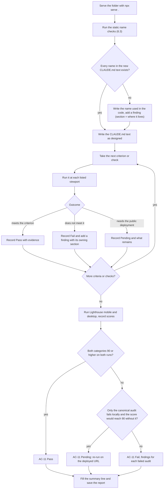

# S12 - Updated architecture docs and final acceptance audit

- **Plan:** [plan.md](plan.md)
- **Type:** Enabler
- **Requirements covered:** R-DOCS (RFF §8 "Update `CLAUDE.md` 'Page sections'"); verification of all 11 RFF §10 acceptance criteria; verification of R-A11Y (RFF §6), R-SEO (RFF §9, Lighthouse SEO ≥ 90) and R-PERF (RFF §9)
- **Prerequisites (read only):** `#main-nav`, `#profile`, `#profile-img`, `.social-btn`, `#about`, `#skills`, `#value`, `#experience`, `#projects`, `#projects-professional`, `#projects-personal`, `#education`, `.page-section`, `.section-alt`, `section[id]` scroll offset rule, `--main-nav-height`, `--my-primary-text`, global `:focus-visible` outline, `.skill-chip`, Bootstrap Icons 1.11.3 CDN link, `#footer-year`, `.stat-tile`, `.expertise-card`, `.value-item`, `.timeline`, `.timeline-item`, `.timeline-date`, `.highlight-card`, `#more-projects`, `#more-projects-toggle`, `.project-card-img`, `.project-img-overlay`, the 768px media query, the CSS section blocks convention; the finished `index.html`, `index.css` and `images/`
- **Creates:** none (the report file below is this step's own output, not a shared item)

## 1. Goal

When this step is done:

- The "Architecture" section of `CLAUDE.md` describes the page as it now is: the sticky `#main-nav`, the section order and ids, the theme variables (including `--my-primary-text`), the `.page-section` / `.section-alt` / `.skill-chip` conventions, the CSS-block-per-section rule, the inline scripts, the professional versus personal project cards and the `#more-projects` collapse. It no longer mentions "Strongest Hard skills", "Objectives", `#objectives-list` or "Showcase", and every id, class, variable and CSS comment it names exists in the code.
- A new file `.rff/acceptance-report.md` records, for each of the 11 RFF §10 acceptance criteria, a result (Pass, Fail or Pending) with evidence, the Lighthouse Accessibility and SEO scores (mobile and desktop), the results of the supplementary R-A11Y / R-PERF / R-SEO checks, and a findings list in which every failure names the page section it belongs to.
- `index.html`, `index.css`, `images/` and `my-resume.txt` are not changed.

## 2. Context

- `CLAUDE.md` today has an "Overview" section (still accurate: static page, no build, no tests, preview with `npx serve .` or `python -m http.server`) and an "Architecture" section with five bullets. Bullet 1 (Bootstrap and Icons from the jsDelivr CDN, utility classes, small custom CSS) stays accurate. Bullets 2 to 5 (theming with two variables, the old section list, "Showcase project cards", the 768px note) are out of date.
- The project has no automated test suite, linter or build. Verification is manual in Chrome or Edge (desktop and the 375px DevTools viewport), DevTools console snippets, Lighthouse in DevTools, and `git grep` from the repo root.
- `.rff/` is tracked in git, so the report lives next to the plan and the step files.
- Known values that the audit must check rather than assume: `--my-primary-text` is `#4f6e24` (5.85:1 on white, 5.55:1 on `--bs-gray-100`); `#86af49` is 2.55:1 against white, which matters for the white icons on the `.btn-primary` social buttons (non-text contrast needs 3:1); the canonical link points to `https://portfolio.castelani.dev.br/`, so a localhost Lighthouse run may flag the canonical as pointing to another domain, which is expected; the toolbox holds 46 chips.

## 3. Structure

### 3.1 Files

| File | Change | Responsibility |
|------|--------|----------------|
| `CLAUDE.md` | modify | Replace "Architecture" bullets 2 to 5 with the text in 3.2; "Overview" and bullet 1 stay unchanged |
| `.rff/acceptance-report.md` | new | Result of every RFF §10 criterion, Lighthouse scores, supplementary checks, findings |

### 3.2 Docs (`CLAUDE.md`)

Keep the title, the intro line, the whole "Overview" section and the first "Architecture" bullet (starting "**Bootstrap 5.3 and Bootstrap Icons come from the jsDelivr CDN**") exactly as they are. Replace everything after that first bullet (the "Theming", "Page sections", "Showcase project cards" and "Below 768px" bullets) with:

```markdown
- **Theming**: `index.css` sets the theme variables on `html`: `--my-primary` (green `#86af49`) is the fill, border and button color; `--my-primary-text` (`#4f6e24`) is the text green (at least 4.5:1 on white and on `--bs-gray-100`), used for links, `strong`, numbers, chips and icons next to text, because `#86af49` fails text contrast; `--my-secondary` is a hover accent (footer icons); `--main-nav-height` is the navbar height and the single source of the scroll offset. `index.css` overrides Bootstrap's `.btn-primary` and `.border-primary` with `!important` so they use the theme green, and a global `:focus-visible` rule draws a green focus ring instead of Bootstrap's blue glow. New accent styling must use these variables, never Bootstrap's default blue.
- **CSS organization**: base rules (`html` variables, `main`, `a`, `strong`, `#profile`, `#profile-img`, `.social-btn`) come first. Right after `.social-btn` comes the `/* Personal projects */` block (the project-card rules, the overlay focus state and `#more-projects-toggle`). After it, each other page area has one block headed by a comment (`/* Layout and navigation */`, `/* About */`, `/* Expertise */`, `/* What I bring */`, `/* Experience timeline */`, `/* Professional highlights */`, `/* Education */`, `/* Footer */`), holding that area's rules and its own media queries. All these blocks sit before `/* Bootstrap overrides */`; `/* responsiveness */` comes last. The one exception to "media queries live in their block" is the project-card 768px rule, which stays in `/* responsiveness */` (see the last bullet). Style a section only inside its own block, and add a new block before `/* Bootstrap overrides */` for a new area. Classes created for a section are used only inside that section.
- **Navigation**: `<nav id="main-nav">` is a sticky Bootstrap navbar placed before `<main>`. Its brand links to `#profile` (full name from 576px up, initials "SCCJ" below) and its links go to `#about`, `#skills`, `#experience`, `#projects` and `#education` (not `#value`). Below 768px the links collapse behind a hamburger; the inline script right after `</nav>` closes the open menu before scrolling and does nothing if `window.bootstrap` is missing. Every `section[id]` has a `scroll-margin-top` based on `--main-nav-height`, so headings land below the navbar, and scrolling is smooth unless the user prefers reduced motion.
- **Page sections** (in order inside `<main>`): the hero `#profile` (gray `.row`; the page's only `h1`, the title as a non-heading `<p class="h3">`, a tagline, the photo `images/photo2.png` with `alt`, and LinkedIn/GitHub/Email buttons as inline SVGs with `aria-label`s); `#about` "About" (summary and four `.stat-tile` key numbers); `#skills` "Expertise" (five `.expertise-card`s and a grouped "Full toolbox" of chips); `#value` "What I bring" (four `.value-item` statements); `#experience` "Experience" (an `<ol class="timeline">` of six `.timeline-item` roles, newest first, each with a `.timeline-date` badge); `#projects` "Featured Work" (`#projects-professional`, then `#projects-personal`); `#education` "Education & Languages" (education and languages columns). The `<footer>` is the last child of `<main>`: small Bootstrap Icons links (LinkedIn, GitHub, Email) and the copyright line, whose `<span id="footer-year">` holds a static "2026" that the footer's inline script replaces with the current year.
- **Section pattern**: each content section is `<section id="X" class="page-section" aria-labelledby="X-heading">` with `<h2 id="X-heading" class="border-start border-5 border-primary ps-3 fw-bold mb-5">`. `.page-section` gives the vertical padding; `#skills`, `#experience` and `#education` also carry `.section-alt` (the `--bs-gray-100` band), so gray and white bands alternate below the gray hero. Headings go `h1` (hero only), `h2` (section), `h3` for the first level inside a section (subheadings, and card or item titles placed directly under the `h2`), `h4` for titles under an `h3`. Tech badges are `<span class="badge skill-chip">` (light green tint, `--my-primary-text` text), usually inside a `d-flex flex-wrap gap-2` wrapper. Icons are Bootstrap Icons 1.11.3 glyphs (`<i class="bi bi-…" aria-hidden="true">`) when they are decorative.
- **Featured Work cards**: `#projects-professional` holds proprietary work as `.highlight-card` cards (large icon, title, company, description, chips). They are deliberately not interactive: no link, `onclick`, `tabindex`, hover effect or pointer cursor. `#projects-personal` holds the personal demos as copy-pasted blocks inside `<div class="col-12 col-lg-6">`: three featured cards (2 + 1 on lg, one per row below), then the `#more-projects-toggle` button, then `#more-projects`, a Bootstrap `collapse` that starts closed and holds the other demos. To add a demo, copy an existing block into the featured row or into `#more-projects`. The left image is a `div.project-card-img` with `role="link"`, `tabindex="0"` and `aria-label="<Title> live demo"`; its screenshot is an inline `background-image: url(./images/projects/<name>.png)`, and an inline `onclick="window.open(url,'_blank')"` opens the live demo. Inside it, an `aria-hidden` `.project-img-overlay` shows a "View" button on hover and on keyboard focus. The right column holds the title (`h4.card-title.h5`), a description whose source links use `target="_blank" rel="noopener"`, and a `<small class="text-body-secondary">` line listing the tech stack, separated by ` | `. The inline script right after `#projects` opens the demo when Enter is pressed on a focused screenshot and switches the toggle label between "Show more projects" and "Show fewer projects". Screenshots inside the closed collapse are not downloaded until it opens. Project screenshots go in `images/projects/`.
- **Scripts**: there is no JS file. Each inline `<script>` sits right after (or inside) the markup it serves: after `</nav>`, inside the `<footer>`, and after `#projects`. The Bootstrap bundle is loaded with `defer`, so scripts check for `window.bootstrap` at use time or rely only on Bootstrap's DOM events. Without JavaScript all content stays visible, except that the "More projects" list stays closed.
- Below 768px, the `/* responsiveness */` media query in `index.css` changes the project image's corner radius from left-side to top-side and gives it a minimum height.
```

Rules for this text:

- It describes the code as implemented. Before writing it, run the static checks in 6.3. If a name in the text above does not exist in the code (for example a CSS comment worded differently), write the name the code actually uses, and record the difference as a finding in the report (section "Findings", owning section = where the name lives). Do not change the code.
- No other file or section of `CLAUDE.md` changes.

### 3.3 Report (`.rff/acceptance-report.md`)

The file follows this skeleton exactly; the walk-through in section 4 fills it in.

```markdown
# Acceptance report: Recruiter-Ready Portfolio Refresh

- **Source RFF:** `request-for-feature.md` (§10)
- **Date:** <YYYY-MM-DD>
- **Commit:** <output of `git rev-parse --short HEAD`, plus "+ uncommitted changes" if `git status --porcelain -- index.html index.css images` is not empty>
- **Browser:** <Chrome or Edge, version>
- **Served with:** `npx serve .` at <URL>
- **Result:** <n> Pass, <n> Fail, <n> Pending of 11 criteria; Lighthouse Accessibility <mobile>/<desktop>, SEO <mobile>/<desktop>

## 1. Acceptance criteria (RFF §10)

| # | Criterion (short) | Viewports | Result | Evidence / notes |
|---|-------------------|-----------|--------|------------------|
| AC-01 | Hero visible without scrolling on desktop | 1366×768 | | |
| AC-02 | About: summary and 4 stats | 1366×768, 375 | | |
| AC-03 | Skills: 5 expertise cards (§7.2), grouped Full toolbox with every resume skill | 1366×768, 768, 375 | | |
| AC-04 | Experience: 6 roles newest first, Tech6 and Pixeon dates | 1366×768, 375 | | |
| AC-05 | Projects: 2 non-clickable highlights, 3 clickable image cards, no HashMarks | 1366×768 | | |
| AC-06 | "Show more projects" expands the 5 demos and collapses them again | 1366×768, 375 | | |
| AC-07 | 375px: hamburger, cards stack, timeline readable, no horizontal scroll | 375 | | |
| AC-08 | Navbar link scrolls to the section with the heading below the navbar | 1366×768, 375 | | |
| AC-09 | Link preview shows title, description and photo | DevTools + deployed URL | | |
| AC-10 | No "Objectives" section; no stock skill images in the repo or page | static + 1366×768 | | |
| AC-11 | Lighthouse Accessibility ≥ 90 and SEO ≥ 90 | mobile, desktop | | |

## 2. Lighthouse

| Run | URL | Performance | Accessibility | SEO | Best Practices | Notes (failed audits) |
|-----|-----|-------------|---------------|-----|----------------|-----------------------|
| Mobile | | | | | | |
| Desktop | | | | | | |

## 3. Supplementary checks

| # | Check | Requirement | Result | Evidence / notes |
|---|-------|-------------|--------|------------------|
| SC-01 … | (see the list in the step design) | | | |

## 4. Findings

| # | Finding | Section | Criterion / check | Suggested fix |
|---|---------|---------|-------------------|---------------|

(or "None.")

## 5. Documentation

- `CLAUDE.md` updated: <yes>; name checks (static): <pass / differences listed in Findings>
```

Field rules:

- **Result** is one of `Pass`, `Fail`, `Pending`. `Pending` is allowed only for checks that need the public deployment (the deployed link preview of AC-09 and a deployed Lighthouse re-run); the note says what remains to do.
- **Evidence / notes**: what was observed, short (for example the console output, the measured contrast, "3 cards in a 3+2 grid"). Do not paste screenshots.
- **Section** in Findings is the page area the issue lives in, named by its id or element: `#main-nav`, `#profile`, `#about`, `#skills`, `#value`, `#experience`, `#projects-professional`, `#projects-personal`, `#education`, `<footer>`, `<head>`, `index.css` block name, or `CLAUDE.md`.
- One finding per distinct issue; a criterion that fails links to at least one finding by its number.

## 4. Logic flows

The audit records results only; it never edits the page. A failure becomes a finding tied to the section that owns it, and the walk-through continues.



## 5. Edge cases and errors

| Case | Expected behavior |
|------|-------------------|
| A criterion fails | Record `Fail`, add a finding naming the owning section and a one-line suggested fix. Do not change `index.html`, `index.css` or `images/`. Continue the audit. |
| A section is still empty (heading only) or a legacy section is still on the page | Record the affected criteria as `Fail` with a finding for that section. Write `CLAUDE.md` for the code as it is and record the gap. |
| A name in the planned `CLAUDE.md` text does not exist in the code | Use the code's name in `CLAUDE.md`, add a finding (section = where the name lives). |
| Site not deployed yet | AC-09: check the tags locally (see 6.2) and record `Pending` with "check in LinkedIn Post Inspector after deploying". If the tags themselves are wrong or missing, record `Fail` instead. |
| Localhost Lighthouse flags the canonical link (points to the public domain) | Expected. Note it. If it is the only reason SEO is below 90, record AC-11 as `Pending` and re-run Lighthouse on `https://portfolio.castelani.dev.br/` once deployed. |
| Lighthouse score varies between runs | Run each mode up to 3 times in an Incognito window (no extensions) and record the median. |
| Bootstrap CDN blocked or JS disabled during the no-JS check | Expected degraded behavior (SC-07): all content visible, "More projects" stays closed, footer shows "2026". Anything else is a `Fail`. |
| White icons on the green `.btn-primary` social buttons below 3:1 non-text contrast | Record SC-04 as `Fail` with the measured ratio and a finding for `#profile`. It does not change AC-11 unless Lighthouse itself fails. |
| `loading="lazy"` (RFF §9) | Only `` elements can use it. The only `` is the hero photo, which is above the fold, so it must not be lazy. Project screenshots are CSS backgrounds; the requirement is met if the 5 collapsed screenshots are not downloaded before the collapse opens (SC-05). |
| Uncommitted page changes during the audit | Note "+ uncommitted changes" in the Commit line. |

## 6. Tests

No automated suite exists, and this step does not add one. All checks run against the page served with `npx serve .` from the repo root (default URL `http://localhost:3000`) in Chrome or Edge, with DevTools device toolbar for 375px and 768px and a 1366×768 window for desktop. Console snippets are pasted into the DevTools console on that page.

### 6.1 Acceptance criteria walk-through (fills report section 1)

- **AC-01.** Given a 1366×768 window, when the page loads at the top, then the `h1` "Sérgio C. Castelani Jr.", "Senior Software Engineer", the tagline, the photo and the three social buttons are fully visible without scrolling. Console: `[...document.querySelectorAll('#profile h1, #profile img, #profile .social-btn')].every(e => e.getBoundingClientRect().bottom <= innerHeight)` returns `true`. (RFF §10 #1, FR-02)
- **AC-02.** Given the About section, then the RFF §7.3 summary is shown word for word, and `[...document.querySelectorAll('#about .stat-tile')].map(t => t.textContent.replace(/\s+/g, ' ').trim())` lists "27 years experience", "6 industries", "6 companies", "13+ yrs C++". At 1366px they sit in one row; at 375px in a 2×2 grid. (§10 #2, FR-03)
- **AC-03.** Given the Expertise section, then `document.querySelectorAll('#skills .expertise-card').length` is `5`; titles, years ("5+ years", "~2 years", "13+ years", "12+ years", "7 years"), blurbs and chips match RFF §7.2 card by card; the layout is 3+2 at 1366px, 2 per row at 768px, 1 per row at 375px. Then `[...document.querySelectorAll('#skills .skill-chip')].filter(c => !c.closest('.expertise-card')).map(c => c.textContent.trim())` returns 46 chips under the 5 groups Languages, Frameworks & Libraries, Databases, Tools & Platforms, Specialized; every item of the "Technical Skills" section of `my-resume.txt` and every technology listed under "Technologies" in its experience entries appears in the list. (§10 #3, FR-04, FR-05)
- **AC-04.** Given the Experience section, then `[...document.querySelectorAll('#experience .timeline-item')].map(i => i.querySelector('h3').textContent.trim())` lists six roles in the order Tech6, Graebert, Audaces, ITM Apps, AGM, Pixeon; the `.timeline-date` texts include "Oct 2023 – Oct 2026" (Tech6) and "Feb 2005 – Jan 2012" (Pixeon); every company, role, date, bullet count (2 to 4) and chip matches RFF §7.1; `#experience` contains no `a` element. (§10 #4, FR-07)
- **AC-05.** Given Featured Work, then `document.querySelectorAll('#projects-professional .highlight-card').length` is `2` (Sysphera, Audaces 4D & VR Try-on Mirror), `document.querySelectorAll('#projects-professional a, #projects-professional [tabindex], #projects-professional [onclick]').length` is `0`, and hovering a highlight card shows the default cursor and no overlay; GrowTweet, 3D Viewer and Bat-Flappy are visible as image cards, and clicking each screenshot opens its live demo in a new tab; `document.documentElement.outerHTML.toLowerCase().includes('hashmarks')` is `false`. (§10 #5, FR-08)
- **AC-06.** Given the page with "More projects" closed, when you click "Show more projects", then Spider-man Fanpage, Rick & Morty API, Growflix, Nikel and DOM Challenge expand and the button reads "Show fewer projects" with `aria-expanded="true"`; when you click again, then they collapse and the label reads "Show more projects". Repeat at 375px. (§10 #6, FR-08)
- **AC-07.** Given a 375px viewport, then the navbar shows "SCCJ" and a hamburger; the expertise cards, value statements, highlight cards, project cards and education columns are one per row; the timeline line sits at the left edge with readable text; and `document.documentElement.scrollWidth === document.documentElement.clientWidth` returns `true` with the page at rest, with the hamburger menu open, and with "More projects" expanded. (§10 #7, FR-01, R-responsive)
- **AC-08.** Given 1366×768 and then 375px (menu opened first), when you click each navbar link (About, Skills, Experience, Projects, Education) and wait for the scroll to end, then the section's `h2` is fully visible below the navbar: console `const h = document.querySelector(location.hash + ' h2'); h.getBoundingClientRect().top >= document.getElementById('main-nav').getBoundingClientRect().bottom` returns `true` after each click, and at 375px the menu has closed. (§10 #8, FR-01)
- **AC-09.** Given the page, then `[...document.head.querySelectorAll('title, meta[name="description"], meta[property^="og:"], meta[name^="twitter:"], link[rel="canonical"]')].map(e => e.outerHTML)` shows the title "Sérgio C. Castelani Jr. | Senior Full-Stack Software Engineer", a non-empty description, `og:title`, `og:description`, `og:url` and canonical = `https://portfolio.castelani.dev.br/`, `og:type` = `website`, `og:image` and `twitter:image` = `https://portfolio.castelani.dev.br/images/photo2.png`, `twitter:card` = `summary`, `twitter:title`, `twitter:description`. Then, once deployed, paste the public URL into LinkedIn Post Inspector: title, description and photo show. Record `Pending` for the second part if not deployed. (§10 #9, FR-11)
- **AC-10.** Given the repo, then `git grep -n -i "objectives" -- index.html index.css` prints nothing; `git ls-files images | grep -E "desktop\.jpg|web-dev\.jpeg|so\.jpg"` prints nothing and the three files do not exist on disk; given the page, the DevTools Network tab (filter "Img") shows no `.jpg`/`.jpeg` request and no section is titled "Objectives" or "Strongest Hard skills". (§10 #10, FR-06, FR-12)
- **AC-11.** Given an Incognito window and DevTools > Lighthouse (mode Navigation, categories Performance, Accessibility, Best Practices, SEO), when you run it for Mobile and then for Desktop, then Accessibility ≥ 90 and SEO ≥ 90 on both; record all four category scores and every failed Accessibility or SEO audit in report section 2. (§10 #11, R-A11Y, R-SEO)

### 6.2 Supplementary checks (fill report section 3)

- **SC-01 Heading hierarchy.** Console: `document.querySelectorAll('h1').length` is `1`, and `[...document.querySelectorAll('h1,h2,h3,h4,h5,h6')].reduce((prev, h) => { const level = +h.tagName[1]; if (level > prev + 1) console.warn('Skipped level before', h); return level; }, 0)` logs no warning. (R-A11Y heading hierarchy)
- **SC-02 Images and icon-only links.** Console: `[...document.querySelectorAll('img')].filter(i => !i.alt)` is empty; in the Accessibility tree, the hero and footer social links are named "LinkedIn", "GitHub", "Email", and each `.project-card-img` is a link named "<Title> live demo". (R-A11Y alt, aria-label)
- **SC-03 Keyboard.** Given 1366px, when you Tab from the top of the page to the footer, then every focused element shows the green outline (no blue glow), highlight cards are never focused, each project screenshot is focused and shows its "View" overlay, and Enter on a focused screenshot opens its demo in a new tab. (R-A11Y focus, keyboard project images)
- **SC-04 Contrast.** With the DevTools color picker: link text, `strong`, stat numbers, chips, years labels and the "Show more projects" toggle reach at least 4.5:1 on their backgrounds (white, `--bs-gray-100`, chip tint); the white icons on the green social buttons reach at least 3:1 (non-text). Record each measured ratio. (R-A11Y contrast)
- **SC-05 Lazy screenshots and asset weight.** Given the Network tab (Disable cache on, filter "Img"), when the page loads, then the only image requests are `photo2.png` and the three featured screenshots (`growtweet.png`, `vweb.png`, `bat-flappy.png`); when you open "More projects", then the five other screenshots are requested. `document.querySelectorAll('img[loading="lazy"]').length` is `0` and the only `` is the above-the-fold hero photo. No new heavy assets: `git diff --name-status main -- images` lists only `D` lines (`images/desktop.jpg`, `images/web-dev.jpeg`, `images/so.jpg`, `images/projects/hashmarks.png`) and no `A` or `M` line; record the output in SC-05. (R-PERF, RFF §9 Performance "no new heavy assets", lazy images)
- **SC-06 Typos and removed content.** `git grep -n -i "hashmarks\|pactice\|Boostrap" -- . ":!request-for-feature.md" ":!.rff"` prints nothing, and `images/projects/hashmarks.png` does not exist. (FR-12, FR-13)
- **SC-07 No JavaScript.** Given DevTools with JavaScript disabled (Command Menu > "Disable JavaScript"), when you reload, then all sections are visible, desktop nav links still scroll to their sections, the footer reads "© 2026 Sérgio C. Castelani Jr." and "More projects" stays closed. Re-enable JavaScript and check the footer shows the current year. (RFF §5 edge case, FR-10)
- **SC-08 Reduced motion.** Given Rendering > "Emulate CSS prefers-reduced-motion: reduce", when you click a nav link, then the page jumps instantly and the heading is still visible. (R-A11Y)
- **SC-09 Language and privacy.** `document.documentElement.lang` is `"en"`; the page text contains no phone number or postal address, and the only contact data is the `mailto:` email. (RFF §9 i18n, privacy)
- **SC-10 Icons version.** `git grep -n "bootstrap-icons@" index.html` prints one line containing `1.11.3`, and every `bi-*` glyph on the page renders (no empty boxes). (Icons used across sections)

### 6.3 Static checks (docs)

Run from the repo root in Git Bash after editing `CLAUDE.md`:

- Every id named in `CLAUDE.md` exists:
  `for id in main-nav profile about skills value experience projects projects-professional projects-personal education footer-year more-projects more-projects-toggle; do git grep -q "id=\"$id\"" -- index.html || echo "missing id: $id"; done` → no output.
- Every class named in `CLAUDE.md` exists in `index.css`:
  `for c in page-section section-alt skill-chip stat-tile expertise-card value-item timeline timeline-item timeline-date highlight-card project-card-img project-img-overlay social-btn; do git grep -q -E "\.$c([^a-zA-Z0-9_-]|$)" -- index.css || echo "missing class: $c"; done` → no output.
- Every variable named in `CLAUDE.md` is defined:
  `for v in my-primary my-secondary my-primary-text main-nav-height; do git grep -q -E -- "--$v:" index.css || echo "missing var: $v"; done` → no output.
- Every CSS block comment named in `CLAUDE.md` exists:
  `for b in "Layout and navigation" "About" "Expertise" "What I bring" "Experience timeline" "Professional highlights" "Personal projects" "Education" "Footer" "Bootstrap overrides" "responsiveness"; do git grep -q -F "/* $b */" -- index.css || echo "missing block: $b"; done` → no output.
- Removed sections are no longer described:
  `git grep -n -i "strongest hard skills\|objectives\|showcase\|hashmarks" -- CLAUDE.md` → no output.
- Only the "Architecture" section changed:
  `git diff -- CLAUDE.md` → changed lines all fall after the first "Architecture" bullet; the "Overview" section is untouched.
- The report exists and has a result for every criterion:
  `grep -c "^| AC-" .rff/acceptance-report.md` → `11`, and `grep -E "^\| AC-" .rff/acceptance-report.md | grep -v -E "\| (Pass|Fail|Pending) \|"` → no output.
- The page itself was not changed by this step:
  `git status --porcelain -- index.html index.css images my-resume.txt` → same output before and after this step's work.

## 7. Implementation order

1. Serve the folder (`npx serve .`) and note `git rev-parse --short HEAD` and `git status --porcelain -- index.html index.css images my-resume.txt`.
2. Run the id, class, variable and block-comment checks from 6.3 against the current code. Adjust the planned `CLAUDE.md` text to any name that differs and note each difference for the findings.
3. Edit `CLAUDE.md` (3.2), then run all `CLAUDE.md` checks from 6.3.
4. Create `.rff/acceptance-report.md` from the skeleton (3.3).
5. Walk AC-01 to AC-10 (6.1) at the listed viewports and record each result.
6. Run SC-01 to SC-10 (6.2) and record each result.
7. Run Lighthouse mobile and desktop (AC-11), record scores and failed audits.
8. Write the findings list, the summary line and the documentation section; run the report checks from 6.3, and confirm the page files show the same `git status` as in sub-step 1.

## 8. Out of scope

- Does not change `index.html`, `index.css`, `images/` or `my-resume.txt`, and does not fix any failure it finds; failures are only recorded with their section.
- Does not change the "Overview" section or the first "Architecture" bullet of `CLAUDE.md`, and adds no other documentation file.
- Does not deploy the site or refresh link-preview caches; post-deployment checks are recorded as `Pending`.
- Adds no automated test suite, linter or CI.
- Does not correct the resume file's dates (RFF §7.1 note).

## 9. Design notes

- **Docs describe the code, not the plan.** The `CLAUDE.md` text is written against the approved designs, but the static checks run first and the code wins on any name difference. This keeps `CLAUDE.md` truthful for future work, and the difference still surfaces as a finding.
- **Bullets split by concern (SRP).** The old "Page sections" bullet mixed layout, styling and content. The new text has one bullet each for theming, CSS organization, navigation, page sections, the section pattern, Featured Work cards and scripts, so a future change touches one bullet. The "Showcase project cards" bullet becomes "Featured Work cards" and keeps the copy-a-block instructions, now with the accessibility attributes a new card must carry.
- **CSS ownership rule documented as a convention, not as a plan artifact.** It is phrased as "one comment-headed block per page area before `/* Bootstrap overrides */`", which stays meaningful after the plan is finished.
- **Audit records, never fixes.** Mixing fixes into the audit would edit regions owned elsewhere and make the report describe a moving target. Each failure names its section so it can be fixed in that section's own work.
- **Three results instead of two.** `Pending` exists only for checks that need the public deployment (link preview, deployed canonical), so a local audit can finish without marking those as passed or failed.
- **Console snippets as evidence.** With no test suite, short DevTools snippets give repeatable, pasteable evidence for counts, order, overflow and heading position, instead of relying on visual inspection alone.
- **Supplementary checks beyond §10.** R-A11Y items that Lighthouse does not fully cover (non-text contrast of the social icons, keyboard activation of project screenshots, focus visibility, reduced motion) and R-PERF (collapsed screenshots not downloaded) are checked explicitly, because the plan routes their verification here.
- **Recommended defaults (user accepted all):** Lighthouse runs in an Incognito window, up to 3 runs per mode with the median recorded; desktop checks use 1366×768; an SEO score below 90 caused only by the localhost canonical warning is `Pending` until a deployed re-run.
